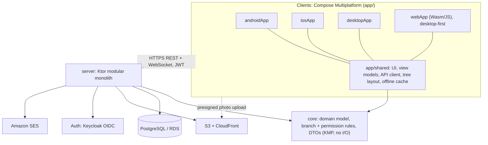

# Architecture

Family tree SaaS: a family builds one private, shared tree with photos, life stories and source
citations, and invites relatives to view or edit only the branches they belong to.

Full product concept, decisions log and data model: [docs/concept-architecture.md](docs/concept-architecture.md).
Desktop mockups (tree view, person page): [docs/mockups/](docs/mockups/).

## System overview

## Gradle modules

| Module | Targets | Owns | Must not |
| --- | --- | --- | --- |
| `:core` | Android, iOS, JVM, JS, Wasm | Domain types (Person, Union, Event, Source, Citation, Grant, Branch…), `@Serializable` API DTOs, branch resolution, permission evaluation, date parsing ("abt 1890"), name formatting (two surnames), validation, duplicate-match scoring | Do I/O, depend on Ktor server, Compose, or a database |
| `:server` | JVM | Ktor app: routing, auth, persistence (Postgres), media (S3), jobs, notifications | Contain domain rules that clients also need (put those in `:core`) |
| `:app:shared` | Android, iOS, JVM, JS, Wasm | Compose UI, navigation, view models, Ktor client, tree layout engine + canvas, i18n (ES/EN), offline cache | Talk to the DB or S3 except through the API (and presigned URLs) |
| `:app:androidApp`, `:app:desktopApp`, `:app:webApp`, `app/iosApp` | per platform | Thin entry points only | Hold feature code |

Package root everywhere: `com.moxietech.family_tree`.

## Core concepts

- **Tree** = tenant. Every row carries `tree_id`. Trees are private; no linking between families.
- **Union** model (GEDCOM-style): people connect through `Union` (two partners) + `UnionChild` (birth, adopted, step, foster), never direct parent edges.
- **Branch** = anchor person + direction (ancestors, descendants, "side" = ancestors + their descendants, whole tree) + depth + include partners. The same definition drives the tree views and the permissions.
- **Membership** links an account to its own `Person` in the tree. The member's **home branch** = their parents and the parents' descendants, derived automatically.
- **Permissions**
  - Edits inside the home branch go live immediately.
  - Edits elsewhere become a `ChangeProposal`, approved by the owner of that branch or the tree owner. A branch owner approves only inside the branch they own.
  - Owning a higher branch must be granted by the tree owner or that branch's owner.
  - People without accounts (deceased, children) can be edited by any contributor on their branch.
  - Living people are private unless a grant covers them; redaction is server-side.
  - Every write goes to `AuditLog` (before/after) for revert and the activity feed.
- **Sources & citations**: a `Source` is reused; a `Citation` ties one fact (person, event, union) to a source with page/detail, confidence 0–3 and optional scan.
- **Duplicate check** on person creation: fuzzy score on names, dates, places, parents; warn and offer merge.

## Server (Ktor modular monolith)

Feature packages under `com.moxietech.family_tree.server.<feature>`, each with `routes`, `service`, `repository`:
`identity`, `trees` (trees, memberships, invitations), `graph` (people, unions, events, places), `permissions`
(grant resolution, scope cache, proposal routing), `media`, `sources`, `collaboration` (proposals, audit, activity),
`notifications`. Later: `importexport` (GEDCOM), `billing` (Stripe).

- Persistence uses PostgreSQL 16, Flyway migrations, and Exposed. Ancestor and descendant queries use recursive CTEs over `union_record` and `union_child`. The planned `GrantScope` cache will store resolved person IDs per grant and rebuild when the graph changes. Row-level security is tracked as a future backstop.
- Reads that combine several queries into one privacy-shaped response (the whole-tree bundle `GET …/graph`, `GET …/unions`) run in one read-only `REPEATABLE READ` transaction, so visibility is decided on the same snapshot the data comes from.
- Repository integration tests start a disposable PostgreSQL 16 container and apply Flyway migrations. See the [README test commands](README.md#running-tests).
- Every request: authenticate (a Keycloak access token whose `aud` names the API, `OIDC_AUDIENCE`) → resolve the account by the token's verified issuer + subject, never by email → load membership → resolve scope → check with `:core` permission rules → execute → audit.
- Errors are `ApiErrorResponse` JSON mapped in `StatusPagesConfig`: malformed IDs (parsed with the field-aware `parseUuidField` where a path or body ID is first converted, in the tree lookup or the service), unknown enum values and undecodable bodies → `400`; forbidden → `403`; missing or foreign IDs → the same generic `404`; a duplicate child link or a stale version → `409`. Responses never include exception or database text.
- Updates (FT-001, `PUT` on a person, union, child link, event, place or source) carry the `version` the client last read. In one transaction the service resolves the record and its references in the URL's tree, then runs a conditional `UPDATE … WHERE version = ?` that advances the version and records the before/after audit. Child links take their versions from a sequence (V5), so a recreated link never reuses an old version; the other records increment theirs. A version that no longer matches, including when a concurrent writer committed first, is a `409` that rolls back with no change and no audit entry.
- Deletes (FT-001, `DELETE …/{id}?version=N` on the same six records, `204` on success) remove only unreferenced records: a record another row in its tree points at, by foreign key or by a same-tree citation, is a `409`. Nothing cascades or unlinks. One transaction resolves the record, checks the version and the references, runs a conditional `DELETE … WHERE version = ?`, re-checks citations for person, union and event (citations have no foreign key), and audits before = record, after = null. A foreign-key reference committed concurrently makes PostgreSQL reject the DELETE (`23503`); `RecordDeletion.guarded` maps only the referencing constraints to the same `409` after rollback. Citation writers (FT-002) must lock the target `FOR KEY SHARE` in their transaction before inserting, which serializes them with deletes.
- Media: presigned S3 uploads/downloads, thumbnails in a worker, EXIF GPS stripped.
- Jobs: SQS (or Postgres job table) + worker in the same codebase.
- Real-time: WebSocket/SSE per tree for live edits.
- API: REST + OpenAPI; DTOs come from `:core`.

## Clients

- Compose Multiplatform everywhere; web via Wasm (JS fallback target exists).
- **Web is desktop-first**: full-width tree canvas, side panel for the selected person, mini-map, keyboard navigation. Mobile layouts are separate, not stretched.
- Tree layout engine in `:app:shared` commonMain: computes positions for any branch view; drawn on a Canvas with pan/zoom and lazy loading by generation.
- **Web client today (FT-005).** `app/shared` commonMain holds the session, the API client, routing, state (`FamilyTreeController`), view slicing, layout and UI. `webMain` (js + wasmJs) holds only the `window` bridge, the Ktor JS engine and `config.json` loading; `app/webApp` mounts `FamilyTreeWebApp()`.
  - Sign-in is Keycloak authorization code + PKCE S256 for the public `family-tree-web` client. Tokens are kept in memory; `sessionStorage` holds only the one-time request and a signed-in flag, so a reload signs in again silently with `prompt=none`.
  - The browser reaches the API on its own origin at `/api`: a dev-server proxy (3000 → 8080) locally, and path routing in production. The server has no CORS.
  - Ancestor and descendant views take their person sets from the server's CTE routes and slice the whole-tree bundle, so they keep the server's redaction. Mini-map, keyboard navigation and lazy loading are not built yet.
  - The person page (FT-006) loads from its URL: the person, the whole-tree bundle for family links and the person-events route for the timeline. Each section loads and fails on its own. `PersonProfile` builds the page through `Viewer`, so hidden living people stay placeholders and union dates show only when both partners are visible. Bios and notes are plain text only. Photos and citations wait for FT-008 and FT-002.
- Offline cache on mobile: SQLDelight.
- Localisation: Spanish and English from day one.

## Infrastructure

AWS: ECS Fargate (server + worker), RDS PostgreSQL, S3 + CloudFront, SES, SQS; Terraform. Launch is free and
invitation-only; billing (per-tree subscription or paid storage) comes later.

## Open decisions

- Which citation source types to support first.