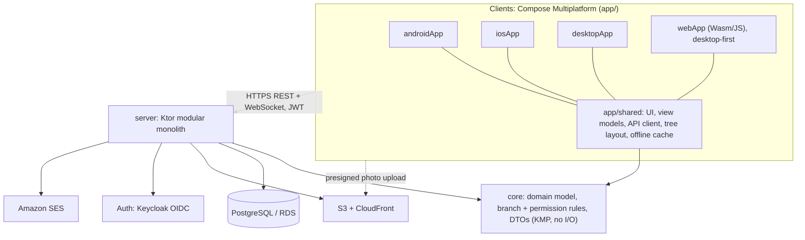

# Architecture

Family tree SaaS: a family builds one private, shared tree with photos, life stories and source
citations, and invites relatives to view or edit only the branches they belong to.

Full product concept, decisions log and data model: [docs/concept-architecture.md](docs/concept-architecture.md).
Desktop mockups (tree view, person page): [docs/mockups/](docs/mockups/).

## System overview

## Gradle modules

| Module | Targets | Owns | Must not |
| --- | --- | --- | --- |
| `:core` | Android, iOS, JVM, JS, Wasm | Domain types (Person, Union, Event, Source, Citation, Grant, Branch…), `@Serializable` API DTOs, branch resolution, permission evaluation, date parsing ("abt 1890"), name formatting (two surnames), validation, duplicate-match scoring | Do I/O, depend on Ktor server, Compose, or a database |
| `:server` | JVM | Ktor app: routing, auth, persistence (Postgres), media (S3), jobs, notifications | Contain domain rules that clients also need (put those in `:core`) |
| `:app:shared` | Android, iOS, JVM, JS, Wasm | Compose UI, navigation, view models, Ktor client, tree layout engine + canvas, i18n (ES/EN), offline cache | Talk to the DB or S3 except through the API (and presigned URLs) |
| `:app:androidApp`, `:app:desktopApp`, `:app:webApp`, `app/iosApp` | per platform | Thin entry points only | Hold feature code |

Package root everywhere: `com.moxietech.family_tree`.

## Core concepts

- **Tree** = tenant. Every row carries `tree_id`. Trees are private; no linking between families.
- **Union** model (GEDCOM-style): people connect through `Union` (two partners) + `UnionChild` (birth, adopted, step, foster), never direct parent edges.
- **Branch** = anchor person + direction (ancestors, descendants, "side" = ancestors + their descendants, whole tree) + depth + include partners. The same definition drives the tree views and the permissions.
- **Membership** links an account to its own `Person` in the tree (at most one member per person). The member's **home branch** = their parents and the parents' descendants, with partners, derived automatically from that link (`:core` `HomeBranch`, FT-011).
- **Permissions**
  - Edits inside the home branch go live immediately.
  - Edits elsewhere become a `ChangeProposal`, approved by the owner of that branch or the tree owner. A branch owner approves only inside the branch they own.
  - Owning a higher branch must be granted by the tree owner or that branch's owner.
  - People without accounts (deceased, children) can be edited by any contributor on their branch.
  - Living people are private unless a grant covers them; redaction is server-side.
  - Every write goes to `AuditLog` (before/after) for revert and the activity feed.
- **Sources & citations**: a `Source` is reused; a `Citation` ties one fact (person, event, union) to a source with page/detail, confidence 0–3 and optional scan.
- **Duplicate check** on person creation: fuzzy score on names, dates, places, parents; warn and offer merge.

## Server (Ktor modular monolith)

Feature packages under `com.moxietech.family_tree.server.<feature>`, each with `routes`, `service`, `repository`:
`identity`, `trees` (trees, memberships, invitations), `graph` (people, unions, events, places), `permissions`
(grant resolution, scope cache, proposal routing), `media`, `sources`, `collaboration` (proposals, audit, activity),
`notifications`. Later: `importexport` (GEDCOM), `billing` (Stripe).

- Persistence uses PostgreSQL 16, Flyway migrations, and Exposed. Ancestor and descendant queries use recursive CTEs over `union_record` and `union_child`. The `GrantScope` cache (FT-010) stores resolved person IDs per grant and is rebuilt once the graph or the grant changes. Row-level security is tracked as a future backstop.
- Grants (FT-010, `permissions` package; V7/V8 `tree_grant`, `grant_scope`, `grant_scope_state`, `tree_graph_generation`).
  - A grant belongs to a membership (`(tree_id, account_id)` foreign key). It holds a role name and a `:core` `Branch`: anchor, direction, depth and partners.
  - `GrantService` writes grants. Writes are owner-only, versioned, and audited as `Grant`. A write locks the anchor `FOR KEY SHARE`, so a race with a person delete ends in a `404` or a `409`. There are no routes yet; FT-011 and FT-012 add them.
  - `GrantScopeRepository` resolves a branch with a recursive CTE that matches `:core` `BranchResolution`.
    - It includes the anchor and its ancestors or descendants up to the depth.
    - A side takes the ancestors up to the depth, then all their descendants.
    - Whole tree is everyone.
    - Direct partners are added last.
    - Every step filters by `tree_id`, and a grant resolves only for its own tree. Unlimited legs deduplicate by person. A depth of at least people − 1 runs as unlimited, so work stays bounded on cyclic data.
  - Every writer that can change a branch takes `GraphWriteLock` shared first and advances the tree's `tree_graph_generation` just before its audit entry. Those are person create and delete, union and child-link create, update and delete, and merges. A grant update advances its `version`.
  - `GrantScopeService` has two entry points.
    - `scopeInSnapshot` and `scopesInSnapshot` require a caller transaction at `REPEATABLE READ` or `SERIALIZABLE`. They use a cached scope whose stamps still match there, or compute it from the same snapshot without writing.
    - `refreshScope` stores a current scope under `GraphWriteLock` exclusive, the generation row `FOR SHARE` and the grant `FOR NO KEY UPDATE`. It is a `404` for a missing grant or tree.
  - Cache rows cascade with their person or grant and never block a delete. A grant anchor is a real reference (`409` on deleting the anchor person). A merge that would retire an anchor is a `409`.
  - Nothing enforces grants yet; FT-012 to FT-014 will.
- Invitations and account-to-person linking (FT-011, `trees` package; V9 `invitation`, `invitation_grant`, membership `version` and one member per person). **Off unless `INVITATIONS_ENABLED=true`**: while off the routes are not installed, so every caller, anonymous or signed in, gets the plain `404` of an unknown route, and the services refuse too. Kept off for real users until FT-012 to FT-014.
  - `InvitationService` creates, lists and revokes (tree owner only, through `TreeService.getTreeForWriter`, so Phase 1 policy is never bypassed). A token is 256 random bits, returned once; only its SHA-256 digest is stored. The acceptance link is `{INVITATION_ACCEPT_URL}#/trees/{treeId}/join?token=…`: tree and token travel only in the fragment and in request bodies, never in server paths, logs or audit (nor does the invitee's email). An invitation optionally links a person and proposes grants; its person and grant anchors are real same-tree references (a person delete or a merge retiring them is a `409` until it is revoked). Expired invitations stay listed (`expired: true`) and keep their references until the owner revokes them.
  - Invitation create, redemption and owner linking take the linked person's row `FOR NO KEY UPDATE` (the linking reservation) before checking for an existing member or pending invitation, so they serialize per person across the two tables; the unique indexes are the backstop.
  - Redemption (`POST /api/v1/trees/{treeId}/invitations/redeem`, token in the body) is one READ COMMITTED transaction: `GraphWriteLock` shared for the URL's tree, then the invitation found and locked `FOR UPDATE` by tree and digest in one statement (another tree's token is the same `404` as a random one and stays usable in its own tree). After the lock it checks expiry with the current time, the creator still being the active owner, the caller's membership, the person reservation and the anchors `FOR KEY SHARE`. It creates or activates the caller's membership (account by issuer + subject, never email), creates the proposed grants through `GrantRepository` (created by the inviter), deletes the invitation (so it works once) and audits all of it. Email-addressed invitations can't be redeemed until the claim rule is decided (`409`).
  - Mail goes through `InvitationMailer` on `Dispatchers.IO` after the commit: `none` (default) or a local `.eml` capture directory; no SMTP or SES yet.
  - `MemberService` lists members and links or unlinks a member's person at the membership's version (owner only, same gate).
  - A member's home branch (`:core` `HomeBranch`, a `SIDE` branch of depth 1 with partners anchored at their linked person) is derived at read time by `HomeBranchService.homeBranchInSnapshot` through the grant CTE. An unlinked member has none; a parentless person's is their own line downwards. Not enforced before FT-012.
- Reads that combine several queries into one privacy-shaped response (the whole-tree bundle `GET …/graph`, `GET …/unions`, a target's citations) run in one read-only `REPEATABLE READ` transaction, so visibility is decided on the same snapshot the data comes from.
- Repository integration tests start a disposable PostgreSQL 16 container and apply Flyway migrations. See the [README test commands](README.md#running-tests).
- Every request: authenticate (a Keycloak access token whose `aud` names the API, `OIDC_AUDIENCE`) → resolve the account by the token's verified issuer + subject, never by email → load membership → resolve scope → check with `:core` permission rules → execute → audit.
- Errors are `ApiErrorResponse` JSON mapped in `StatusPagesConfig`: malformed IDs (parsed with the field-aware `parseUuidField` where a path or body ID is first converted, in the tree lookup or the service), unknown enum values and undecodable bodies → `400`; forbidden → `403`; missing or foreign IDs → the same generic `404`; a duplicate child link, a stale version or a merge the graph can't hold → `409`; the photo store unreachable or refusing → `503` (FT-008). Responses never include exception or database text.
- Updates (FT-001, `PUT` on a person, union, child link, event, place or source) carry the `version` the client last read. In one transaction the service resolves the record and its references in the URL's tree, then runs a conditional `UPDATE … WHERE version = ?` that advances the version and records the before/after audit. Child links take their versions from a sequence (V5), so a recreated link never reuses an old version; the other records increment theirs. A version that no longer matches, including when a concurrent writer committed first, is a `409` that rolls back with no change and no audit entry.
- Deletes (FT-001, `DELETE …/{id}?version=N` on the same six records, `204` on success) remove only unreferenced records: a record another row in its tree points at, by foreign key (a grant's anchor included, FT-010) or by a same-tree citation, is a `409`. Nothing real cascades or unlinks; only derived grant-scope cache rows go with their person. One transaction resolves the record, checks the version and the references, runs a conditional `DELETE … WHERE version = ?`, re-checks citations for person, union and event (citations have no foreign key), and audits before = record, after = null. A foreign-key reference committed concurrently makes PostgreSQL reject the DELETE (`23503`); `RecordDeletion.guarded` maps only the referencing constraints to the same `409` after rollback. Citation writers (FT-002) must lock the target `FOR KEY SHARE` in their transaction before inserting, which serializes them with deletes.
- Citations (FT-002, `sources` package): `POST …/citations` (owner only) locks the source and the target `FOR KEY SHARE` by ID and `tree_id` in one READ COMMITTED transaction, then inserts and audits; a missing, foreign or concurrently deleted source or target is the generic `404`. Reads are per target only (`GET …/{people|events|unions}/{id}/citations`), in one read-only `REPEATABLE READ` snapshot, and `ViewerPolicy.citationsOn` returns nothing when any person the fact is about (the person, a union's partners, an event's person or union partners) is hidden from the caller: an empty list for a person or union, and the missing-event `404` for an event, which other routes omit. An optional `mediaId` must be a verified `CITATION_SCAN` of the same tree not on another citation (FT-008).
- Person merges (FT-007, `POST …/people/merge`, owner only, `PersonMergeService`): the request names the survivor and the retired person with the version of each the owner reviewed, and a side (`SURVIVOR`/`RETIRED`) for every differing profile field (`:core` `PersonMerge`). One READ COMMITTED transaction takes `GraphWriteLock` exclusive for the tree, locks both people `FOR UPDATE` in UUID order, checks versions (`409`) and choices (`400`), then locks every reference in a fixed order (unions by partner, child links, events, memberships, citations). It rejects merges that would break the graph (`PersonMerge.relationshipConflicts` over every union of the tree, plus both people linked to accounts) with a `409`, moves every reference keeping its ID and advancing its version, retargets citations under the FT-002 lock on the survivor, updates the survivor, deletes the retired person and audits the decision and each changed row. Union and child-link creates, union updates, event creates and updates, and profile-photo assignments (FT-008) take `GraphWriteLock` shared first, so they wait for a merge and then see a retired person as the usual `404`.
- Media (FT-008, `media` package; V6 `media` table): `POST …/media` (owner) validates purpose (`PROFILE_PHOTO`, `CITATION_SCAN`), type (JPEG, PNG) and exact size (≤ 20 MiB), generates the media ID and an `uploads/{tree}/{media}` key, presigns a `PUT` (`ObjectStore`, AWS SDK v2 `S3ObjectStore`; any S3-compatible endpoint by settings) and inserts the `PENDING` row with its audit. `POST …/media/{id}/finalize` (owner, retry-safe) reads the upload (missing: `409`, or the `READY` record if an overlapping finalization already won), checks the size, then `ImageSanitizer` checks the structure, rebuilds the file from an allow-list (Exif/GPS, XMP, IPTC, comments, JFXX and JFIF thumbnails, PNG text chunks dropped; orientation rewritten) and `PixelVerifier` decodes every pixel into a bounded subsampled raster. The cleaned file goes to `media/{tree}/{media}/{sha256}`; the read, verification and write hold one of `MEDIA_MAX_CONCURRENT_VERIFICATIONS` permits, which bounds the image buffers in memory; then one transaction locks the row and, only if still `PENDING`, marks it `READY` (or `REJECTED`, `400`) with its audit; the upload is deleted best effort. `GET …/media/{id}/download` (members) decides visibility in one `REPEATABLE READ` snapshot (`ViewerPolicy.canSeeMedia`: the photo's person, every subject of the scan's citation, or the owner for unattached media) and presigns a 5-minute `GET`; anything else is the generic `404`. Object store failures are `503`. Thumbnails in a worker are later work.
- Profile photos (FT-008): `PUT …/people/{id}/profile-photo` (owner, `{mediaId|null, version}`) takes `GraphWriteLock` shared first, then locks the media `FOR UPDATE` (404 / 409 not `READY` / 400 wrong purpose / 409 another person's), then updates the person at its version (409 stale) with the audit, in one transaction. Citation creates lock a `CITATION_SCAN` media the same way after the source and target. Merges treat the photo as a profile field (`MergeField.PROFILE_PHOTO`).
- Jobs: SQS (or Postgres job table) + worker in the same codebase.
- Real-time: WebSocket/SSE per tree for live edits.
- API: REST + OpenAPI; DTOs come from `:core`.

## Clients

- Compose Multiplatform everywhere; web via Wasm (JS fallback target exists).
- **Web is desktop-first**: full-width tree canvas, side panel for the selected person, mini-map, keyboard navigation. Mobile layouts are separate, not stretched.
- Tree layout engine in `:app:shared` commonMain: computes positions for any branch view; drawn on a Canvas with pan/zoom and lazy loading by generation.
- **Web client today (FT-005).** `app/shared` commonMain holds the session, the API client, routing, state (`FamilyTreeController`), view slicing, layout and UI. `webMain` (js + wasmJs) holds only the `window` bridge, the Ktor JS engine and `config.json` loading; `app/webApp` mounts `FamilyTreeWebApp()`.
  - Sign-in is Keycloak authorization code + PKCE S256 for the public `family-tree-web` client. Tokens are kept in memory; `sessionStorage` holds only the one-time request and a signed-in flag, so a reload signs in again silently with `prompt=none`.
  - The browser reaches the API on its own origin at `/api`: a dev-server proxy (3000 → 8080) locally, and path routing in production. The server has no CORS.
  - Ancestor and descendant views take their person sets from the server's CTE routes and slice the whole-tree bundle, so they keep the server's redaction. Mini-map, keyboard navigation and lazy loading are not built yet.
  - Merging duplicates (FT-007) is an owner-only pane on the tree screen, opened from the post-create duplicate notice, the toolbar or the selected person. Its state (`TreeScreen.merge`) lives in the controller, so it is dropped with the tree, the session or on success. Both records are fetched fresh, and each read carries its own generation, so only the latest read for the pair is shown. The owner sees every differing value in full, in the page, under numbered record labels. They pick the survivor and a value for each difference, then confirm the removal. On success the tree reloads and the survivor's page opens; a `409` reloads both records and asks again.
  - The person page (FT-006) loads from its URL: the person, the whole-tree bundle for family links and the person-events route for the timeline. Each section loads and fails on its own. `PersonProfile` builds the page through `Viewer`, so hidden living people stay placeholders and union dates show only when both partners are visible. Bios and notes are plain text only.
  - Citations on the person page (FT-006 follow-up) are read-only, from the FT-002 per-target lists and the tree's sources (`PersonSources`). Nothing is requested until the account is known, as the viewer decides what may be requested; then the person's citations and the source list load with the person, each event's with the timeline, and each union's with the family (only unions whose partners are all visible, as `citationsOn`; targets are the `:core` `CitationTarget`). The requests run in a per-page `CitationWork` scope with at most four at once; every route change, a full reload and the session's end cancel it, running and queued requests alike. Every target loads and fails on its own inside the Sources card, and a retry fetches only failed parts. Timeline events show their source count and expand their citations. Source text and web addresses are plain, inert text. Scans are fetched only when opened, at most two at once, pinned in `AppState.photos` while open.
  - Invitation links (FT-011): `#/trees/{treeId}/join?token=…` opens the join page. Before the session starts, the controller replaces the URL with the bare `#/trees/{treeId}/join` and keeps the link in memory and in sessionStorage (this tab only) so it survives the sign-in redirect; the token is never in a route, a sign-in return route or the state. The signed-in user presses "Accept"; the controller sends the tree in the path and the token in the body, then reloads the trees and opens the tree. The link is dropped after a definitive answer (`404`/`409`/`403`/`400`), on sign-out and on leaving the page; an unreachable server keeps it for a retry.
  - Photos (FT-008): the header shows the profile photo; the owner adds, changes or removes it in place. The controller presigns, sends the file with `HttpMediaTransfer` (a separate Ktor client with no session token) straight to the store, finalizes and attaches it; a retry resumes the failed step. Images are fetched through `…/download` links into `AppState.photos` (encoded bytes, least recently used within 64 MiB and 40 entries, never evicting the images on screen, cleared with the session) and decoded by Compose. The file chooser is a `BrowserBridge.pickFile` hidden `<input type=file>` that checks `File.size` and type against the cap before reading anything. The merge pane shows both photos for the `PROFILE_PHOTO` choice.
- Offline cache on mobile: SQLDelight.
- Localisation: Spanish and English from day one.

## Infrastructure

AWS: ECS Fargate (server + worker), RDS PostgreSQL, S3 + CloudFront, SES, SQS; Terraform. Launch is free and
invitation-only; billing (per-tree subscription or paid storage) comes later.

## Open decisions

- Which citation source types to support first.
- Photos: whether owners may keep location metadata, what happens to unattached uploads, and further formats (see the concept doc's "Still open").
- Invitations (FT-011): who can claim an email-addressed invitation (concept doc, "Still open").
