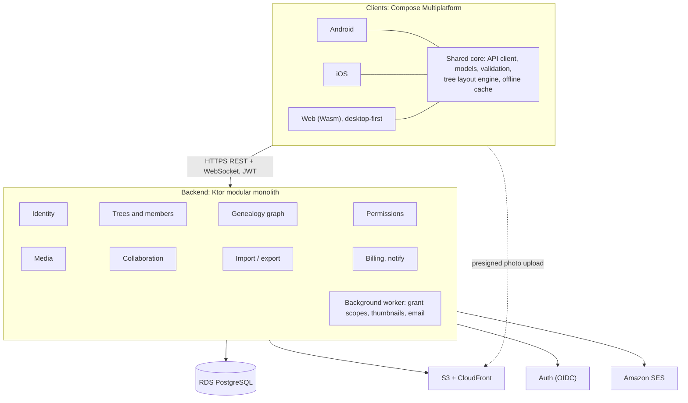

# Family Tree SaaS — Concept & Architecture

Last updated: 2026-11-16 · Live version: https://claude.ai/artifact/UEGgKDMKLry47RfF9imFtZ

## Vision

A multi-tenant SaaS where a family builds one shared tree with photos and life stories, and invites relatives to view or edit only the branches they belong to. Kotlin on the server, Kotlin Multiplatform on the clients, so web, Android and iOS share one codebase for models, validation and the tree layout engine.

**Working name:** TBD (e.g. Rootline, Kinfolk, Lineage).

**Who it is for**

- **Tree owner** — the family historian who creates the tree and invites people.
- **Collaborators** — relatives who add their own branch, photos and stories.
- **Viewers** — family who just want to browse, often on a phone.

**What sets it apart**

- Branch-scoped permissions: "Aunt Maria can edit Mom's side only; cousins can view everything."
- Any person can be the focal point: ancestors only, descendants only, maternal or paternal side, from anyone in the tree.
- Stories first: each person has a rich bio, a timeline of life events and a photo gallery, not just names and dates.

## MVP features

The MVP proves three things: building a tree is easy, branch views are instant, and sharing a branch is safe.

| Area | MVP | Later |
| --- | --- | --- |
| People | Name(s), sex, birth/death dates and places, living flag, bio (rich text), profile photo | Alternate names, occupations, custom facts |
| Relationships | Parents, partners (married/divorced/partner), children; adoptive/step/foster | Twins, DNA matches, uncertain parentage |
| Media | Photo upload, per-person gallery, tag several people in one photo | Documents, audio/video, face detection, crop-to-avatar |
| Tree views | Full tree, ancestors, descendants, maternal side, paternal side, re-centre on anyone | Fan chart, hourglass, timeline, map of places |
| Collaboration | Invite by email/link, roles, branch-scoped grants, change proposals, activity feed | Comments, live presence |
| Import/export | None at launch | GEDCOM 7, PDF/print charts, photo book |
| Accounts | Invite-only sign-up, email + Google/Apple login | Teams/organisations, genealogist pro accounts |
| Search | By name, date range, place | Full-text over bios |

Also in the MVP:

- **Duplicate check**: when someone adds a person, fuzzy-match on name, dates, places and parents, and warn before a second copy is created; offer a merge instead.
- **Spanish and English**: full UI localisation, plus names stored as given names + paternal surname + maternal surname, so Spanish naming displays and sorts correctly.
- **Sources and citations**: attach a source (e.g. a birth certificate or census record) to any fact (a date, place, relationship), with page/detail, a confidence level and an optional scan of the document.

## Branches and permissions

One concept drives both the views and the sharing: a **branch** is an anchor person plus a direction. The same definition that draws "Mom's side" on screen also decides who may edit it.

**Branch definition**

| Field | Values | Example |
| --- | --- | --- |
| Anchor | Any person | Mom |
| Direction | Ancestors, descendants, ancestors + their descendants ("side"), whole tree | Ancestors + their descendants |
| Depth | Unlimited or N generations | 4 generations up |
| Include partners | Yes/no | Yes (spouses of blood relatives) |

"Maternal side of me" = anchor Mom, direction ancestors + their descendants: grandparents, aunts, uncles and cousins on her side, nothing on Dad's side.

**Roles**

| Role | Can do | Scope |
| --- | --- | --- |
| Owner | Everything, delete tree, transfer ownership, approve anywhere | Whole tree |
| Admin | Invite, manage grants, edit anyone | Whole tree |
| Branch owner | Approve proposals and grant access inside the branch they own | Owned branch |
| Contributor | Edit live in home branch; propose changes elsewhere | Home branch + grants |
| Viewer | Read only | Granted branches |

**Rules**

- A member holds one or more **grants** (role + branch). Grants union; the highest role on a person wins.
- Editing a relationship needs edit rights on at least one end. A person added inside a branch is automatically inside it.
- **Living people are private by default**: outside a grant that covers them, they show as "Private" with no dates, photos or bio.
- Grant scopes are resolved to a set of person IDs and cached; the cache is rebuilt when relationships change.
- Every change is written to an audit log (who, what, before/after), so any edit can be reverted.

**Edit approval: home branch vs. the rest**

- Every member's account is **linked to their own person** in the tree; their home branch is derived from that link, with no manual setup.
- **Home branch** = their parents and the parents' descendants (siblings, nieces/nephews, own children and partners).
- Edits inside the home branch go live immediately.
- Owning a higher branch (e.g. a grandparent's line) must be granted by the tree owner or the owner of that branch.
- Edits outside the home branch become a **change proposal**, approved by the owner of that branch or the tree owner. A branch owner approves only inside the branch they own.
- People without an account (deceased relatives, children) can be edited by any contributor on the branch they sit in, as well as its owners.
- Proposals show a before/after diff and can be approved per field.

## Data model

Families are modelled the way GEDCOM does: people connect through **Union** records (two partners + their children), not direct parent edges. This handles remarriage, half-siblings and adoption cleanly and keeps a later GEDCOM import/export nearly 1:1.

| Entity | Key fields | Notes |
| --- | --- | --- |
| Account | id, oidc_issuer + oidc_subject, email, name, locale | A login; can belong to many trees. Found by the verified issuer + subject; email is profile data |
| Tree | id, name, owner_account_id, settings | Tenant boundary; every row below carries tree_id |
| Membership | tree_id, account_id, person_id, status, version | person_id = the member's own person (drives home branch); a person is linked to at most one member (FT-011, V9) |
| Grant | membership (tree_id + account_id), role, anchor_person_id, direction, depth, include_partners, version | Branch-scoped permission. FT-010 (V7, V8) stores it as `tree_grant` |
| GrantScope (cache) | grant_id, tree_id, person_id; stamp: grant version + tree graph generation | Resolved person set, used only while both stamps are current; otherwise computed in the reader's snapshot or refreshed (FT-010) |
| Invitation | tree_id, email, token, person_id, proposed grants, expires_at | Email or shareable link. FT-011 (V9) stores only a SHA-256 digest of the token; the row exists only while pending (accepting or revoking deletes it) |
| Person | id, tree_id, given_names, surname_paternal, surname_maternal, sex, is_living, profile_media_id, bio (rich text JSON), created_by | |
| Event | person_id or union_id, type, date, place_id, notes | Dates as GEDCOM-style text + sortable range ("abt 1890") |
| Union | id, tree_id, partner1_id, partner2_id, type, start/end | Married, divorced, partners, unknown |
| UnionChild | union_id, child_id, relation (birth, adopted, step, foster) | |
| Place | id, name, hierarchy, lat/lng | Shared within a tree |
| Media | id, tree_id, purpose, status, storage_key, mime, width/height, caption, date | Files in S3. FT-008 (V6) has purpose, status, keys, type, sizes, dimensions and hash; caption and date come with the gallery |
| MediaTag | media_id, person_id, region (optional box) | One photo, many people |
| Source | id, tree_id, title, type, author, publisher, repository, url, date | Reused across many facts |
| Citation | source_id, target (person, event or union), page/detail, confidence (0–3), note, media_id | Ties one fact to one source |
| ChangeProposal | target, field diffs, author, approver, status | Edits outside the home branch |
| AuditLog | tree_id, actor, entity, before, after, at | Revert and activity feed |

Branch queries are recursive SQL over Union/UnionChild. Family trees are small graphs (typically under 50,000 people), so PostgreSQL with recursive CTEs is enough; no graph database needed.

## Architecture

Start as a **modular monolith** in Kotlin (Ktor), one PostgreSQL database, S3 for photos, and a Kotlin Multiplatform client shared across Android, iOS and web. Split modules into services only when load or team size demands it.

Every request passes through the Permissions module; photos upload straight from the client to S3 with presigned URLs.

**Technology choices**

| Layer | Choice | Why |
| --- | --- | --- |
| API server | Kotlin + Ktor, REST + OpenAPI, coroutines | Lightweight, shares kotlinx.serialization DTOs with the clients |
| Persistence | PostgreSQL 16, Exposed, Flyway. RDS for deployment | Recursive CTEs for branch queries. Row-level security is planned |
| Search | Postgres full-text + pg_trgm | Fuzzy name search and duplicate check without another system |
| Media | Amazon S3 + CloudFront, presigned uploads, thumbnail worker | Photos never pass through the API server |
| Background jobs | Amazon SQS (or a Postgres job table) + worker | Grant-scope rebuilds, thumbnails, emails |
| Real-time | WebSocket or SSE per tree | Collaborators see edits live |
| Auth | Keycloak OIDC with JWTs. Google and Apple sign-in are planned | Self-hosted provider for local development and production |
| Email | Amazon SES | Invites, notifications |
| Hosting | AWS: ECS Fargate, RDS PostgreSQL, S3 + CloudFront, Terraform | Simple to start, scales horizontally |
| Billing (later) | Stripe Checkout + webhooks | Per-tree subscription or paid storage |

**Backend modules**: identity, trees & membership, genealogy graph, permissions, media, collaboration (proposals, audit, activity), import/export, billing, notifications.

**Clients**

- **Shared KMP module**: API client (Ktor client), DTOs, validation, date parsing, permission checks for the UI, and the **tree layout engine** (positions people and union connectors for any branch view).
- **UI**: Compose Multiplatform for Android, iOS and desktop; web via Compose for Web (Wasm). Tree drawn on a Canvas with pan, zoom and lazy loading by generation.
- **Offline cache**: SQLDelight on mobile.
- **Web is desktop-first and full width**: the tree canvas fills the screen, with a side panel for the selected person, a mini-map and keyboard navigation. If Compose for Web falls short, a TypeScript front end uses the same OpenAPI contract.

**Security**

- Every query is filtered by tree_id and the caller's resolved grant scope, in one permissions layer, with Postgres row-level security as a backstop.
- Media URLs are short-lived signed URLs, checked against the visibility of the tagged people.
- Living-person redaction happens server-side, never in the client.

## SaaS, billing and privacy

Launch is free and invitation-only; trees are private, with no linking between families. Later, the tree becomes the unit of billing (subscription per tree or paid storage) and invited relatives stay free.

**Tenancy**: shared database, tree_id on every row, row-level security. One account can own or join many trees.

**Privacy and compliance**

- Living people hidden from anyone without a grant covering them; owners can mark any person private.
- GDPR/CCPA: data export, account deletion, and a request flow for a living person to ask to be removed.
- Photo metadata (EXIF GPS) stripped on upload unless the owner opts in.
- Encryption at rest and in transit; backups with point-in-time recovery.

## Roadmap

1. **Foundations** — accounts, trees, people, unions, events, sources; full-tree and ancestor/descendant views on web; photo upload.
2. **Branches and sharing** — invitations, account-to-person linking, home branches, grants, change proposals, living-person privacy, maternal/paternal views, audit log, duplicate check. Invite-only launch (ES/EN).
3. **Mobile** — Android and iOS from the same Compose code, offline cache, camera upload.
4. **Billing and import** — Stripe plans, usage limits, GEDCOM import/export. Opens to the public.
5. **Collaboration depth** — comments, live updates.
6. **Delight** — "How are we related?" calculator, memory prompts (text and voice answers added to bios), photo face suggestions, birthday and anniversary reminders, fan and hourglass charts, timelines and maps, print/PDF charts, photo books.

## Decisions

| Topic | Decision |
| --- | --- |
| Audience | Private family trees only |
| Member identity | Each account is linked to its own person in the tree |
| Home branch | Parents and their descendants; higher branches only when granted |
| Contributor edits | Live in their home branch; approval needed elsewhere |
| Approvers | Branch owner (only for their branch) or tree owner |
| People without accounts | Any contributor on the branch can edit them |
| Web | Desktop-first, uses the full screen |
| Business model | Free and invitation-only at launch; per-tree subscription or paid storage later |
| GEDCOM import | Not at launch |
| Duplicate check | In the MVP |
| Duplicate person merge (FT-007) | The tree owner chooses the surviving record and explicitly chooses the value to keep for each conflicting profile field, including living status. Common values carry forward. The owner confirms the merge after reviewing the choices. |
| Merge integrity (FT-007) | Profile fields are given names, each surname part, sex, living status and bio; an empty and a missing optional value are the same, and empty against a value is a difference that needs a choice. The server takes both reviewed versions with the choices as one decision (`409` if either person changed, `400` unless the choices name exactly the differing fields). Partner positions, child links, events, membership and person citations move to the survivor in one transaction. Unions, events and citations keep their IDs. A moved child link takes the composite key of the survivor. Every changed row with a version receives a new one, and the retired person is deleted. Two identical child links in one union collapse into the survivor's. A merge is a `409` that writes nothing when one person is a partner, parent or ancestor of the other, when both are children of one union with different relations, or when both are linked to member accounts. Since FT-008 the profile photo is one of the profile fields: different photos, or a photo against none, need an explicit choice, and the photo not chosen stays stored as unattached media (owner-readable only). Two unions with the same partners, or the merged person belonging to two families as a child, are allowed as before. Audit records the decision (`PersonMerge`) and every changed row. A per-tree advisory lock serializes merges with writers that add person references or ancestry edges |
| Languages | Spanish and English at launch |
| Sources and citations | Supported in the MVP |
| Cloud | AWS |
| Photo upload verification (FT-008) | Verify presigned photo uploads with a local S3-compatible service. Use runtime configuration for the photo store. AWS bucket, IAM and deployment configuration will be set separately. The local service and test fixture is SeaweedFS `weed mini` (`ghcr.io/chrislusf/seaweedfs:4.54`, loopback only, local-only credentials from the shell). Locally it is opt-in (Compose profile `media`) and refuses to start without both credentials; the server's bucket/CORS bootstrap only runs against an explicit local endpoint. The AWS S3 design is unchanged |
| Photo uploads (FT-008) | Owner-only presign and finalize, by tree. Clients send bytes straight to the store with presigned URLs; the API never carries them and never accepts a storage key. Finalization checks the exact declared size, the format, every pixel and the dimensions (JPEG baseline/progressive or PNG, up to 20 MiB and 50 MP), removes location and other hidden metadata (keeping only the Exif orientation), stores the cleaned file and only then marks it `READY`; it is safe to retry and a failure never makes anything readable. Unverified and rejected uploads are never readable. Readers get a 5-minute presigned `GET` only when they can see the photo's person or every person its citation is about; an unattached image is the owner's only. A media row is attached at most once and only for the purpose it was uploaded for |
| Photo location metadata (FT-008) | Always removed in FT-008. The concept's owner opt-in to keep location ("unless the owner opts in") is deferred until a story defines who may see a kept location |
| Auth provider | Keycloak, self-hosted, run via docker-compose for local dev and deployed alongside the server in production; OIDC discovery keeps the integration provider-agnostic if this changes later |
| API tokens (FT-067) | The API accepts only access tokens (`typ` = `Bearer`) whose `aud` contains the resource-server client ID (`family-tree-server`, set with `OIDC_AUDIENCE`), with a signature from the issuer's JWKS, the configured issuer and an `exp` that hasn't passed. Keycloak adds the audience to the browser client's access tokens through an audience mapper; ID and refresh tokens are rejected |
| Account identity (FT-003) | An account is identified by the access token's verified issuer and subject, unique as a pair and immutable once bound; the first request from a new identity creates its account atomically. Email is mutable profile data: not unique, refreshed from the token, and never used to find, link or transfer an account. Accounts created before FT-003 stay unbound until an operator binds them from an authoritative mapping (`resolve_legacy_account`, README "Resolving legacy accounts") |
| Persistence library | Exposed (JetBrains' Kotlin SQL library); Flyway for migrations |
| Web sign-in (FT-005) | The browser uses Keycloak's authorization code flow with PKCE (S256) for the public `family-tree-web` client, with Web Crypto randomness for `state`, `nonce` and the verifier and a verified callback `state`. No client secret in the frontend, tokens only in memory, nothing in `localStorage`, no token logging. A reload restores the session through Keycloak (`prompt=none`), and an expired session drops all user data from the UI. The existing realm configuration is authoritative |
| Web API routing (FT-005) | The web client calls `/api` on its own origin. In development the dev server on port 3000 proxies `/api` to the server on 8080; in production the same origin must route `/api/*` to the server. The API has no CORS configuration |
| Unions with a private partner (FT-005, FT-006) | The union's type and its partner and child links stay visible next to the private placeholder; its start and end dates are hidden. Clients show union dates only when both partners are visible to the caller, matching the server's redaction |
| Person page text (FT-006) | Bios, event notes and place names are untrusted: clients render them as plain text only (no HTML, Markdown or link parsing) after removing control characters and bidi override marks |
| Updates and versions (FT-001) | Person, union, child link, event, place and source updates are `PUT` replacements with the create route's fields and validation plus the `version` the client last read. Person, union, event and source use their existing `version` columns; place and child link got one in V4 (existing rows start at 1). An update applies only if that version is still stored, and increments it in the same conditional `UPDATE`. Otherwise it is a `409` with no change and no audit entry. A child link is identified by its union and child, so only its relation can change. Because that key can be deleted and created again, child-link versions are opaque change tokens from one database sequence (V5), issued on every insert and update: they increase, can skip numbers, and are never reused, so an old link's version can't change its replacement. Clients must send back the version they read, never compute one. Phase 1 updates are owner-only, like creates |
| Deleting referenced records (FT-001) | Delete an unreferenced record when the caller can write and has the current version. Return `409` if another record in the tree still references it, including through a citation. Keep the record, its references and its audit history intact on conflict. Audit a successful deletion in the same transaction |
| Citation writers and deletes (FT-001, FT-002) | A citation's target has no foreign key, so a citation writer must, in the same transaction as the insert (or a retarget), lock the target row with `SELECT … FOR KEY SHARE` filtered by ID and `tree_id`, and return `404` if no row comes back. A delete's `DELETE` then waits for that writer, and the delete re-checks citations afterwards. FT-002 locks the source the same way, so a source deleted first is also a `404` |
| Grant scopes (FT-010) | A grant's branch resolves to its anchor plus its ancestors or descendants up to the depth (null = unlimited), a side (below), or every person in the tree for a whole-tree grant (depth ignored). When the grant includes partners, it adds the direct partners of those people last, and never a partner's own lineage, other children or other partners. Resolution stays inside the grant's tree at every step and ends on cycles in the data. Grants and their scopes are stored but not enforced until FT-012 to FT-014; Phase 1 authorization is unchanged. Grant writes are owner-only and audited, and role names carry no authority before FT-012 |
| Side branches (FT-010) | A side is the anchor and its ancestors up to the depth, plus every descendant of those people with no depth limit; the anchor's own descendants are included even when it has no recorded parents. Depth caps only the ascent. Source: `BranchDirection.SIDE` in `:core` ("ancestors of the anchor, plus all of their descendants"), the FT-015 story ("all of their descendants"), and the branch table above ("4 generations up"). Partners, when included, are added after the descendants, so nothing is walked upward from a partner |
| Branch traversal (FT-010) | Birth, adopted, step and foster child links count, following the existing ancestor and descendant views. A depth of N includes each person reachable within N generations on the bounded leg, even if a longer path also reaches them |
| Grant scope cache (FT-010) | The resolved person set is derived data. A cached scope is used only while the grant's version and the tree's graph generation still equal the values it was built from; every write that can change a branch advances the generation in its own transaction. Cache rows never block a delete and are not references: they cascade with their person or grant. A grant's anchor is a real reference, so deleting the anchor person is a `409` |
| Merges and grant anchors (FT-010) | A merge whose retired person anchors a grant is a `409` that writes nothing, so a merge never moves a grant to another person implicitly. The owner re-anchors or removes the grant first. A grant anchored at the survivor stays as it is, and its scope follows the merged relationships |
| Invitation email claims (FT-011) | An email-addressed invitation is claimed only by a signed-in account whose access token, the same validated token whose issuer and subject identify the account, carries that address in `email` with `email_verified` as the JSON boolean `true`. A false, missing or non-boolean claim (including the string `"true"`) is unverified. Addresses are compared trimmed and with ASCII case folded, with no provider-specific aliases. A wrong or unverified address gets one generic `409`, writes nothing and leaves the invitation for the right account. Email never finds or links an account. Link invitations (no address) only need a signed-in account |
| Citation visibility (FT-002) | Citations are read only per target (person, event or union); there is no tree-wide listing. A caller gets a target's citations only when they can see every person it is about: the person, a union's partners, an event's person or its union's partners. Otherwise no citation is shown, because a citation's page, note, confidence, source and scan can describe a private person. For a person or a union the list is empty: unions with a hidden partner keep their type and links (FT-066), and only their citations are withheld. An event with a hidden person is omitted by every other route, so its citation route returns the same `404` as a missing event and never confirms it exists. Since FT-008 a citation can carry a scan (`mediaId`): a verified `CITATION_SCAN` upload of the same tree, readable by exactly the callers who can see the citation |

## Still open

- [ ] Citations: which source types matter most (vital records, census, church records, newspapers, family bibles, oral history)?
- [ ] Photos (FT-008 follow-ups): should the owner be able to keep a photo's location, and who would see it? Should replaced, unchosen (merge) and unused uploads be listed, reused or deleted? Should HEIC/WebP or CMYK JPEGs be accepted (converted server-side)?
