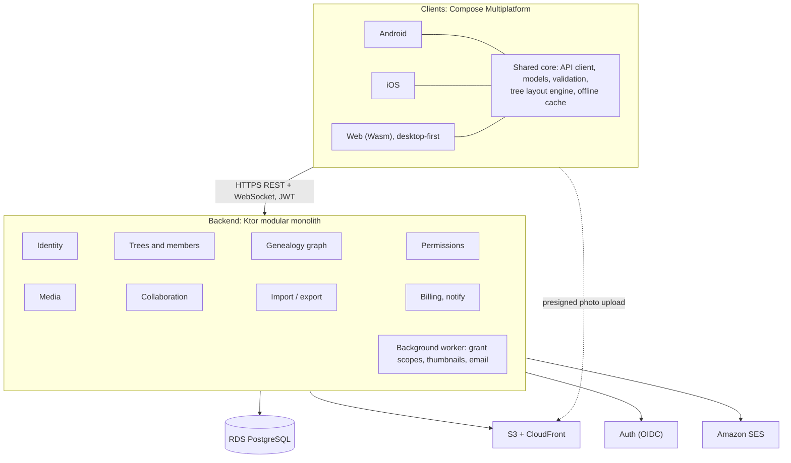

# Family Tree SaaS — Concept & Architecture

Last updated: 2026-11-13 · Live version: https://claude.ai/artifact/UEGgKDMKLry47RfF9imFtZ

## Vision

A multi-tenant SaaS where a family builds one shared tree with photos and life stories, and invites relatives to view or edit only the branches they belong to. Kotlin on the server, Kotlin Multiplatform on the clients, so web, Android and iOS share one codebase for models, validation and the tree layout engine.

**Working name:** TBD (e.g. Rootline, Kinfolk, Lineage).

**Who it is for**

- **Tree owner** — the family historian who creates the tree and invites people.
- **Collaborators** — relatives who add their own branch, photos and stories.
- **Viewers** — family who just want to browse, often on a phone.

**What sets it apart**

- Branch-scoped permissions: "Aunt Maria can edit Mom's side only; cousins can view everything."
- Any person can be the focal point: ancestors only, descendants only, maternal or paternal side, from anyone in the tree.
- Stories first: each person has a rich bio, a timeline of life events and a photo gallery, not just names and dates.

## MVP features

The MVP proves three things: building a tree is easy, branch views are instant, and sharing a branch is safe.

| Area | MVP | Later |
| --- | --- | --- |
| People | Name(s), sex, birth/death dates and places, living flag, bio (rich text), profile photo | Alternate names, occupations, custom facts |
| Relationships | Parents, partners (married/divorced/partner), children; adoptive/step/foster | Twins, DNA matches, uncertain parentage |
| Media | Photo upload, per-person gallery, tag several people in one photo | Documents, audio/video, face detection, crop-to-avatar |
| Tree views | Full tree, ancestors, descendants, maternal side, paternal side, re-centre on anyone | Fan chart, hourglass, timeline, map of places |
| Collaboration | Invite by email/link, roles, branch-scoped grants, change proposals, activity feed | Comments, live presence |
| Import/export | None at launch | GEDCOM 7, PDF/print charts, photo book |
| Accounts | Invite-only sign-up, email + Google/Apple login | Teams/organisations, genealogist pro accounts |
| Search | By name, date range, place | Full-text over bios |

Also in the MVP:

- **Duplicate check**: when someone adds a person, fuzzy-match on name, dates, places and parents, and warn before a second copy is created; offer a merge instead.
- **Spanish and English**: full UI localisation, plus names stored as given names + paternal surname + maternal surname, so Spanish naming displays and sorts correctly.
- **Sources and citations**: attach a source (e.g. a birth certificate or census record) to any fact (a date, place, relationship), with page/detail, a confidence level and an optional scan of the document.

## Branches and permissions

One concept drives both the views and the sharing: a **branch** is an anchor person plus a direction. The same definition that draws "Mom's side" on screen also decides who may edit it.

**Branch definition**

| Field | Values | Example |
| --- | --- | --- |
| Anchor | Any person | Mom |
| Direction | Ancestors, descendants, ancestors + their descendants ("side"), whole tree | Ancestors + their descendants |
| Depth | Unlimited or N generations | 4 generations up |
| Include partners | Yes/no | Yes (spouses of blood relatives) |

"Maternal side of me" = anchor Mom, direction ancestors + their descendants: grandparents, aunts, uncles and cousins on her side, nothing on Dad's side.

**Roles**

| Role | Can do | Scope |
| --- | --- | --- |
| Owner | Everything, delete tree, transfer ownership, approve anywhere | Whole tree |
| Admin | Invite, manage grants, edit anyone | Whole tree |
| Branch owner | Approve proposals and grant access inside the branch they own | Owned branch |
| Contributor | Edit live in home branch; propose changes elsewhere | Home branch + grants |
| Viewer | Read only | Granted branches |

**Rules**

- A member holds one or more **grants** (role + branch). Grants union; the highest role on a person wins.
- Editing a relationship needs edit rights on at least one end. A person added inside a branch is automatically inside it.
- **Living people are private by default**: outside a grant that covers them, they show as "Private" with no dates, photos or bio.
- Grant scopes are resolved to a set of person IDs and cached; the cache is rebuilt when relationships change.
- Every change is written to an audit log (who, what, before/after), so any edit can be reverted.

**Edit approval: home branch vs. the rest**

- Every member's account is **linked to their own person** in the tree; their home branch is derived from that link, with no manual setup.
- **Home branch** = their parents and the parents' descendants (siblings, nieces/nephews, own children and partners).
- Edits inside the home branch go live immediately.
- Owning a higher branch (e.g. a grandparent's line) must be granted by the tree owner or the owner of that branch.
- Edits outside the home branch become a **change proposal**, approved by the owner of that branch or the tree owner. A branch owner approves only inside the branch they own.
- People without an account (deceased relatives, children) can be edited by any contributor on the branch they sit in, as well as its owners.
- Proposals show a before/after diff and can be approved per field.

## Data model

Families are modelled the way GEDCOM does: people connect through **Union** records (two partners + their children), not direct parent edges. This handles remarriage, half-siblings and adoption cleanly and keeps a later GEDCOM import/export nearly 1:1.

| Entity | Key fields | Notes |
| --- | --- | --- |
| Account | id, oidc_issuer + oidc_subject, email, name, locale | A login; can belong to many trees. Found by the verified issuer + subject; email is profile data |
| Tree | id, name, owner_account_id, settings | Tenant boundary; every row below carries tree_id |
| Membership | tree_id, account_id, person_id, status | person_id = the member's own person (drives home branch) |
| Grant | membership_id, role, anchor_person_id, direction, depth, include_partners | Branch-scoped permission |
| GrantScope (cache) | grant_id, person_id | Resolved person set, rebuilt on graph change |
| Invitation | tree_id, email, token, person_id, proposed grants, expires_at | Email or shareable link |
| Person | id, tree_id, given_names, surname_paternal, surname_maternal, sex, is_living, profile_media_id, bio (rich text JSON), created_by | |
| Event | person_id or union_id, type, date, place_id, notes | Dates as GEDCOM-style text + sortable range ("abt 1890") |
| Union | id, tree_id, partner1_id, partner2_id, type, start/end | Married, divorced, partners, unknown |
| UnionChild | union_id, child_id, relation (birth, adopted, step, foster) | |
| Place | id, name, hierarchy, lat/lng | Shared within a tree |
| Media | id, tree_id, storage_key, mime, width/height, caption, date | Files in S3 |
| MediaTag | media_id, person_id, region (optional box) | One photo, many people |
| Source | id, tree_id, title, type, author, publisher, repository, url, date | Reused across many facts |
| Citation | source_id, target (person, event or union), page/detail, confidence (0–3), note, media_id | Ties one fact to one source |
| ChangeProposal | target, field diffs, author, approver, status | Edits outside the home branch |
| AuditLog | tree_id, actor, entity, before, after, at | Revert and activity feed |

Branch queries are recursive SQL over Union/UnionChild. Family trees are small graphs (typically under 50,000 people), so PostgreSQL with recursive CTEs is enough; no graph database needed.

## Architecture

Start as a **modular monolith** in Kotlin (Ktor), one PostgreSQL database, S3 for photos, and a Kotlin Multiplatform client shared across Android, iOS and web. Split modules into services only when load or team size demands it.

Every request passes through the Permissions module; photos upload straight from the client to S3 with presigned URLs.

**Technology choices**

| Layer | Choice | Why |
| --- | --- | --- |
| API server | Kotlin + Ktor, REST + OpenAPI, coroutines | Lightweight, shares kotlinx.serialization DTOs with the clients |
| Persistence | PostgreSQL 16, Exposed, Flyway. RDS for deployment | Recursive CTEs for branch queries. Row-level security is planned |
| Search | Postgres full-text + pg_trgm | Fuzzy name search and duplicate check without another system |
| Media | Amazon S3 + CloudFront, presigned uploads, thumbnail worker | Photos never pass through the API server |
| Background jobs | Amazon SQS (or a Postgres job table) + worker | Grant-scope rebuilds, thumbnails, emails |
| Real-time | WebSocket or SSE per tree | Collaborators see edits live |
| Auth | Keycloak OIDC with JWTs. Google and Apple sign-in are planned | Self-hosted provider for local development and production |
| Email | Amazon SES | Invites, notifications |
| Hosting | AWS: ECS Fargate, RDS PostgreSQL, S3 + CloudFront, Terraform | Simple to start, scales horizontally |
| Billing (later) | Stripe Checkout + webhooks | Per-tree subscription or paid storage |

**Backend modules**: identity, trees & membership, genealogy graph, permissions, media, collaboration (proposals, audit, activity), import/export, billing, notifications.

**Clients**

- **Shared KMP module**: API client (Ktor client), DTOs, validation, date parsing, permission checks for the UI, and the **tree layout engine** (positions people and union connectors for any branch view).
- **UI**: Compose Multiplatform for Android, iOS and desktop; web via Compose for Web (Wasm). Tree drawn on a Canvas with pan, zoom and lazy loading by generation.
- **Offline cache**: SQLDelight on mobile.
- **Web is desktop-first and full width**: the tree canvas fills the screen, with a side panel for the selected person, a mini-map and keyboard navigation. If Compose for Web falls short, a TypeScript front end uses the same OpenAPI contract.

**Security**

- Every query is filtered by tree_id and the caller's resolved grant scope, in one permissions layer, with Postgres row-level security as a backstop.
- Media URLs are short-lived signed URLs, checked against the visibility of the tagged people.
- Living-person redaction happens server-side, never in the client.

## SaaS, billing and privacy

Launch is free and invitation-only; trees are private, with no linking between families. Later, the tree becomes the unit of billing (subscription per tree or paid storage) and invited relatives stay free.

**Tenancy**: shared database, tree_id on every row, row-level security. One account can own or join many trees.

**Privacy and compliance**

- Living people hidden from anyone without a grant covering them; owners can mark any person private.
- GDPR/CCPA: data export, account deletion, and a request flow for a living person to ask to be removed.
- Photo metadata (EXIF GPS) stripped on upload unless the owner opts in.
- Encryption at rest and in transit; backups with point-in-time recovery.

## Roadmap

1. **Foundations** — accounts, trees, people, unions, events, sources; full-tree and ancestor/descendant views on web; photo upload.
2. **Branches and sharing** — invitations, account-to-person linking, home branches, grants, change proposals, living-person privacy, maternal/paternal views, audit log, duplicate check. Invite-only launch (ES/EN).
3. **Mobile** — Android and iOS from the same Compose code, offline cache, camera upload.
4. **Billing and import** — Stripe plans, usage limits, GEDCOM import/export. Opens to the public.
5. **Collaboration depth** — comments, live updates.
6. **Delight** — "How are we related?" calculator, memory prompts (text and voice answers added to bios), photo face suggestions, birthday and anniversary reminders, fan and hourglass charts, timelines and maps, print/PDF charts, photo books.

## Decisions

| Topic | Decision |
| --- | --- |
| Audience | Private family trees only |
| Member identity | Each account is linked to its own person in the tree |
| Home branch | Parents and their descendants; higher branches only when granted |
| Contributor edits | Live in their home branch; approval needed elsewhere |
| Approvers | Branch owner (only for their branch) or tree owner |
| People without accounts | Any contributor on the branch can edit them |
| Web | Desktop-first, uses the full screen |
| Business model | Free and invitation-only at launch; per-tree subscription or paid storage later |
| GEDCOM import | Not at launch |
| Duplicate check | In the MVP |
| Languages | Spanish and English at launch |
| Sources and citations | Supported in the MVP |
| Cloud | AWS |
| Auth provider | Keycloak, self-hosted, run via docker-compose for local dev and deployed alongside the server in production; OIDC discovery keeps the integration provider-agnostic if this changes later |
| API tokens (FT-067) | The API accepts only access tokens (`typ` = `Bearer`) whose `aud` contains the resource-server client ID (`family-tree-server`, set with `OIDC_AUDIENCE`), with a signature from the issuer's JWKS, the configured issuer and an `exp` that hasn't passed. Keycloak adds the audience to the browser client's access tokens through an audience mapper; ID and refresh tokens are rejected |
| Account identity (FT-003) | An account is identified by the access token's verified issuer and subject, unique as a pair and immutable once bound; the first request from a new identity creates its account atomically. Email is mutable profile data: not unique, refreshed from the token, and never used to find, link or transfer an account. Accounts created before FT-003 stay unbound until an operator binds them from an authoritative mapping (`resolve_legacy_account`, README "Resolving legacy accounts") |
| Persistence library | Exposed (JetBrains' Kotlin SQL library); Flyway for migrations |
| Web sign-in (FT-005) | The browser uses Keycloak's authorization code flow with PKCE (S256) for the public `family-tree-web` client, with Web Crypto randomness for `state`, `nonce` and the verifier and a verified callback `state`. No client secret in the frontend, tokens only in memory, nothing in `localStorage`, no token logging. A reload restores the session through Keycloak (`prompt=none`), and an expired session drops all user data from the UI. The existing realm configuration is authoritative |
| Web API routing (FT-005) | The web client calls `/api` on its own origin. In development the dev server on port 3000 proxies `/api` to the server on 8080; in production the same origin must route `/api/*` to the server. The API has no CORS configuration |
| Unions with a private partner (FT-005, FT-006) | The union's type and its partner and child links stay visible next to the private placeholder; its start and end dates are hidden. Clients show union dates only when both partners are visible to the caller, matching the server's redaction |
| Person page text (FT-006) | Bios, event notes and place names are untrusted: clients render them as plain text only (no HTML, Markdown or link parsing) after removing control characters and bidi override marks |

## Still open

- [ ] Citations: which source types matter most (vital records, census, church records, newspapers, family bibles, oral history)?
