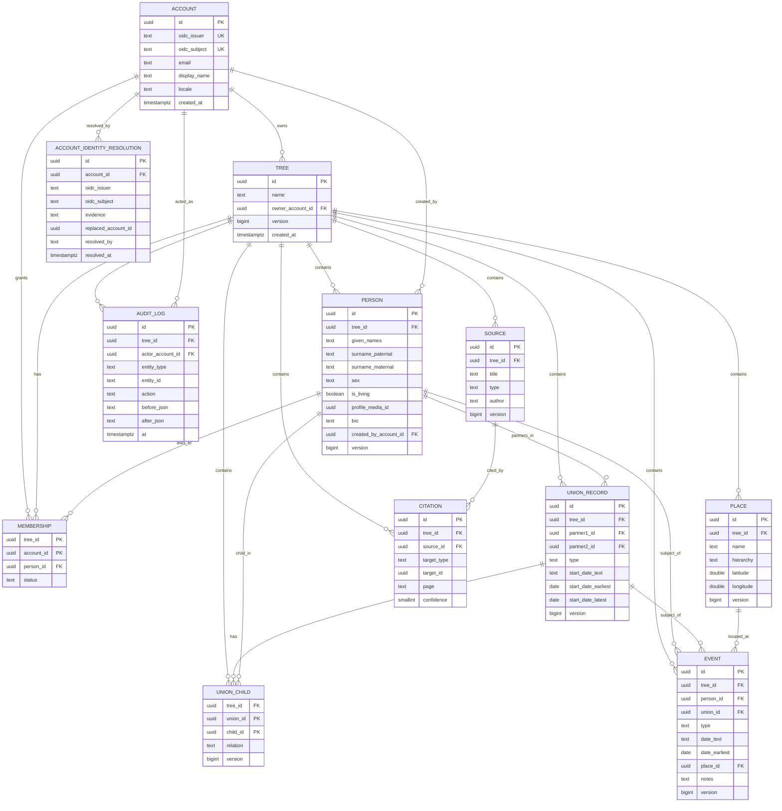

# Delivery Log

Session-by-session record of what was actually built, why, and what's still open. This
complements [concept-architecture.md](concept-architecture.md) (product scope, data
model, decisions, roadmap) — that document says what the product is; this one says what
exists in the repo right now and how it got there. Session entries are newest first;
the **Backlog** and **Database design** sections below them are living references kept
up to date in place, not logged chronologically.

---

## 2026-11-16 — FT-002 citation routes: create and target-scoped listing (in progress)

FT-002 is **In progress**: the routes, tests and docs below are written but not yet
verified (no Gradle or Docker run in this session). It moves to **Done** once
`:server:test` passes and the PR is reviewed. No migration; the existing `citation`
table and `:core` DTOs (`CreateCitationRequest`, `CitationDto`) are used unchanged.

**Contract.**

```
POST /api/v1/trees/{treeId}/citations                     CreateCitationRequest → 201 CitationDto
GET  /api/v1/trees/{treeId}/people/{personId}/citations   → List<CitationDto>
GET  /api/v1/trees/{treeId}/events/{eventId}/citations    → List<CitationDto>
GET  /api/v1/trees/{treeId}/unions/{unionId}/citations    → List<CitationDto>
```

- **Create** is owner-only, checked before the body is decoded (`403` whatever the
  body). Then, all `400`: an undecodable body or a missing `confidence` ("Malformed
  request body"); `sourceId` / `targetId` not UUIDs ("… must be a UUID"); a
  `targetType` other than exactly `PERSON`, `EVENT` or `UNION`; a `confidence` outside
  0–3; any non-null `mediaId` (there is no media to resolve it against until FT-008).
  Then, in one READ COMMITTED transaction: lock the source
  `FOR KEY SHARE` by ID and `tree_id` (none → `404` "No source with id …"), lock the
  target the same way in `person`, `event` or `union_record` (none → the same `404` as
  `TreeScopedLookups`, e.g. "No event with id …"), insert, and append one `CREATE`
  audit entry (entity `Citation`, before `null`, after = the returned DTO). Another
  tree's source or target is the same `404` as a missing one. IDs are parsed once into
  typed `Uuid`s (`CitationTargetRef`) and returned canonical.
- **List** is for any active member (`403` otherwise). The path ID is parsed after
  the read check (`400` "personId|eventId|unionId must be a UUID"), then resolved in
  the URL's tree (`404` as above). Only same-tree citations on that exact target are
  returned, ordered by ID. There is no tree-wide or per-source citation listing.

**Privacy.** `ViewerPolicy.citationsOn` decides, from the people a fact is about:
the person; a union's partners; an event's person, or its union's partners. If any of
them is hidden from the caller (FT-066: living and not the owner), the list is empty,
like a hidden person's events. Page, note, confidence, source ID and media ID can
describe the people involved, so none of them is shown. FT-066's projections are
unchanged: a union with a hidden partner still shows its type and links (dates
hidden), and no existing event or union response gains citation data. The target, its
subjects and its citations are read in one read-only REPEATABLE READ snapshot.

**Concurrency** (FT-001 lock contract, now followed). Both locks are taken before the
insert, in the same transaction as the insert and audit:
- Citation first: a delete of the target or source that arrives later finds no
  citation in its checks, its `DELETE` waits on the writer's lock, and after the
  writer commits it sees the citation (post-DELETE check for person/union/event,
  `citation_source_*` foreign key for a source): `409`, nothing deleted or audited.
- Delete first: the writer's `FOR KEY SHARE` waits on the deleting transaction; once
  it commits the lock finds no row and the create is the generic `404` with no
  citation and no audit entry. A foreign-key violation on `citation_source_*` (not
  reachable while the source lock is held) also maps to that `404` after rollback.

**Tests** (`server/.../sources/CitationRoutesTest`, HTTP through the production
`module` and token verifier on Testcontainers PostgreSQL 16; "nothing written" is a
fingerprint of every tenant row):
- The owner cites a person, union and event (including upper-case IDs); the response
  and the listing match, with one `CREATE` audit entry whose after is the DTO.
- A non-owner member gets the citations of a deceased person, a union of deceased
  partners and their events, and `[]` for a living person, a union with a living
  partner, and events of either. None of those citations' IDs, pages or notes appears
  in any other route they can read (people, person, events, ancestors, descendants,
  unions, graph, sources, places). FT-066 union and event projections are unchanged.
  After the owner marks the person deceased, every citation is visible.
- Tree B's source, person, event and union in tree A's URL give the same `404` as
  random IDs, on create and on listing; an event ID named as a person is a `404`;
  a tree B citation row naming a tree A person isn't listed. The other tree's owner
  and an invitee get `403`. Nothing is written in either tree.
- Non-owners get `403` for valid, malformed and empty bodies; every malformed field
  and path ID is a `400` with nothing written.
- API-created citations block deleting their person, union, event and source (`409`).
- **Races, both orderings, for person, union, event and source.** Citation first: the
  create is parked on its INSERT by a test-held `SHARE` lock on `citation` while the
  delete waits on its row lock → `201` and `409`. Delete first: the delete is parked
  on its audit INSERT by a `SHARE` lock on `audit_log` while the create waits on
  `FOR KEY SHARE` → `204` and `404`. Waits are confirmed in `pg_stat_activity`.
- A trigger that rejects the citation audit insert rolls the citation back (`P0001`).

**Verification.** Not run in this session (no Gradle, Docker or Git). To verify:
`./gradlew :server:test` (Docker running; README "Running tests").

## 2026-11-16 — FT-001 review fix: child-link versions are never reused

**Finding (PR #17, reproduced with disposable Keycloak and PostgreSQL).** A child
link is keyed by union and child. Deleting a link and creating the same key again
gave both incarnations version 1, so a delayed `DELETE` (or `PUT`) carrying the first
link's version changed the replacement and returned success.

**Fix.** `V5__union_child_version_sequence.sql` adds `union_child_version_seq`, set to
start above the highest existing `union_child.version`, and makes it the column
default. `UnionRepository` takes a fresh value from the sequence for every link insert
and for every successful relation update (the conditional `UPDATE … WHERE version = ?`
is unchanged). Existing rows keep their versions; V4 is untouched. Child-link versions
are now opaque change tokens: they increase, can skip numbers (a rolled-back update
uses up a value), and are never issued twice. Clients send back what they read. JSON
without a version still decodes as 1 (`VersionedDtoTest` unchanged). Person, union, event, place and
source keep their per-record increment, since their IDs are never reused.

**Regression coverage.**
- `VersionedDeleteTest`: delete a link, recreate the same key with `STEP`; the new
  version is higher; a `DELETE` and a `PUT` carrying the old version are stale `409`s
  with every row and audit entry unchanged and the replacement still `STEP` at its own
  version, which then deletes. The concurrent-delete and audit-rollback cases now send
  the link's actual version.
- `VersionColumnsMigrationTest`: a V4 link at version 7 keeps it; new links get 8, and
  a deleted and recreated link gets 9.
- `VersionedUpdateTest` reads child-link versions instead of assuming `1` or `+1`
  (the other records still assert `+1`); the "future version" probe is now far above
  any issued value.

**Verification.** The final JVM suites passed with 49 core, 105 server and 112 shared
tests. The opt-in live Keycloak server test was skipped. A separate real Keycloak and
PostgreSQL run verified that recreated child links reject the previous version,
successful deletes write one audit entry, and both concurrent foreign-key references
and citation writers following the target lock contract lead to `409`. A concurrent
event create that lost its place to an earlier delete returned `404`.

## 2026-11-16 — FT-001 completed with versioned deletes

The user decided the delete policy ("Deleting referenced records" in
`concept-architecture.md`): an unreferenced record is deleted, a referenced one is a
`409`. This completes the six delete routes on PR #17. V5 above protects versions
when a child link is recreated.

**Contract.**

```
DELETE /api/v1/trees/{treeId}/people/{personId}?version=N
DELETE /api/v1/trees/{treeId}/unions/{unionId}?version=N
DELETE /api/v1/trees/{treeId}/unions/{unionId}/children/{childId}?version=N
DELETE /api/v1/trees/{treeId}/events/{eventId}?version=N
DELETE /api/v1/trees/{treeId}/places/{placeId}?version=N
DELETE /api/v1/trees/{treeId}/sources/{sourceId}?version=N
```

- `version` is required and given once. `N` is the record's current version as a
  positive decimal integer with no sign, no leading zeros, and a value up to
  9223372036854775807. Anything else (missing, empty, repeated, `0`, `-1`, `01`,
  `1.5`, too large) is `400` "version query parameter must be a single positive
  integer". No request body.
- `204` with an empty body on success.
- Checks in order: the owner write check, before the path ID or `version` is parsed
  (`403` for anyone else, whatever they send). Then path IDs → `400`; the version →
  `400`; the record in the URL's tree → the same generic `404` for a foreign or
  missing ID (a child link not in the union is `404` "No child … in union …"). Then
  the stored version → `409` stale, references → `409` "… is still referenced by
  other records; remove those references first".
- A conflict or any failure writes nothing and no audit entry. A success appends one
  `DELETE` audit entry (actor, the entity's existing type and ID, before = the record
  in its create/update snapshot shape, after = `null`) in the same transaction.
  Earlier audit entries for the record are kept (`audit_log.entity_id` is text, not a
  foreign key). A child link's before is its union with the remaining links, read once
  after the DELETE, plus the removed link.

**Reference inventory** (V1 + V2; since V2 every reference is same-tree):

| Deleted | Blocked by |
| --- | --- |
| person | `union_record.partner1_id` / `partner2_id`, `union_child.child_id`, `event.person_id`, `membership.person_id` (any status); a citation with target `PERSON` |
| union_record | `union_child.union_id`, `event.union_id`; a citation with target `UNION` |
| event | a citation with target `EVENT` |
| place | `event.place_id` |
| source | `citation.source_id` |
| union_child | nothing |

Only references in the same tree count: a citation row in another tree that names the
ID (which V2's preflight rejects as invalid data) neither blocks nor is revealed.
Nothing is cascaded, unlinked or set to null.

**How it holds under concurrency** (`graph/RecordDeletion.kt`). One transaction:
resolve and compare the version, run the reference checks above, then
`DELETE … WHERE id = ? AND tree_id = ? AND version = ?` (0 rows → `409` stale). Then,
for person, union and event, check citations again, then audit.
- **Foreign-key writers.** A writer that inserts a reference holds `FOR KEY SHARE` on
  the target until it commits. The DELETE waits for it, and PostgreSQL then rejects the
  DELETE with `23503`. `RecordDeletion.guarded` catches the exception after the
  transaction has rolled back and maps it to the referenced `409` only when the
  constraint is one that references the deleted table (both the V1 single-column and
  the V2 same-tree constraint names). Every other database error, such as an audit
  failure, propagates unchanged. A writer that comes after the DELETE waits for the
  delete's commit and then fails its own foreign-key check.
- **Citations** have no foreign key. Existing citations are found by the checks before
  and after the DELETE, in the same transaction. **Lock contract for FT-002** (also in
  the decisions table): a citation writer must, in the same transaction as the insert
  or retarget, run
  `SELECT … FROM person|union_record|event WHERE id = ? AND tree_id = ? FOR KEY SHARE`
  and return `404` if no row comes back. Then a concurrent delete's DELETE waits for
  the writer and its post-DELETE check sees the committed citation; a writer that
  arrives later waits for the delete and finds no row. FT-002's implementation wasn't
  changed.
- **Competing updates and deletes** on one row serialize on its row lock. The loser's
  conditional statement no longer matches the version and is a `409`; later requests
  for a deleted record are `404`.

A database-level design (triggers or a citation foreign key per target type) was not
chosen: the polymorphic `target_type`/`target_id` can't carry one foreign key without a
schema change and a backfill of existing citations, which FT-002 can still decide on.

**Tests.** `server/.../graph/VersionedDeleteTest` (HTTP through the
production `module` and token verifier on Testcontainers PostgreSQL 16; "nothing
changed" is a fingerprint of every tenant row, citations and audit entries included):
- Every route deletes an unreferenced record with `204` and an empty body, the row is
  gone, one `DELETE` audit entry has the expected before and a null after, earlier
  entries stay, and the read routes no longer return the record.
- Each kind of reference gives `409` with nothing written: partner 1 only, partner 2
  only, child link, event subject, membership link, cited (living, so private to
  members) person; union with a child, an event or a citation; cited event; place used
  by an event; source with citations.
- Tree B's records give the same `404` body as random IDs on all six routes and leak
  nothing; a tree B citation naming a tree A person doesn't block its deletion.
- A stale (after an update) or future version is `409` with nothing written, the
  current version deletes, and later updates or deletes are `404`.
- A delete and an update from one version, parked behind a test-held row lock, leave
  exactly one winner with matching rows and audit entries. Six concurrent deletes of
  one link give one `204` and one audit entry.
- **Concurrent foreign-key writer race**: an uncommitted insert of an event (for a
  place and for a person) or a child link (for a union) holds its lock while the
  DELETE waits (seen in `pg_stat_activity`); after the writer commits the delete is
  `409`, the record stays and nothing is audited.
- **Citation race under the FT-002 lock contract**: a writer locks an event or person
  `FOR KEY SHARE` and inserts a citation; the parked delete is `409` after the commit.
- A test trigger that rejects `DELETE` audit inserts rolls back all six deletes as a
  database error (`P0001`), not a conflict; after it is dropped the same calls succeed,
  and a referenced person still fails with a `ConflictException`.
- The active non-owner gets `403` with valid, missing, malformed and zero versions and
  malformed path IDs; the invitee and another tree's owner get "Not a member".
- Malformed `version` values, malformed path IDs, missing records and an unlinked child
  are `400` or `404` with nothing written.

**Verification.** The final regression results are recorded in the V5 review entry
above.

## 2026-11-16 — FT-001 staged versioned updates (in progress)

FT-001 stays **In progress**: this stage adds updates and the version strategy only.
Delete routes and deletion semantics are untouched while the product decision on
deleting records that other records reference is pending (now under "Still open" in
`concept-architecture.md`). The changes are uncommitted; one pull request will cover
the whole story.

**Routes** (owner-only, like creates; `200` with the updated record):

```
PUT    /api/v1/trees/{treeId}/people/{personId}                       UpdatePersonRequest     → PersonDto
PUT    /api/v1/trees/{treeId}/unions/{unionId}                        UpdateUnionRequest      → UnionDto
PUT    /api/v1/trees/{treeId}/unions/{unionId}/children/{childId}     UpdateUnionChildRequest → UnionDto
PUT    /api/v1/trees/{treeId}/events/{eventId}                        UpdateEventRequest      → EventDto
PUT    /api/v1/trees/{treeId}/places/{placeId}                        UpdatePlaceRequest      → PlaceDto
PUT    /api/v1/trees/{treeId}/sources/{sourceId}                      UpdateSourceRequest     → SourceDto
```

**Request shapes.** Each update request (in `:core` `api/`) has the matching create
request's fields plus a required `version`; `UpdatePersonRequest` already existed. A
child link is identified by its union and child in the path, so
`UpdateUnionChildRequest` carries only `relation` and `version`. Person updates never
change the ID, tree, creator or profile media.

**Order of checks**, the same as the create routes:
1. Authentication, then `requireTreeWriter` before the path ID or body is read, so a
   non-owner gets `403` for any input, malformed JSON included (FT-068).
2. Path IDs (`parseUuidField`) and field rules (`Validation`, enum names, date order,
   two different partners, exactly one event subject) → structured `400`.
3. Inside one transaction: the record is resolved in the URL's tree (another tree's ID
   is the same generic `404` as a missing one), then the body's references (partners;
   event person, union and place) are parsed and resolved in that tree. A missing
   record therefore stays a `404` even when a body ID is malformed, as with child links.

**Optimistic concurrency.** In the same transaction the service compares the stored
version with the request's, then runs a conditional
`UPDATE … WHERE id = ? AND tree_id = ? AND version = ?` that sets every field and
`version + 1`. No matching row (a concurrent writer committed first) or a different
stored version throws `staleVersion(...)` (a `ConflictException`, mapped to `409` with
"… has been changed since you read it; reload it and try again"). The transaction
rolls back, so neither the record nor the audit log changes. Under PostgreSQL's read
committed isolation, a second writer blocked on the row lock re-checks the version
after the first commits and fails.

**Audit.** Each successful update appends one `UPDATE` entry in the same transaction,
with the actor, the entity's existing type and ID (`Person`, `Union`, `UnionChild` as
`union:child`, `Event`, `Place`, `Source`), and before/after snapshots in the same DTO
shapes as their creation entries. Union snapshots carry the same child list before and
after (child links have their own versions and entries). A child link entry is built
from one read of the union's links, taken after the targeted row is locked, with only
the targeted link swapped between its original and updated value. So a sibling link
committed meanwhile appears identically in both (review finding on draft PR #17: two
separate reads had attributed a sibling's change to the entry). An event that keeps its
place reuses the place read for "before", so a concurrent place edit never appears as
an event change.

**Versions on place and child link (V4).**
`V4__place_and_union_child_versions.sql` adds `version bigint not null default 1` to
`place` and `union_child`. Existing rows start at 1, the value new rows get.
`PlaceDto` and `UnionChildDto` gained `version` with a default of 1 marked
`@EncodeDefault`: responses always include it, JSON without it (from before FT-001)
still decodes, and existing Kotlin call sites compile unchanged. Create request bodies
didn't change. The web client ignores unknown fields, so the extra field is harmless
to it; it doesn't call the update routes yet.

**Tests added.**
- `server/.../graph/VersionedUpdateTest` (HTTP through the production `module` on
  Testcontainers PostgreSQL 16, as in `AuthenticatedAccessTest`):
  - Each route as owner: `200`, version + 1 in the response and the row, one `UPDATE`
    audit whose before is the record as created and whose after is the response.
  - Updates are visible through the person, bundle, events, places and sources reads.
  - Create and list responses carry place and child link versions (1) in the raw JSON;
    create bodies without a version are still accepted.
  - Stale (already used) and unknown (future) versions → `409` on every route, with
    an unchanged fingerprint of every tree row and audit entry.
  - Two writers that read the same version are parked on a test-held row lock until
    both wait in their conditional `UPDATE` (seen in `pg_stat_activity`); after
    release exactly one gets `200` and the other `409`, with one audit entry. A
    burst of six concurrent writers per route also yields one success and one entry.
  - Review regressions under a test-held row lock: child 1's update waits while a
    sibling's relation change commits, and child 1's entry shows the sibling
    unchanged; an event update that keeps its place waits while the place is renamed,
    and its entry shows the same place before and after. Child links are selected by
    child ID, never by position.
  - A test trigger that rejects `UPDATE` audit inserts rolls back all six service
    updates (PostgreSQL `P0001` in the cause chain, no row changed); after the trigger
    is dropped the same calls succeed at the original versions.
  - The active non-owner gets `403` for valid, malformed, version-less and
    malformed-path requests on every route; the invitee and another tree's owner get
    "Not a member"; nothing changes.
  - Tree B's records as targets, and tree B's partners, event person, union and place
    as references, give the same `404` body as random IDs, leak none of tree B's IDs
    or names, and change neither tree.
  - Malformed path and body IDs, unknown enums, blank names and titles, the same
    partner in two spellings, inverted union dates, zero or two event subjects and
    missing versions are structured `400`s. Missing references and an unlinked child
    are `404`s, and a missing record with a malformed body ID stays a `404`. No input
    is echoed and nothing changes.
- `server/.../db/VersionColumnsMigrationTest`: rows written at V3 get version 1 from
  V4 and keep their other columns.
- `core/.../api/VersionedDtoTest`: version-less place and child link JSON decodes,
  the version is encoded even at its default, and every update request needs one.

**Verification.** `:core:jvmTest`, `:server:test` and `:app:shared:jvmTest` passed
with 49, 92 and 112 passing tests respectively. The opt-in Keycloak test was skipped
by the server suite. A separate check with disposable Keycloak and PostgreSQL
confirmed that competing person updates produce one write and one audit entry,
stale and foreign-tree requests change neither, and an audit failure rolls back
the write. Repeating the live sibling-link race confirmed that each audit shows
only the link updated by the request. Delete routes remain pending the policy for
referenced records.

## 2026-11-16 — FT-006 built the person page

Opening a person from the tree (or a direct link or reload of
`#/trees/{treeId}/people/{personId}`) now shows the full person page, laid out from
[the mockup](mockups/person-page.dc.html): a header card, the life story and timeline
on the left, family links on the right. No server code, schema or realm changed; the
page uses only existing routes: the person, the FT-004 bundle (for family links) and
`GET …/people/{personId}/events` (for the timeline, newly added to `FamilyTreeApi`).
Photos (FT-008) and source citations (FT-002) are not shown until their APIs exist;
the header keeps an initials placeholder where the photo goes.

**Where it lives.** `state/PersonProfile.kt` turns the DTOs into the page model
(header, family links, timeline, life facts) through `Viewer`, so privacy uses the
`:core` `PersonVisibility` rule and names go through `PersonNameFormatter`.
`ui/PersonPage.kt` renders it. `PersonScreen` gained `graph` and `events`.
`FamilyTreeController` has `showInTree()` and `openPerson()`. The platform entry
points didn't change.

**Loading and failures.** The controller loads the tree, then the person, then the
bundle and events side by side. A failed tree or person fills the page with the
localized failure (not found has no retry). A failed family or timeline shows the
failure and a retry inside that section only. Retry fetches just the failed sections.
Results apply only to the same opening of the page in the same session, so a late
response for a previous person is dropped, and an expired session clears the page.

**Privacy and untrusted data.**
- A living person hidden from the caller shows the localized placeholder and "Living
  person · no access". Name parts, initials, bio, life facts and timeline are not
  shown, even if a response carried them. The timeline says details are private
  instead of "no events".
- Partners keep their union type when the partner is private (the decision recorded
  in FT-005). Union dates are shown only when both partners are visible, the same
  rule the server applies.
- Bios, event notes and place names are untrusted. They render only as plain Compose
  `Text`, never as HTML, Markdown or links. Control characters and bidi
  override/isolate marks are removed, line breaks normalized, and blank text treated
  as empty.
- A person, bundle or event from a different tree or ID than the route asked for is
  treated as not found or dropped. Valid UUIDs in the route (dashed or hex-only,
  any case) are canonicalized with Kotlin's `Uuid` parser, matching the canonical IDs
  the server returns; other IDs are kept and compared as typed. A wrong-tree URL
  stops at the tree's `404` and requests nothing else.

**Navigation.** Family links open the relative's page and change the URL, so back
returns to the previous person. "Back to tree" keeps the tree's last view and root
and selects the person. "Show in tree" keeps the view, centres on the person and
selects them. Everything is in the page (no dialogs or popups), as in FT-005.

**Timeline order.** Birth first, death and burial last. Other events are sorted by
their earliest date bound, including years before 1. Undated events come after dated
ones, then by ID.

**EN/ES strings** for the page, event types, date ranges and private or empty states
are in `composeResources/values` and `values-es`.

**Tests added (`:app:shared` commonTest).**
- `PersonProfileTest` (9):
  - Owner header with formatted name, name parts, initials and cleaned bio.
  - A hidden living person stays a placeholder with a private timeline, even when a
    response wrongly carries a bio or events.
  - Deceased people are visible to members.
  - Bio cleaning: markup kept as literal text, control and bidi marks removed.
  - Family: parents with adoption relation, partner with type and dates, children
    with relations, unknown IDs skipped.
  - A private partner keeps the union type without dates (also from the hidden
    person's own page).
  - A bundle from another tree is ignored.
  - Timeline order (including a BC date and undated events), other people's and
    other trees' events dropped, life facts.
  - An empty timeline for a visible person.
- `FamilyTreeControllerTest` (11 more):
  - Reload loads person, family and timeline from the URL.
  - Timeline and family failures stay local; retry refetches only them.
  - A wrong-tree route is not found and requests nothing else.
  - A person record from another tree or with another ID is not shown.
  - Route IDs in another case match canonical records.
  - Opening a relative changes the URL; back returns.
  - "Show in tree" and "Back to tree" keep the view and select the person.
  - A late timeline for an earlier page is discarded.
  - Session expiry drops the page and keeps the route.
- `HttpFamilyTreeApiTest` (1 more): the events route, encoded path ID, and tolerance of
  unknown fields.

**Verification.** The core and server suites passed. All 112 distinct shared tests
passed on JVM, JS and Wasm, and both development bundles built. In Edge with
disposable Keycloak and PostgreSQL, both browser builds opened the profile from
the tree, followed a relative and returned, reopened a compact UUID link, and
reloaded the profile. They displayed and retried a timeline request failure,
ordered an open-ended date by its known bound, rejected a person from a different
tree, and showed the Spanish private placeholder with visible union type and
hidden union dates and personal details.

## 2026-11-15 — FT-005 built the authenticated web workflow and tree views

The web client (Compose for Web, JS and Wasm) now signs in with Keycloak, lists and
creates trees, creates people, links children through unions, and shows the full,
ancestor and descendant views. Selecting a person opens a minimal page for FT-006 to
build out. No server code, schema or realm changed; the client uses only existing
routes.

**Where it lives.** `app/shared` commonMain holds the client: `auth`
(`SessionManager`, PKCE and ID-token claim checks), `client` (`FamilyTreeApi` and its
HTTP implementation, with explicit kotlinx serializers for `:core` DTOs), `navigation`
(hash routes), `tree` (`TreeSlicer`, `TreeLayoutEngine`, `familyOf`), `state`
(`FamilyTreeController`, `AppState`, `Viewer`) and `ui` (Compose screens).
`webMain`, shared by js and wasmJs, adds the `window` bridge (identical `js()` interop
files in `jsMain` and `wasmJsMain`), the Ktor JS engine and `config.json` loading.
`app/webApp` only calls `FamilyTreeWebApp()`. The other platforms keep the starter
`App()`.

**Sign-in.** Authorization code with PKCE S256 against the realm as it is: public
client `family-tree-web`, redirect URI `http://localhost:3000/`, and the FT-067
audience mapper. Web Crypto generates `state`, `nonce` and the verifier and computes
the S256 challenge. The client consumes the `sessionStorage` record once and strips
the fragment callback from the URL. It requires a single matching `state` before the
exchange and checks the returned ID token's issuer, browser client audience, expiry
and nonce before starting the session.
- Tokens are kept in memory only. `sessionStorage` holds a "signed in" flag so a
  reload repeats the request with `prompt=none`. `login_required` there means the
  Keycloak session ended, and the app shows the expired-session message.
- The access token is refreshed up to 30 s before expiry, in the background and before
  calls, and once after an API `401`. Recovering from a rejected token stays within
  the session that sent the original request. A second `401`, a rejected refresh token or an
  elapsed refresh lifetime ends the session. If Keycloak can't be reached, the session
  is kept and the call reports "can't be reached".
- Sign-out clears the tab, then goes to the end-session endpoint with `id_token_hint`.
  The realm has no post-logout redirect URI for this client, so Keycloak shows its own
  page.

**No stale data.** `FamilyTreeController` runs every load in a per-session job. When
the session ends, expires or changes subject, the job is cancelled and the state is
replaced before anything else. Results are applied only for the same session, and for
tree data only while the same tree is open. The UI chooses its screen from the auth
state first, so nothing renders while signed out or redirecting.

**Routing.** The fragment holds the page: `#/trees/{id}?view=ancestors&root={personId}`
and `#/trees/{id}/people/{personId}`. A reload, a bookmark or the back button returns
to the same view. The silent re-sign-in restores the fragment. The dev server
(`app/webApp/webpack.config.d/devServer.js`) serves port 3000 and proxies `/api` to
`:8080`. Production is expected to route `/api` to the server on the web origin too
(README "Running the web client").

**Views.** The full view lays out the FT-004 bundle. The ancestor and descendant views
take their person set from the existing `…/ancestors` and `…/descendants` routes and
cut the matching people and unions out of the bundle (`TreeSlicer`). Descendants also
show each descendant's partners, not those partners' other families. IDs the bundle
doesn't contain are ignored. Slicing only removes people and links, so the server's
union visibility policy carries over: a union with a hidden partner still shows its
links and type without dates. `Viewer` uses `:core` `PersonVisibility` to show hidden
people as the localized private placeholder and `TreePermissions.canWrite` to show the
create controls. Names go through `PersonNameFormatter`.

`TreeLayoutEngine` draws partners side by side, with children hanging from the line
between them:
- A depth-first pass skips child links that close a loop. The canvas reports how many
  it skipped.
- A child of two unions (birth and adoptive) sits below the lower one.
- Partners share a generation, and a person without parents sits just above their
  highest child. When those rules conflict, for example when a partner is also an
  ancestor, plain parent/child generations are used.
- Blocks of partners are ordered by their parents' positions, then again bottom-up by
  their children's.

**Owner actions.** Create a tree, add a person and link a child through a chosen union.
The form shows the parents' existing unions and allows creating another with a selected
type. If creating the union succeeds and linking the child fails, the form points to
that saved union for retry. A `409` shows "already linked". The forms and lists render
in the page to keep Compose's browser accessibility tree in sync. The server's possible
duplicates are listed after a person is created. Errors are
localized by kind; server text is never shown. EN and ES strings are in
`composeResources/values` and `values-es`.

**Tests added (`:app:shared` commonTest).**
- `PkceTest`: RFC 7636 Appendix B challenge and verifier, with the browser digest behind a testable interface.
- `TokenValidationTest`: ID-token claims and trusted configuration URLs.
- `SessionManagerTest` (MockEngine token endpoint):
  - S256 request contents; verifier never in the URL.
  - Code exchange, URL cleanup and in-memory tokens.
  - Forged or replayed state, wrong nonce and failed exchange are rejected.
  - Silent restore and `login_required` on reload.
  - Refresh, rejected refresh, unreachable Keycloak and refresh lifetime.
  - Late refresh and API `401` responses cannot affect a replacement session.
  - Sign-out.
- `HttpFamilyTreeApiTest`:
  - Bearer header and same-origin URL.
  - One retry after a `401`; a second `401` ends the session.
  - Status mapping without server text; encoded path IDs.
- `RouteTest`, `TreeSlicerTest` (including the redacted-union pass-through and `familyOf`) and `TreeLayoutEngineTest`:
  - Centring, spouse generation and a child of two unions.
  - Two- and three-person loops and self-parenting.
  - The partner-is-descendant fallback.
  - Out-of-slice links, remarriage order and determinism.
- `FamilyTreeControllerTest` (fake session and API):
  - Reload restores the route.
  - Expiry and a different subject clear everything; a late response after expiry is discarded.
  - Sign-out.
  - Union reuse or creation, `409`, and validation before requests.
  - Person creation.
  - Person page reload and back.
  - Not found; back-button view change.

**Verification.** `:app:shared:jvmTest`, `:app:shared:jsTest` and
`:app:shared:wasmJsTest` each passed 85 tests. Both development bundles built.
`:core:jvmTest` and `:server:test` passed. In Edge with disposable Keycloak and
PostgreSQL, the JS client signed in, created a tree and people, and saved a child
link through a union that remained in the graph after reload. The full-tree, ancestor
and descendant views rendered the saved relationship. A person's route reopened on
reload and returned to the tree. A tampered callback was rejected before exchange.

## 2026-11-15 — FT-004 added the authenticated whole-tree bundle

`GET /api/v1/trees/{treeId}/graph` returns `TreeGraphDto` with tree ID,
people and unions including child links. It uses the shared viewer policy
and three tree-scoped queries. The bundle and union list use a read-only
`REPEATABLE READ` transaction so visibility and relationship data come from
one snapshot.

**Verification.** `gradlew.bat :core:jvmTest :server:test` passed. The
production-authenticated PostgreSQL tests cover owner completeness, member
redaction with visible union type, denied or cross-tree requests, empty trees,
and a concurrent commit during a bundle read. Removing snapshot isolation
in an isolated copy made the concurrency test expose the newly committed
union in the first response and fail.

## 2026-11-15 — FT-071 corrected uncertain and unsupported date bounds

Date order validation rejects a range only when the earliest possible start
is later than the latest possible end. Reversed or invalid `BET` ranges and
dates outside the PostgreSQL storage bounds keep their display text with no
sortable dates. Approximate dates keep their bounds only when the expanded
window fits the same range.

The server binds date-only values as PostgreSQL `date` objects and reads them
as `LocalDate`. This avoids the legacy JDBC calendar shift and pgjdbc's
early-date clamp. Existing stored bounds are read as stored.

**Verification.** `gradlew.bat :core:jvmTest :server:test` passed, including
English and Spanish date parsing and an authenticated API regression checking
raw PostgreSQL bounds. An independent live API probe with disposable Keycloak
and PostgreSQL verified both exact storage boundaries, text-only unsupported
and reversed ranges, and overlapping union dates.

## 2026-11-15 — FT-070 returned structured client errors

Every path and request-body UUID goes through `parseUuidField` / `parseOptionalUuidField`
(`server/errors/UuidFields.kt`), which return `kotlin.uuid.Uuid` and turn a malformed
value into a `400` `ApiErrorResponse` naming the field (`"childId must be a UUID"`)
without echoing the input. Routes keep wrapping the raw path text in `TreeId`,
`PersonId` and `UnionId`; each path ID is validated where it is first converted:
`TreeService.loadTreeAndMembership` for `treeId` (every tree-scoped route goes through
it first), the person reads in `PersonService` and `EventService` for `personId`, and
`UnionService.addChild` for `unionId`. The wrappers, PostgreSQL `uuid` columns and the
JSON wire format are unchanged. Union and event services parse body IDs once and reuse the
`Uuid` for the same-partner comparison (two spellings of one ID are rejected),
tree-scoped lookups and inserts.

Preserved behavior: a well-formed missing or foreign ID is still the generic `404`; a
child link to a missing union is a `404` even when `childId` is malformed, because the
union is resolved before the child ID is parsed (PR #3); and POST routes still check
the writer before decoding the body or parsing the union path ID, so a non-owner gets
`403` whatever they send (FT-068).

`StatusPagesConfig` adds `ConflictException` → `409` and Ktor's `BadRequestException`
(malformed JSON, missing field, wrong JSON type) → `400` with the fixed message
`Malformed request body`. There is no global `IllegalArgumentException` handler;
`PersonService` now raises `ValidationException` for an unknown `sex`, like the other
enum fields. An unsupported content type stays Ktor's `415`.

`UnionService.addChild` runs its write transaction in `insertChild` and, after that
transaction has rolled back, maps only a PostgreSQL unique violation (SQLSTATE `23505`)
on `union_child_pkey` to `409` (`This person is already a child of union …`). Other
database errors still propagate, and no database text reaches the response.

New HTTP cases in `AuthenticatedAccessTest` (production verifier, test-signed JWTs,
Testcontainers PostgreSQL): a table of malformed path/body IDs, unknown enum values and
undecodable bodies, all `400` with no changes; `415` for `text/plain`; valid missing
IDs as `404`, including the missing-union-before-malformed-child order; non-owner `403`
before ID/enum validation; same partner in two spellings; repeated child links (same
and upper-case spellings of union and child, different relation) as `409`; and 8
concurrent duplicate link requests yielding one `201`, one link and one audit row.

**Verification.** `gradlew.bat :core:jvmTest :server:test` passed, including all 21 production-authenticated HTTP tests against disposable PostgreSQL. Eight concurrent duplicate requests produced one `201`, seven `409` responses, one child link, and one audit entry.

## 2026-11-15 — FT-069 made place creation and auditing atomic

`PlaceService.createPlace` now inserts the place and appends its audit entry in one
Exposed transaction. The entry records the tree, actor, place ID, `CREATE`, a null
before snapshot, and the created `PlaceDto` encoded with `AuditJson`. Person, union,
child link, event, source, and tree creation already audit inside their write
transaction; their behavior is unchanged.

`PlaceAuditTest` (Testcontainers PostgreSQL) checks exactly one matching audit
snapshot per created place, that blank-name and non-member requests add neither a
place nor an audit row, and that a test-only trigger failing the `Place` audit insert
rolls the place back.

**Verification.** `gradlew.bat :core:jvmTest :server:test` passed, including all three PostgreSQL place audit tests. The rollback test confirmed SQLSTATE `P0001` from the audit trigger and unchanged place and audit counts.

## 2026-11-15 — FT-060 kept private data out of routine server logs

Logback defaults to `INFO` and retains the existing request status lines.
Set `FAMILY_TREE_LOG_LEVEL=DEBUG` or `TRACE` for one local debugging process.

**Verification.** `gradlew.bat :core:jvmTest :server:test` passed. With disposable
Keycloak and PostgreSQL, person, place and event writes returned `201`. Default logs
included the request status without the supplied names, dates, places, notes, or
bearer token. A second process with `FAMILY_TREE_LOG_LEVEL=TRACE` emitted verbose logs.

## 2026-11-15 — FT-072 added authenticated HTTP regressions and a pull request CI gate

**`AuthenticatedAccessTest` (14, `:server`).** It runs the production `module` and
verifier against a disposable PostgreSQL 16 container migrated by Flyway. Every request
carries an RS256 access token signed by a run-only key that `TestJwks` serves over
loopback, so the verifier fetches keys from a JWKS endpoint as it would from Keycloak.
Each actor has a fixed issuer and a stable subject, so it resolves to the same account
on every request (FT-003). Both trees are seeded through the API by their owners:
owner A's three-generation family with two living people, and owner B's tree. An active
non-owner (`relative`) and an `INVITED` account are added to tree A directly, since
there is no invitation route yet.
- **FT-065 tenant isolation.**
  - Owner A reading a tree-B person (detail, ancestors, descendants, events) gets the
    same `404` body as for a missing ID, with no tree-B data.
  - Owner A's people, union, place, source and event lists contain only tree A.
  - Tree B's routes are `403` "Not a member" for owner A. A missing tree is `404`.
  - Owner A's writes into tree B are `403`, and nothing changes.
  - Owner A's writes in tree A that reference a tree-B row return the same `404` body
    as a missing ID, with no rows or audit entries added in either tree. Covered:
    either union partner, the union or child of a child link, and an event's person,
    union or place.
- **FT-066 living-person privacy.**
  - The owner sees living people, their event date, place and notes, and union dates.
  - The member sees placeholders in the list, detail, ancestor and descendant views,
    with deceased people in full.
  - The member gets an empty event list for a living person, and still gets a deceased
    person's events.
  - On a union with a living partner, the member sees the type (`MARRIED`), both
    partner links and the child, without start or end dates. The deceased
    grandparents' union keeps its date.
  - A member's create with a known hidden name is `403` and writes nothing. The owner
    gets the real duplicate match.
  - Leak checks mask UUIDs before searching response bodies for names, years and
    notes, so a year can't match inside a random ID.
- **FT-068 membership and owner-only writes.**
  - The invitee doesn't see tree A and gets `403` "Not a member" for every read and
    write route.
  - The active non-owner lists tree A, and every read route returns `200`.
  - Every write by the non-owner is `403` "Only the tree owner…", for valid and
    malformed bodies alike, and nothing changes.
  - The owner's write succeeds with exactly one audit entry in tree A and nothing in
    tree B.

The KDoc in `TenantIsolationTest` and `MembershipAccessTest` now points to this suite
instead of saying the HTTP cases are FT-072's scope.

**CI.** `.github/workflows/ci.yml` runs on every pull request to `main`, with no path
filters or job conditions. Its job is named `Core and server tests`. It runs
`bash ./gradlew --no-daemon --stacktrace :core:jvmTest :server:test` on `ubuntu-24.04`
(Docker Engine for Testcontainers) with Azul JDK 21, which matches
`gradle/gradle-daemon-jvm.properties`. The token is `contents: read`, checkout doesn't
keep credentials, and `actions/checkout` and `actions/setup-java` are pinned to commit
SHAs. `KeycloakBrowserTokenTest` stays opt-in (`-PkeycloakIt=true`), so CI skips it.
The FT-003, FT-067, graph and service-level suites run unchanged in the same job.

**Verification.** `gradlew.bat :core:jvmTest :server:test` passed 32 core and 63
server tests on Windows, with the opt-in live Keycloak suite skipped. Both workflow
action pins match their upstream release tags. In the isolated draft
[GitHub Actions run](https://github.com/jlvarona/family-tree/actions/runs/43763571952),
temporarily removing the person lookup's tree filter failed six tenant-isolation
tests, including two production-authenticated HTTP tests. The filter was restored.
The [main ruleset](https://github.com/jlvarona/family-tree/rules/27332094) requires
`Core and server tests` from GitHub Actions on the latest code before merge.

## 2026-11-15 — FT-003 bound accounts to the OIDC issuer and subject

**Lookup.** `configureOidc` now also requires a non-blank `iss` and `sub`.
`currentAccount()`, which every route uses (including `GET /me`), builds an
`OidcIdentity` from the verified token and calls
`AccountRepository.getOrCreateByIdentity`. That runs in one READ COMMITTED
transaction: `insert … on conflict (oidc_issuer, oidc_subject) do nothing`, an email
refresh that writes only when the address changed, then a select by the pair.
Parallel first logins race on the unique key: the losing insert waits, then does
nothing, and every caller reads the same row. `findByEmail` and the email-keyed
`insert` are gone, so no code path looks an account up by email.

**Migration `V3__account_oidc_identity.sql`.**
- Adds `oidc_issuer`/`oidc_subject` to `account`: both or neither set, non-blank,
  `unique (oidc_issuer, oidc_subject)`. A trigger rejects changing a binding once set.
- Drops `account_email_key`, so a reclaimed or shared address can belong to several
  identities.
- Leaves existing rows unbound with their IDs unchanged, so every foreign key still
  points at the same account. Nothing links them by email.
- Adds `unbound_legacy_account` (a view listing them with owned trees, memberships,
  people created and audit entries) and `resolve_legacy_account(account, issuer,
  subject, evidence, replace_unused_account)`. The function binds one account and
  records it in the new `account_identity_resolution` table. It fails without
  changes on missing arguments or evidence, an unknown account, an account bound to
  another identity, or an identity that belongs to another account. The one
  exception is an empty account created by an early login, which it replaces only
  when asked explicitly. Re-running the same mapping is a no-op. README "Resolving
  legacy accounts" has the operator steps.

**Tests.**
- `AccountIdentityTest` (5, `:server`), through the production module and verifier
  with `TestJwks`:
  - 24 parallel first `GET /me` requests return one account ID, with one row.
  - Eight threads released by a barrier race `getOrCreateByIdentity` in PostgreSQL
    and get one account.
  - An email change keeps the account ID, the new address is stored, and the tree
    still lists, reads and accepts writes.
  - Another subject using the former or the current email gets a new account, sees
    no trees, gets `403` on the tree's read and write, and gains no membership.
  - The same subject from another issuer is a different account.
- `LegacyAccountBackfillTest` (5, `:server`) seeds each fresh database under V2
  (legacy owner and member, a tree, a person, memberships and an audit entry), then
  runs the production `DatabaseConfig.migrate`:
  - IDs and every foreign key are preserved, the rows are unbound, and the view
    lists them with correct counts.
  - A login with the legacy owner's email gets a new, empty account and `403`.
  - Resolving (twice) restores the legacy account ID through `/me` with the tree,
    and records the evidence.
  - Conflicting mappings, missing evidence or subject, an unknown account, a direct
    update of a binding, and replacing an account that owns a tree all fail with
    nothing changed.
  - An empty account created by an early login is replaced only with the explicit
    flag, and its ID is recorded.
- Existing suites now create accounts with an identity. `MembershipAccessTest`'s
  HMAC tokens carry an issuer, and `TreeScopedMigrationTest` targets V2 explicitly.

**Verification.** On Windows with Docker Engine 29.7.2 and PostgreSQL 16,
`gradlew.bat :core:jvmTest :server:test -PkeycloakIt=true` passed 32 core
tests and 51 server tests, including both live Keycloak cases. The legacy
migration tests confirm that both false and SQL NULL refuse an account
replacement and leave the account rows and resolution audit unchanged.

## 2026-11-15 — FT-067 required the API audience on Keycloak access tokens

**Verifier.** `AuthConfig.configureOidc` still checks the JWKS signature, issuer and
time claims (5 s leeway), and now also requires:
- `aud` to contain `OidcSettings.audience` (`OIDC_AUDIENCE`, default
  `family-tree-server`, the realm's resource-server client);
- `typ` = `Bearer`, Keycloak's marker for access tokens, so ID tokens (`ID`) and
  refresh tokens (`Refresh`) are rejected even if their audience matched;
- a usable `exp`. java-jwt compares `exp` (with the leeway) only when it decodes to a
  timestamp, and its presence check accepts `"exp": null`, so `validate` also requires
  `expiresAtAsInstant` to be set.

A blank issuer or audience fails at startup. `Application.module` takes the
`OidcSettings`, so tests can point the production module at a test JWKS. The default
JWKS URI is now derived from the configured issuer, not only from the env var.

**Realm.** `ops/keycloak/realm-export.json` gives `family-tree-web` an
`oidc-audience-mapper` (`family-tree-api-audience`) that adds `family-tree-server` to
access tokens and introspection, not ID tokens. `--import-realm` skips existing realms,
so the README gives two ways to update a local Keycloak: recreate the container, or
add the mapper with `kcadm.sh` (or the admin console).

**Tests.**
- `OidcAccessTokenTest` (14, `:server`) runs the real `module` against a
  disposable Postgres. `TestJwks` serves a run-only RSA key over loopback HTTP, so the
  production `JwkProvider` fetches it as it would Keycloak's certs endpoint.
  - `200` on `GET /api/v1/me`: an access token with `aud` `[family-tree-server,
    account]`, and one with a single string audience.
  - `401`: missing audience, wrong audience, ID token (with the client audience and
    with the API audience), no `typ`, expired, no `exp`, `exp` null, `exp`
    non-numeric, wrong issuer, and a token
    signed by an unknown key under the right `kid`.
  - A custom audience is honoured, and a blank audience is a configuration error.
- `KeycloakBrowserTokenTest` (opt-in, `-PkeycloakIt=true`) starts Keycloak 26 with
  the repo realm and a Postgres, both on Testcontainers' random ports. It signs the dev
  user in to `family-tree-web` with authorization code + PKCE and calls the API, with
  issuer, JWKS URI and audience set explicitly so `OIDC_*` variables can't redirect it: the
  access token gets `200`, the ID token from the same sign-in gets `401`, and an
  `admin-cli` access token without the API audience gets `401`.

**Verification.** On Windows with Docker Engine 29.7.2, PostgreSQL 16 and Keycloak
26.0, `gradlew.bat :core:jvmTest :server:test -PkeycloakIt=true` passed 32 core
tests and 41 server tests, including both live Keycloak cases. An independent live
API check also returned `200` for a `family-tree-web` access token issued through
authorization code + PKCE and `401` for the corresponding ID token. The README's
in-place `kcadm.sh` commands were verified against a disposable pre-FT-067 realm:
the added mapper put the API audience in new access tokens only.

## 2026-11-15 — FT-066 applied living-person privacy across API responses

**Shared rule in `:core`.** New `permissions/PersonVisibility.canSeeDetails`: the
tree owner sees everyone; other active members see deceased people in full and
living people as a placeholder. FT-013 will add grants to this rule.

**One projection on the server.** New `graph/ViewerPolicy`, built per request from
the tree and the caller, is the only place responses are shaped for privacy. The
person list, detail, ancestors, descendants, person events, union list and
duplicate candidates all go through it. The old per-service `toViewerDto` and the
`redacted()` in `PersonMapping` are gone. For a person hidden from the caller:
- **Person:** a placeholder keeps the ID, tree, `isLiving` and version so the tree
  still renders. The name becomes `"Private"`, sex `UNKNOWN`, and surnames, bio and
  profile media are removed. Hiding sex is new; FT-098 kept it.
- **Events:** `GET …/people/{id}/events` returns an empty list (no dates, places or
  notes). The person still resolves, since their placeholder is visible.
- **Unions:** a union with a hidden partner keeps its partner and child links and
  its type, but loses its start and end dates. A hidden child doesn't hide the
  parents' union dates.
- **Duplicates:** hidden people are dropped before scoring, so neither a placeholder
  nor a score can point at a private identity. In Phase 1 only the owner can create
  people (FT-068), so this matters once FT-012 lets other members write.

Write responses (create union, child link, event) are owner-only and unchanged.
Not covered: the place list still lists every place in the tree, including one used
only by a hidden person's event. A place name is not tied to a person in that
response.

**Verification.** `gradlew.bat :core:jvmTest :server:test` passed on Windows, Docker
Engine 29.7.2, PostgreSQL 16. `:core` has 32 tests and `:server` has 25.
- `PersonVisibilityTest` (2, `:core`): the owner sees living and deceased people; a
  member sees only the deceased.
- `LivingPrivacyTest` (6, `:server`), on a three-generation family with two living
  people:
  - The owner sees full names, bio, sex, event date/place/notes and union dates.
  - A member sees placeholders for living people in the list and detail, and
    deceased people in full.
  - Ancestor and descendant views return the same people, with placeholders.
  - A member gets no events for a living person, and does get the deceased
    partner's events.
  - A union with a living partner keeps its links but has no dates; the
    grandparents' union keeps its date even though their child is living.
  - Duplicates: at the policy boundary, a known hidden name yields no candidate for
    a member, a visible near-match still does, and the owner gets the real match.
    Through the service, the member gets `403` (FT-068) and the owner sees the
    real match.
- Disabling the union-date, events and duplicate filters makes the three matching
  `LivingPrivacyTest` cases fail.
- Every other suite still passes.

## 2026-11-14 — FT-068 required active membership and owner-only writes

**Shared policy in `:core`.** New `permissions/TreePermissions`: `canRead` needs an
`ACTIVE` membership for the caller in that tree; `canWrite` also needs the caller to
be the tree owner. This is the Phase 1 policy until FT-012 (grants) and FT-014
(proposals) widen writes for other members. Clients can use the same functions to
hide edit controls.

**Server.** `TreeService.getTreeForMember` is split into `getTreeForReader` and
`getTreeForWriter`. Both load the tree and the caller's membership row
(`MembershipRepository.find`) in one transaction and apply `TreePermissions`. A
missing tree is a `404`. No membership, or only an invitation, is a `403` "Not a
member of tree …". An active non-owner attempting a write is a `403` "Only the tree
owner can make changes to tree …". `TreeRepository.listForAccount` now lists only
trees with an `ACTIVE` membership, so an invited account doesn't see the tree. Every
current mutation (create person, union, child link, event, place and source) checks
write access before touching the request: the POST route calls `getTreeForWriter`
before decoding the JSON body, and the service calls it again before validating
fields, so direct service callers are covered too. A non-owner gets `403` even for
malformed JSON. All read routes, including `GET /trees/{treeId}`, call
`getTreeForReader`. Tree creation is unchanged: it still inserts the caller's
`ACTIVE` owner membership in the same transaction.

**Verification.** `gradlew.bat :core:jvmTest :server:test` passed on Windows, Docker
Engine 29.7.2, PostgreSQL 16. `:core` has 30 tests and `:server` has 19.
- `TreePermissionsTest` (6, `:core`): active owner, active non-owner, invited
  account, invited owner, no membership, and a membership for another tree or account.
- `MembershipAccessTest` (6, `:server`):
  - An invited account doesn't see the tree in its list, and every read and every
    mutation is rejected with "Not a member".
  - An active non-owner can use every read and sees the expected people and ancestors.
  - Every mutation from an active non-owner is a `403`, and the per-tree row counts
    of graph tables, `membership` and `audit_log` don't change.
  - The write check runs before body validation: a blank name or an unknown source
    type still gets `403`, not `400`.
  - Over HTTP, every POST route returns `403` to a non-owner sending malformed JSON,
    and `400` to the owner sending the same body; nothing is written. This test uses
    a test-only HMAC JWT provider under the production provider name.
  - The owner can still read and create.
- `TenantIsolationTest`, `TreeScopedMigrationTest`, `GraphIntegrationTest` and
  `ApplicationTest` still pass.

Dropping the owner condition from `canWrite` makes two `MembershipAccessTest` cases
fail; removing the route-level check from the person POST makes the HTTP case
fail. There is no invitation route yet, so the tests insert `INVITED` and `ACTIVE`
memberships directly. Running these cases through the production JWT verifier with
test-signed Keycloak-shaped tokens remains FT-072's scope.

## 2026-11-14 — FT-065 enforced tenant isolation in the graph API and PostgreSQL

**Service and repository layer.** Every graph and source repository lookup now takes
the tree ID (`findById(treeId, id)`, `childrenOf(treeId, unionId)`,
`listByPerson(treeId, personId)`). Writes resolve each referenced person, union and
place in the caller's tree through `graph/TreeScopedLookups` before inserting: union
partners, union and child for child links, and an event's person or union and place.
An ID from another tree gets the same `404` and message as an ID that doesn't exist.
Reading a person from another tree used to fail an `IllegalArgumentException` check
(an unmapped `500`); it is now a `404`. Ancestor/descendant/event reads return `404`
for an anchor outside the tree instead of an empty list. The recursive ancestor and
descendant CTEs filter by `tree_id` on the anchor, every join and every recursive step.

**Migration `V2__tree_scoped_references.sql`.** A preflight `DO` block checks
existing data for cross-tree union partners, child links, event subjects/places,
membership-linked people, and citations whose target is missing or in another tree
than the source. It raises one error listing up to 20 offending IDs per check, and
the transaction rolls back with nothing changed. Then V2 adds `tree_id` to
`union_child` and `citation` (backfilled from the union/source, `not null`, indexed),
unique `(id, tree_id)` keys on `person`, `union_record`, `place` and `source`, and
composite same-tree foreign keys on every reference listed above. The polymorphic
citation target still has no foreign key; FT-002 validates it in the application.
Exposed mappings gained the two new columns.

**Verification.** `gradlew.bat :server:test` passed 13 tests on Windows, Docker
Engine 29.7.2, PostgreSQL 16:
- `TenantIsolationTest` (8): cross-tree reads and writes return `404` with the same
  message as a missing ID; rejected writes leave per-tree row counts of every graph
  table and `audit_log` unchanged; tree-wide lists contain only the caller's tree;
  same-tree unions, child links, events with places and ancestor/descendant queries
  still work. One direct cross-tree insert per same-tree foreign key (all nine,
  including the second partner and a foreign child in a same-tree union) fails with
  SQLSTATE `23503`, and the test asserts the name of the constraint that rejected it.
  Removing the partner-2 and child constraints from V2 makes that test fail. A child
  link to a missing union stays a `404` even when the child ID is malformed.
- `TreeScopedMigrationTest` (2): migrates fresh databases to V1, plants historical
  rows, then runs V2. Bad rows stop the migration with each offending ID named and no
  V2 column created; consistent rows are backfilled.
- `GraphIntegrationTest` and `ApplicationTest` still pass.

The local dev database (shared Postgres instance) was checked read-only before
merging: no cross-tree rows and no citations, so V2 applies cleanly on next start.
The authenticated HTTP versions of these cases remain FT-072's scope.

**Local Gradle fix.** Gradle's earlier failures on this machine came from AVG
Antivirus's HTTPS scanning: it re-signs TLS traffic with "AVG Web/Mail Shield Root",
which Windows trusts and Java doesn't (`PKIX path building failed`), leaving partial
entries in the Gradle cache. Running with
`JAVA_TOOL_OPTIONS=-Djavax.net.ssl.trustStoreType=Windows-ROOT` and one
`--refresh-dependencies` fixed it without changing any repository or user settings.
The README's test section records the workaround.

## 2026-11-14 — FT-063 restored the PostgreSQL integration test

Testcontainers 1.21.0 failed Docker discovery with HTTP 400 on Docker Engine
29.7.2 (minimum API 1.40). Upgraded the existing JUnit 4 setup to
[Testcontainers 1.21.4](https://github.com/testcontainers/testcontainers-java/releases/tag/1.21.4).
`GraphIntegrationTest` closes its Hikari connection pool in JUnit teardown.
The class rule manages the disposable PostgreSQL container and surfaces startup
failures as test failures.

The filtered `:server:test --tests "*GraphIntegrationTest"` and the full
`:server:test` both passed on Windows with Engine 29.7.2 and PostgreSQL 16.8.
The test report confirms Flyway applied `V1__init.sql` to the fresh database,
the ancestor/descendant assertions ran, and the connection pool shut down.
The local Gradle run used a shorter JVM socket temp path and an offline repository
with Maven Central artifacts to work around environment-specific Gradle errors.
The README records the standard Windows and Linux commands.
The repository guidance now asks agents to review affected documentation before
committing changes. The architecture docs reflect the selected server stack and
link to the test instructions.

## 2026-11-14 — Review of the Phase 1 foundation

Reviewed the backlog against the current code. The server create/read routes, core
helpers, and local development stack are in place. The desktop greeting build repair
is recorded as FT-100 (`44d6653`). The Compose clients still show the starter UI.

The review found cross-tree access through event and relationship IDs, living-person
details outside the redacted person routes, authorization based on inactive memberships,
and a missing audit entry for place creation. The backlog now gives these gaps explicit
stories alongside the identity, API validation, logging, and CI work. No implementation
changed in this session.

Gradle failed to connect to its daemon over loopback. Running existing compiled tests
directly with JUnit passed 24 core, 2 shared, and 2 Ktor tests. Direct checks reproduced
the overlapping and inverted date range issues in FT-071. Docker returned HTTP 400 to
Testcontainers during setup, so the PostgreSQL suite did not execute. The access-control
findings came from source inspection.

## 2026-11-13 — Phase 1 "Foundations": server scaffold, persistence, auth, graph API

**Starting point:** a fresh Kotlin Multiplatform wizard template. `core/`, `server/`,
`app/*` held only `Greeting*`/`Platform*` placeholders; no git repository; no business
code anywhere.

**Ending point:** a working Ktor server backed by real PostgreSQL and real Keycloak
OIDC, implementing the Phase 1 roadmap slice (accounts, trees, people, unions, events,
sources; ancestor/descendant graph queries), verified end-to-end against the actual
running stack, with two real bugs found and fixed along the way.

### 1. Decisions resolved

Two items were listed as "Still open" in `concept-architecture.md`. Both had to be
settled before anything could be scaffolded, so they were asked up front rather than
guessed:

| Decision | Choice | Why |
| --- | --- | --- |
| Auth provider | **Keycloak**, self-hosted | Full control, no AWS lock-in to start; runs in `docker-compose` for local dev running the *real* authorization-code/password flow, not a bypass login, so dev and prod exercise the same code path. OIDC discovery keeps swapping providers later a config change, not a rewrite. |
| Persistence library | **Exposed** (+ Flyway for migrations) | JetBrains' own Kotlin SQL library — idiomatic DSL, good coroutine story, lighter setup than jOOQ's codegen for this stage. |

Both are now recorded in `concept-architecture.md`'s decisions table.

### 2. `:core` — domain model, DTOs, shared logic (no I/O)

Per `AGENTS.md`'s "Where code goes" table, everything here is pure Kotlin, unit-tested,
usable from both the server and (eventually) the Compose clients.

- **`domain/`** — `Account`, `Tree`, `Membership`, `Person`, `Union` / `UnionChild`,
  `Event`, `Place`, `Source` / `Citation`, `AuditLog`, `Branch`. Every id is a typed
  wrapper (`PersonId`, `TreeId`, ...) around a `String` so a `PersonId` can never be
  passed where a `TreeId` is expected — the compiler catches it instead of a runtime
  cross-tenant bug.
- **`format/GedcomDateParser`** — parses what a researcher actually types ("abt 1890",
  "bef 12 Mar 1901", "bet 1880 and 1885", plain years/months/dates, English *and*
  Spanish month abbreviations) into a `GedcomDate` carrying both the original display
  text and a sortable `(earliest, latest)` range. It is designed to preserve free text
  without bounds when parsing fails. Bounds are kept only inside the PostgreSQL
  `date` range (24 Nov 4714 BC / ISO -4713-11-24 to 31 Dec 5874897); a date or
  widened "about" window outside it, or a `BET` range with a reversed or invalid
  endpoint, keeps its text with no bounds (FT-071).
- **`format/PersonNameFormatter`** — given names + two surnames → display string / sort
  key. Nothing formats a name by string concatenation anywhere else.
- **`format/DuplicatePersonScorer`** — fuzzy name/date/parent match (0–100) backing the
  MVP's "might be a duplicate" warning on person creation. Uses a character-bigram Dice
  coefficient plus a diacritic fold (see the bug below) rather than pulling in a fuzzy
  matching library.
- **`validation/Validation`** — shared field rules (blank checks, email format, date
  ordering, confidence range) so server and future client forms reject the same input
  the same way.
- **`api/`** — `@Serializable` DTOs and request/response types for all of the above,
  plus `GedcomDate` ↔ `GedcomDateDto` mapping.
- **23 unit tests** across all of the above (`core/src/commonTest`).

### 3. `:server` — Ktor, Postgres, Keycloak

New packages under `com.moxietech.family_tree.server.<feature>`, each with
`routes` / `service` / `repository` per `AGENTS.md`:

| Package | Owns |
| --- | --- |
| `config` | `DatabaseConfig` (HikariCP DataSource, Flyway migration runner, Exposed `Database.connect`), `AuthConfig` (Ktor JWT auth provider verifying against Keycloak's live JWKS endpoint), `StatusPagesConfig` (maps `ValidationException`/`NotFoundException`/`ForbiddenException` to 400/404/403 JSON bodies) |
| `db` | Exposed `Table` objects mirroring the Flyway migration exactly; `GedcomDateColumnType` for date-bound columns (written as PostgreSQL date text in a `PGobject`, read as `LocalDate`; no `java.sql.Date`) |
| `identity` | Just-in-time `Account` provisioning from the verified JWT (`GET /api/v1/me`) |
| `trees` | Create/list/get `Tree`; seeds an owner `Membership` row on creation |
| `graph` | `Person` (create + duplicate check, list, get, ancestors, descendants), `Union` + `UnionChild`, `Event`, `Place` |
| `sources` | `Source` create/list (`Citation` is modeled in the schema but has no routes yet — see "Not built") |
| `collaboration` | `AuditLogRepository.append(...)` and `AuditJson` for transactional snapshots, including place creation (FT-069). |
| `errors` | `ValidationException` / `NotFoundException` / `ForbiddenException` — the vocabulary every service throws, mapped centrally by `StatusPagesConfig` |

**Routes implemented** (all under `/api/v1` and require authentication):

```
GET    /api/v1/me
POST   /api/v1/trees
GET    /api/v1/trees
GET    /api/v1/trees/{treeId}
POST   /api/v1/trees/{treeId}/people
GET    /api/v1/trees/{treeId}/people
GET    /api/v1/trees/{treeId}/people/{personId}
GET    /api/v1/trees/{treeId}/people/{personId}/ancestors
GET    /api/v1/trees/{treeId}/people/{personId}/descendants
GET    /api/v1/trees/{treeId}/people/{personId}/events
POST   /api/v1/trees/{treeId}/unions
GET    /api/v1/trees/{treeId}/unions
POST   /api/v1/trees/{treeId}/unions/{unionId}/children
POST   /api/v1/trees/{treeId}/events
POST   /api/v1/trees/{treeId}/places
GET    /api/v1/trees/{treeId}/places
POST   /api/v1/trees/{treeId}/sources
GET    /api/v1/trees/{treeId}/sources
GET    /api/v1/trees/{treeId}/graph        (FT-004: whole-tree bundle, people + unions with children)
```

**Authorization**, for now: routes resolve the caller's `Account` from the JWT.
Tree-specific operations check for a membership row for the URL tree. The people list,
detail, and branch routes redact a living person's name, bio, and profile media for
non-owners. FT-065, FT-066, and FT-068 cover the gaps in resource scoping, privacy
across responses, and membership checks. *(Since FT-068, reads need an `ACTIVE`
membership and writes need the active tree owner; see that session entry. Since FT-066, one `ViewerPolicy` shapes every person, union, event and duplicate
response for living-person privacy.)*

**Multi-table writes are one transaction** (e.g. create tree → insert owner membership
→ append audit entry): the service layer opens one Exposed `transaction { }` and the
repository calls inside it share it rather than opening their own.

### 4. Local dev environment

- `docker-compose.yml` — Postgres 16 + Keycloak 26, both exposing the same protocols
  production will use (real Postgres wire protocol, real OIDC authorization-code flow).
- `ops/keycloak/realm-export.json` — a seeded `family-tree` realm with a public
  `family-tree-web` client and a confidential `family-tree-server` resource-server
  client, plus one dev user, imported automatically on container start.

### 5. Verification

Beyond the 23 `:core` unit tests and two Ktor `testApplication` routing tests
(`ApplicationTest`), the whole stack was brought up for real
(`docker compose up`) and driven end-to-end with `curl` against a live Postgres and a
live Keycloak-issued JWT:

- Created a tree, three people, a union, a union-child link, a birth event, a source.
- Confirmed `ancestors`/`descendants` resolve correctly across the union graph.
- Confirmed the duplicate-check flags near-matches and the living-person redaction
  shows a non-owner member `"Private"` while the owner sees the real record.
- Confirmed `400` (blank name, same partner twice), `404` (unknown tree), `403`
  (real tree, non-member caller), `401` (no token) all return structured JSON, not a
  stack trace.

That live testing is what caught two real bugs — unit tests alone wouldn't have, since
neither needs a real Postgres or a second account to reproduce:

1. **Recursive CTE bug.** The `ancestors` query's recursive term referenced the CTE
   twice (once for `partner1_id`, once for `partner2_id`), which Postgres flatly
   rejects ("recursive reference to query 'ancestors' must not appear more than once").
   Fixed by unnesting both partner columns through one `LATERAL VALUES` join, so the
   self-reference appears exactly once (`server/graph/PersonRepository.kt`).
2. **Accent-insensitive duplicate matching.** `DuplicatePersonScorer` compared raw
   lowercased strings, so "Jose Perez" never matched "José Pérez" — an extremely common
   way the same name ends up typed twice. Added a diacritic-folding step in `:core`
   (plain Kotlin char map; `commonMain` has no `java.text.Normalizer`).

A third issue was fixed along the way but wasn't a logic bug: `:server` was missing the
`kotlinx.serialization` Gradle plugin, so the server-local `ApiErrorResponse` DTO had no
generated serializer and every mapped error response threw and returned `500` instead
of its intended status code.

**A `GraphIntegrationTest`** (Testcontainers Postgres, per `AGENTS.md`'s testing
convention) codifies bug #1 as a regression test — same scenario as the manual curl
testing above, run against an ephemeral container. It's written and correct but can't
execute in *this* sandbox: Testcontainers 1.21.0's Docker-detection probe pins an old
Docker API version that this machine's very new Docker Desktop (29.7.2) rejects with a
400. That's a local tooling/version-skew issue, confirmed by the fact that the identical
scenario was separately verified by hand against the real stack; it should run cleanly
in a normal dev machine or CI image.

### 6. Not built yet (flagged, not silently dropped)

- **Invitations / grants (Phase 2).** No API path exists yet to make someone other than
  the tree owner a member — the membership used for the "second viewer" redaction test
  above was inserted directly in Postgres to simulate what the invite flow will do.
- **Citation routes.** The table exists (`citation`, with a polymorphic
  `target_type`/`target_id`) but there's no service/route layer over it yet.
- **Photo upload.** Needs an S3 bucket and credentials decision first; not something to
  guess at.
- **Update/delete on any entity.** Phase 1's roadmap line is "accounts, trees, people,
  unions, events, sources" — read + create. Edit/delete semantics (and whatever
  optimistic-concurrency behavior they need, given every row already carries a
  `version` column) are a deliberate next-session scope, not an oversight.

### 7. Local dev database, pointed at a shared Postgres instance

This machine already runs a Postgres 17 container (`mappy-roadmap-postgres-1`, for a
separate project) bound to host port 5432 — the same port `docker-compose.yml`'s
`postgres` service would try to claim. Rather than run a second, conflicting Postgres,
this project now shares that instance: a dedicated `family_tree` role and `family_tree`
database were created inside it (`CREATE ROLE ... LOGIN PASSWORD 'family_tree'`,
`CREATE DATABASE family_tree OWNER family_tree`), isolated from that other project's
own database, with its own login — not reusing the other project's admin credentials.

Role/database name match the server's existing `DB_USER`/`DB_URL` defaults exactly, so
no environment variables changed. Started the server once to let Flyway apply
`V1__init.sql` against it, confirmed all 11 tables landed with `family_tree` as owner,
and confirmed the other project's own tables (`mappy_dev`) were untouched. Then stopped
the server — this was a one-time setup step, not something that needs to stay running.

`docker-compose.yml`'s `postgres` service is still there and still works for a machine
*without* a conflicting instance — see README.md "Setting up the database" for both
paths. (Keycloak has the identical port-8081 conflict with that other project's own
Keycloak container, but that wasn't today's ask — flagged here so it doesn't surprise
anyone later.)

---

## Backlog: status, priority, and order of work

Every story has a **status**, a **priority**, and a place in the **order** below. This
section is kept up to date in place: change a story's status when work on it starts or
finishes, in both the status board and the story's own line, in the same commit.

- **Status:** `Done` · `In progress` · `To do` · `Blocked` (waiting on a decision or an
  outside dependency, named in the story).
- **Priority:** `P1` must have to close the current phase · `P2` should have, picked up
  alongside P1 work · `P3` later phase or only when needed.
- **Order:** the sequence stories will be worked on (1 = next). Done stories have no
  order number. A `Blocked` story keeps its slot and moves forward once it's unblocked.

IDs are stable, so commits and PRs can reference them. E0's stories were numbered after
the fact (FT-090 to FT-099) so they don't collide with the IDs already in use.

### Status board

**Done (26)** · **In progress (1)** · **To do (27)** · **Blocked (1)**

| Order | ID | Story | Epic | Priority | Status |
| --- | --- | --- | --- | --- | --- |
| — | FT-090 | Resolve auth provider + persistence library | E0 | P1 | Done |
| — | FT-091 | `:core` domain model with typed ids | E0 | P1 | Done |
| — | FT-092 | `:core` shared logic: dates, names, duplicates, validation | E0 | P1 | Done |
| — | FT-093 | `:core` API DTOs | E0 | P1 | Done |
| — | FT-094 | Server scaffold: Postgres, Flyway, Keycloak JWT, error mapping | E0 | P1 | Done |
| — | FT-095 | Accounts, trees, memberships | E0 | P1 | Done |
| — | FT-096 | Graph API: people, unions, children, events, places, ancestors/descendants | E0 | P1 | Done |
| — | FT-097 | Sources create/list | E0 | P1 | Done |
| — | FT-098 | Initial audit logging and redacted person views | E0 | P1 | Done |
| — | FT-099 | Local dev environment | E0 | P1 | Done |
| — | FT-100 | Repair the desktop/shared starter build | E0 | P2 | Done |
| — | FT-063 | Restore PostgreSQL integration tests on Docker | E7 | P1 | Done |
| — | FT-065 | Enforce tenant isolation in graph routes and PostgreSQL | E7 | P1 | Done |
| — | FT-068 | Require active membership and authorize writes separately | E7 | P1 | Done |
| — | FT-066 | Apply living-person privacy across API responses | E7 | P1 | Done |
| — | FT-067 | Require API audience on Keycloak access tokens | E7 | P1 | Done |
| — | FT-003 | Bind local accounts to OIDC issuer and subject | E1 | P1 | Done |
| — | FT-072 | Require authenticated PostgreSQL regression tests in CI | E7 | P1 | Done |
| — | FT-060 | Keep private data out of routine server logs | E7 | P2 | Done |
| — | FT-069 | Complete transactional audit coverage | E7 | P2 | Done |
| — | FT-070 | Return structured client errors for invalid inputs and duplicate links | E7 | P2 | Done |
| — | FT-071 | Correct uncertain and inverted date bounds | E7 | P2 | Done |
| — | FT-004 | "Whole tree" bundle endpoint | E1 | P1 | Done |
| — | FT-005 | Authenticated owner workflow and web tree views | E1 | P1 | Done |
| — | FT-006 | Person page UI | E1 | P1 | Done |
| — | FT-001 | Update & delete endpoints | E1 | P1 | Done |
| 1 | FT-002 | Citation routes | E1 | P1 | In progress |
| 2 | FT-007 | Duplicate-merge workflow | E1 | P1 | To do |
| 3 | FT-008 | Photo upload (S3 presigned URLs) | E1 | P1 | Blocked |
| 4 | FT-064 | Make compose host ports configurable | E7 | P2 | To do |
| 5 | FT-010 | `Grant` + `GrantScope` tables, branch resolution | E2 | P1 | To do |
| 6 | FT-011 | Invitations + account-to-person linking | E2 | P1 | To do |
| 7 | FT-012 | Grant-based authorization | E2 | P1 | To do |
| 8 | FT-013 | Grant-based living-person redaction | E2 | P1 | To do |
| 9 | FT-014 | `ChangeProposal` workflow | E2 | P1 | To do |
| 10 | FT-015 | Maternal/paternal "side" views | E2 | P1 | To do |
| 11 | FT-016 | Activity feed UI + revert | E2 | P1 | To do |
| 12 | FT-062 | Decide which citation source types come first | E7 | P2 | To do |
| 13 | FT-020 | Android Compose screens | E3 | P3 | To do |
| 14 | FT-021 | iOS Compose screens | E3 | P3 | To do |
| 15 | FT-022 | Offline cache (SQLDelight) | E3 | P3 | To do |
| 16 | FT-023 | Camera upload | E3 | P3 | To do |
| 17 | FT-030 | Stripe plans + usage limits | E4 | P3 | To do |
| 18 | FT-031 | GEDCOM 7 import | E4 | P3 | To do |
| 19 | FT-032 | GEDCOM 7 / PDF export | E4 | P3 | To do |
| 20 | FT-040 | Comments | E5 | P3 | To do |
| 21 | FT-041 | Live presence / WebSocket updates | E5 | P3 | To do |
| 22 | FT-050 | "How are we related?" calculator | E6 | P3 | To do |
| 23 | FT-051 | Memory prompts | E6 | P3 | To do |
| 24 | FT-052 | Photo face-tagging suggestions | E6 | P3 | To do |
| 25 | FT-053 | Birthday / anniversary reminders | E6 | P3 | To do |
| 26 | FT-054 | Fan, hourglass, timeline, map views | E6 | P3 | To do |
| 27 | FT-055 | Print/PDF charts and photo books | E6 | P3 | To do |
| 28 | FT-017 | Row-level security on `tree_id` | E2 | P3 | To do |
| 29 | FT-061 | `audit_log` JSON columns `text` → `jsonb` | E7 | P3 | To do |

Start with the API security fixes. Complete FT-072 before
using real family data or enabling invitations. FT-017 and FT-061 remain deferred
until their stories identify a concrete need.

### Epics

| Epic | Theme | Depends on | Status |
| --- | --- | --- | --- |
| **E0** | Phase 1 server foundation | — | Done (2026-11-13) |
| **E1** | Close out Phase 1 — Foundations | E0 | To do |
| **E2** | Phase 2 — Branches and sharing | E1 | To do |
| **E3** | Phase 3 — Mobile | E2 (a real multi-user mobile app needs grants first) | To do |
| **E4** | Phase 4 — Billing and import | E2 | To do |
| **E5** | Phase 5 — Collaboration depth | E2 | To do |
| **E6** | Phase 6 — Delight | mostly E1; a few touch E2 | To do |
| **E7** | Hardening & housekeeping | Core security stories gate real data and sharing | To do |

### E0 — Phase 1 server foundation (Done)

The 2026-11-13 entry records the server foundation. FT-100 records the subsequent
desktop/shared build repair.

- **FT-090 Resolve auth provider + persistence library.** `Done · P1` — Keycloak and
  Exposed + Flyway, recorded in `concept-architecture.md`.
- **FT-091 `:core` domain model with typed ids.** `Done · P1`
- **FT-092 `:core` shared logic.** `Done · P1` — `GedcomDateParser`,
  `PersonNameFormatter`, `DuplicatePersonScorer` (accent-insensitive), `Validation`;
  24 core tests at the 2026-11-14 review.
- **FT-093 `:core` API DTOs.** `Done · P1`
- **FT-094 Server scaffold.** `Done · P1` — HikariCP + Flyway `V1__init.sql`, Exposed
  tables, Keycloak JWT auth via JWKS, `StatusPagesConfig` error mapping.
- **FT-095 Accounts, trees, memberships.** `Done · P1` — just-in-time account
  provisioning (`GET /me`), tree create/list/get, owner membership seeded on creation.
- **FT-096 Graph API.** `Done · P1` — people (with duplicate check), unions, union
  children, events, places, recursive-CTE ancestors/descendants.
- **FT-097 Sources create/list.** `Done · P1`
- **FT-098 Initial audit logging and redacted person views.** `Done · P1` — audit
  snapshots are written with tree, person, union, child link, event, and source
  creation. Person list/detail and branch results redact names, bio, and profile media
  for non-owners. FT-066 extended this to every response; FT-069 tracks audit coverage.
- **FT-099 Local dev environment.** `Done · P1` — `docker-compose.yml` (Postgres 16 +
  Keycloak 26), seeded realm, dev database on the shared Postgres instance.
- **FT-100 Repair the desktop/shared starter build.** `Done · P2` — updated
  `Greeting.kt` after removal of `sayHello()` (`44d6653`).

### E1 — Close out Phase 1 (Foundations)

- **FT-001 Update & delete endpoints.** `Done · P1` — Person, Union, UnionChild,
  Event, Place, and Source currently support create/read. Reuse tree-scoped lookups,
  owner write checks, and transactional audits (FT-065, FT-068, FT-069). Use existing
  version columns for optimistic concurrency and define a version strategy for Place
  and UnionChild, which lack one. A stale mutation returns `409` with no changes
  to the domain record or audit log.

  PR #17 adds versioned owner-only `PUT` updates and `DELETE …?version=N` for all six
  records, V4 version columns and a V5 child-link version sequence. A referenced record
  returns `409`; a successful deletion leaves a before-only audit entry. See the
  2026-11-16 FT-001 entries for the contract and verification.
- **FT-002 Citation routes.** `In progress · P1 · #1` — use the current `citation` table
  and `:core`'s `CitationTarget` (person/event/union). Resolve both the source and
  the polymorphic target within the authorized tree, audit writes in the same
  transaction, and enforce the target's visibility policy (FT-065, FT-066). Follow
  the citation lock contract from FT-001 (decisions table): lock the target
  `FOR KEY SHARE` before inserting or retargeting a citation.

  Create and target-scoped listing are implemented (2026-11-16 FT-002 entry), awaiting
  verification and review. Citation update/delete are not in this story.
- **FT-003 Bind local accounts to OIDC issuer and subject.** `Done · P1`.
  Update `AuthConfig`, `CurrentAccount`, `AccountRoutes`, and
  `AccountService`/`AccountRepository`. Pass the verified `iss` and `sub` to
  a transactional get-or-create. Add a unique constraint on the pair through Flyway.
  Treat email as profile data and reconcile the existing unique email constraint
  with email reuse by different identities.

  Preserve existing account IDs, tree ownership, and memberships when backfilling.
  Bind legacy rows only from an authoritative identity mapping. Surface unresolved
  rows for explicit resolution before access is restored to them. A matching email
  claim alone must never link an account.

  **Acceptance:** parallel first requests create one account, an email change preserves
  the account ID and tree access, a different subject with the former email cannot
  inherit membership, and verified backfills preserve existing foreign keys.
- **FT-004 "Whole tree" bundle endpoint.** `Done · P1` — one call returning every
  person + union for a tree, for a client's first paint, instead of composing it from
  two separate list calls. `Branch.direction = WHOLE_TREE` already exists in `:core`,
  unused. Build the bundle from the tree-scoped, viewer-safe projections established
  in FT-065 and FT-066.

  Implemented: `GET /api/v1/trees/{treeId}/graph` returns
  `TreeGraphDto` (`:core` `api/GraphDtos.kt`: `treeId`, `people`, `unions` with
  children) to any active member. `GraphService` uses `getTreeForReader` and
  `ViewerPolicy`, so hidden living people use placeholders and unions with a hidden partner keep
  type and links but lose dates, exactly as on `/people` and `/unions`. It runs three
  tree-scoped queries (people once, unions, and every child link grouped by union via
  `UnionRepository.childrenByUnion`) instead of one query per union. The separate
  routes are unchanged. The queries run in one read-only `REPEATABLE READ`
  transaction, so the bundle is a single snapshot: a person or union committed
  mid-read can't leave a dangling link or expose union dates because a newly added
  living partner was missing from the visibility set. `GET /unions`
  (`UnionService.listUnions`) had the same race and got the same fix. A regression
  test parks a non-owner's bundle read on a `union_child` lock (detected through
  `pg_stat_activity` within 10 s), commits a living partner and dated union, and checks
  that the read stays on the old snapshot and a fresh read shows them redacted. `AuthenticatedAccessTest` adds owner completeness, member
  placeholders with union type and hidden dates, tenant isolation and denied readers,
  and an empty tree; `/graph` joins the read-route list for the invitee and member
  checks. Not yet run: `:server:test`, `:core:jvmTest`.
- **FT-005 Authenticated owner workflow and web tree views.** `Done · P1`.
  Build the first workflow in Compose for Web using the tree mockup
  ([layout reference](mockups/tree-view.dc.html)). Keep the API client, DTO usage,
  view models, and layout in `app/shared`, and keep platform entry points thin.
  Connect browser sign-in against Keycloak using authorization code with PKCE
  and the API audience in FT-067. Use the existing create/read endpoints and the
  whole-tree bundle from FT-004. Localize controls and errors in English and Spanish
  and format names through `:core`.

  **Acceptance:** in the browser, sign in, create a tree, create people, and link a
  child through a union. Reload and confirm the saved relationship appears in the
  full-tree, ancestor, and descendant views. Select a person and open their page
  (FT-006). Cover empty states, loading, request failures, and session expiry.

  Implemented: the web client in `app/shared` (common code plus `webMain` browser
  wiring), mounted by a one-line `app/webApp` entry. Authorization code + PKCE S256
  against the existing `family-tree-web` client, with in-memory tokens and silent
  `prompt=none` restore after reload. The tree list and create form, full, ancestor and
  descendant views on a layered canvas, the selected-person panel, add-person and
  link-child forms, and a minimal person destination for FT-006. See the session
  entry for verification details.
- **FT-006 Person page UI** (Compose for Web). `Done · P1` — first render
  the selected person's profile, story, family links, and permitted timeline from the
  existing API. Show the localized private placeholder for redacted records. Verify
  navigation from the tree and back, plus reload of the selected person. Add source
  citations and photos when FT-002 and FT-008 provide the underlying APIs. Use
  [the person page mockup](mockups/person-page.dc.html) as the layout reference.

  Implemented: the person page in `app/shared` (`state/PersonProfile.kt`,
  `ui/PersonPage.kt`) with header, life story, timeline and family links, loaded
  from the URL through the existing person, bundle and person-events routes. No
  server, schema or realm change. Citations (FT-002) and photos (FT-008) are not
  shown. See the session entry for tests and verification.
- **FT-007 Duplicate-merge workflow.** `To do · P1 · #2` — `DuplicatePersonScorer` only
  returns a warning score today (`CreatePersonResponse.possibleDuplicates`); there's no
  UI or API path to actually merge two person records into one yet.
- **FT-008 Photo upload** (S3 presigned URLs + a `media` table). `Blocked · P1 · #3` —
  waiting on an AWS bucket/credentials decision; not something to guess at.
  `person.profile_media_id` and `citation.media_id` are already typed `uuid` and
  FK-less, so the table can land later without a breaking migration.

### E2 — Phase 2: Branches and sharing

- **FT-010 `Grant` + `GrantScope` tables and branch resolution.** `To do · P1 · #5` —
  the recursive CTE that turns an anchor + direction + depth + include-partners into a
  resolved person-id set (cached, rebuilt when the graph changes). `Branch` already
  exists in `:core` as the shared definition; nothing resolves it against real data yet.
- **FT-011 Invitations** (email or link) **and account-to-person linking.**
  `To do · P1 · #6` — derives each member's home branch automatically once linked.
  Enable invitations for users after FT-072 passes and FT-012 through FT-014 cover
  shared-tree authorization and proposals.
- **FT-012 Real grant-based authorization.** `To do · P1 · #7` — replaces today's
  Phase 1 owner-only write policy from FT-068 with resolution against `GrantScope`.
  Keep the active membership requirement and pair grant checks with FT-014.
- **FT-013 Grant-based living-person redaction.** `To do · P1 · #8` — extend the
  response policy from FT-066 to allow visibility when a grant covers the person.
- **FT-014 `ChangeProposal` workflow.** `To do · P1 · #9` — out-of-branch edits become
  a proposal with a before/after diff, approved per field by the branch owner or the
  tree owner.
- **FT-015 Maternal/paternal "side" views** (`Branch.direction = SIDE`).
  `To do · P1 · #10` — ancestors of an anchor plus all of their descendants, nothing on
  the other side.
- **FT-016 Activity feed UI + revert.** `To do · P1 · #11` — reads `audit_log`, which
  already carries `before_json`/`after_json` for exactly this; nothing reads them yet.
- **FT-017 Row-level security on `tree_id`.** `To do · P3 · #28` — the defense-in-depth
  backstop `ARCHITECTURE.md` describes, once there's a performance/operational reason to
  add it. FT-065 covers tenant isolation in the current API and foreign keys.

### E3 — Phase 3: Mobile

- **FT-020 Android Compose screens.** `To do · P3 · #13`
- **FT-021 iOS Compose screens.** `To do · P3 · #14`
- **FT-022 Offline cache** (SQLDelight) on mobile. `To do · P3 · #15`
- **FT-023 Camera upload**, straight into the presigned-URL flow from FT-008.
  `To do · P3 · #16`

### E4 — Phase 4: Billing and import

- **FT-030 Stripe plans + usage limits**, opening the product to the public.
  `To do · P3 · #17`
- **FT-031 GEDCOM 7 import.** `To do · P3 · #18`
- **FT-032 GEDCOM 7 / PDF export.** `To do · P3 · #19`

### E5 — Phase 5: Collaboration depth

- **FT-040 Comments** on a person, event, or photo. `To do · P3 · #20`
- **FT-041 Live presence / WebSocket-pushed updates**, so collaborators see each
  other's edits without refreshing. `To do · P3 · #21`

### E6 — Phase 6: Delight

- **FT-050 "How are we related?" relationship calculator.** `To do · P3 · #22`
- **FT-051 Memory prompts** — text and voice answers added to a person's bio.
  `To do · P3 · #23`
- **FT-052 Photo face-tagging suggestions.** `To do · P3 · #24`
- **FT-053 Birthday / anniversary reminders.** `To do · P3 · #25`
- **FT-054 Fan chart, hourglass chart, timeline, and map views.** `To do · P3 · #26`
- **FT-055 Print/PDF charts and photo books.** `To do · P3 · #27`

### E7 — Hardening & housekeeping

- **FT-060 Keep private data out of routine server logs.** `Done · P2`.
  Set the root level in `server/src/main/resources/logback.xml` to `INFO`. Keep
  verbose tracing opt-in for local debugging. Check application, JDBC/Exposed,
  and request logging during a person or event write. Logs should show operational
  status without bearer tokens, request bodies, or SQL bind values containing
  names, dates, locations, or notes.
- **FT-061 Migrate `audit_log.before_json`/`after_json` from `text` to `jsonb`.**
  `To do · P3 · #29` — once something actually needs to query into them (deferred
  deliberately, see "Deliberate omissions" below).
- **FT-062 Decide which citation source types to prioritize.** `To do · P2 · #12` —
  beyond the 7 already modeled (vital records, census, church records, newspapers,
  family bibles, oral history, other); the one remaining "Still open" item in
  `concept-architecture.md`. Your decision, not an engineering task.
- **FT-063 Restore PostgreSQL integration tests on Docker.** `Done · P1`.
  Testcontainers 1.21.4 ran the graph regression against a fresh PostgreSQL 16
  container on Docker Engine 29.7.2. Flyway applied the schema, the graph
  assertions passed, and teardown closed Hikari. The README has the Windows and
  Linux test commands.
- **FT-064 Make compose host ports configurable.** `To do · P2 · #4` — this dev
  machine runs Postgres (5432) and Keycloak (8081) for another project on the same host
  ports `docker-compose.yml` claims. Worked around manually today (session entry 7);
  parameterizing the ports (or a per-developer override file) would let both projects'
  stacks coexist without a manual `CREATE ROLE`/`CREATE DATABASE` each time.
- **FT-065 Enforce tenant isolation in graph routes and PostgreSQL.**
  `Done · P1`. In `server/graph`, require the authorized tree ID for
  resource lookups and constrain each anchor, join, and recursive step in the
  ancestor/descendant queries. Scope person event reads and embedded places. For
  event creation, resolve the event's person or union and optional place in that
  tree. For union creation, scope both partners. For child links, scope the union
  and child, including the union returned in the response and audit snapshot.

  Add a new Flyway migration for composite same-tree foreign keys on union partners,
  child links, event subjects and places, and membership's linked person. Add
  `tree_id` to `union_child` and `citation`, backfill from the parent union or source,
  and constrain citation's source in the database. Resolve the polymorphic citation
  target in FT-002. Preflight existing references, including citation targets, and
  stop with actionable diagnostics if any are inconsistent. Resolve such data
  explicitly before enabling the constraints. Update Exposed mappings and the
  database reference with the migration.

  **Acceptance:** using tree A and IDs from B yields the same `404` as a missing
  resource within A, with no data from B or mutation/audit in either tree. Direct
  inserts with cross-tree references fail database constraints. Test malformed
  historical links in the migration preflight and normal same-tree graph traversal.
- **FT-066 Apply living-person privacy across API responses.** `Done · P1`.
  After FT-065 and FT-068, reuse one visibility policy for current routes. Owners
  can see full details in their own tree. For other active members, project hidden
  living people as a private placeholder, omit their events, and suppress union
  dates when a participant is hidden. Keep safe graph links needed to render the
  tree. Exclude hidden people before duplicate scoring, including matches that
  would reveal an identity through a score. Use the same projections for FT-004
  and extend the policy for grants in FT-013.

  **Acceptance:** owner responses retain the expected details. An active non-owner
  sees placeholders in person and branch views, no private event dates, places or
  notes, and no private union dates. Test the duplicate response with a known
  hidden name at the policy boundary as well as the route, since FT-068 denies
  non-owner create requests in Phase 1.
- **FT-067 Require API audience on Keycloak access tokens.** `Done · P1`.
  Configure the resource-server audience in `AuthConfig.kt` and make it configurable
  for deployment. Configure the Keycloak realm/client mapper so the browser client's
  access tokens include that audience. Validate audience and that the credential is an
  access token in addition to existing signature, issuer, and time checks. Update
  the realm setup instructions for existing local installations.

  **Acceptance:** a correctly signed, current access token intended for the API
  succeeds. Signed tokens with a missing or wrong audience, ID tokens, and expired
  tokens return `401`. Verify the browser client's Keycloak token against a real
  API request.
- **FT-068 Require active membership and authorize writes separately.**
  `Done · P1`. In `TreeRepository` and `TreeService`, query active
  memberships for both tree lists and tree-specific access. Introduce a distinct
  check for writes to an existing tree and require the active caller to be the
  owner during Phase 1. Apply it to people, unions, child links, events, places,
  and sources. Use the same policy for later mutations until FT-012 and FT-014
  supply grant and proposal handling. Tree creation still creates the caller's
  active owner membership in the creation transaction.

  **Acceptance:** an invited account cannot list, read, or change that tree.
  An active non-owner can read viewer-safe data and receives `403` for every
  current mutation under that tree. An active owner can complete existing create
  and read flows.
- **FT-069 Complete transactional audit coverage.** `Done · P2`.
  Wrap `PlaceService.createPlace` in one Exposed transaction with its
  `AuditLogRepository.append`. Record the tree, actor, place ID, `CREATE`, a null
  before snapshot, and the serialized created place as the after snapshot.
  Check that existing tenant creation paths preserve their audit coverage.

  **Acceptance:** a successful place create has exactly one matching audit entry.
  A failed audit write rolls back place creation, and a rejected request adds
  neither a place nor an audit record.
- **FT-070 Return structured client errors for invalid inputs and duplicate links.**
  `Done · P2`. Parse path and request body UUIDs through field-aware
  validation. Map invalid enum values such as `CreatePersonRequest.sex`, and
  malformed JSON, to structured `400` responses through `StatusPagesConfig`.
  Compare parsed UUIDs when checking whether union partners are the same. Map the
  specific duplicate union-child key conflict to `409`, including concurrent
  requests. Avoid exposing database exception text.

  **Acceptance:** table-driven route cases cover malformed IDs and enums,
  invalid JSON, an unknown valid ID (`404`), and a repeated link (`409`).
  A concurrent duplicate attempt leaves one link and one audit record.
- **FT-071 Correct uncertain and inverted date bounds.** `Done · P2`.
  In `:core`, change `Validation.validateDateOrder` to reject a range only when
  the earliest possible start is later than the latest possible end. In
  `GedcomDateParser`, preserve the display text and omit bounds for a reversed
  `BET … AND …` expression or an unsupported calendar year. Avoid throwing on
  out-of-range numeric input and guard approximate-year arithmetic.

  **Acceptance:** unit tests cover two same-year dates, overlapping bounds,
  clearly reversed bounds, a reversed `BET` expression, and out-of-range years.
  Existing English and Spanish date parsing continues to pass.
- **FT-072 Require authenticated PostgreSQL regression tests in CI.**
  `Done · P1`. Use the test environment from FT-063 and add Ktor
  `testApplication` route tests backed by a clean PostgreSQL 16 Testcontainer
  with Flyway migrations. Authenticate through the production verifier using
  test-signed JWTs and a controlled JWKS. Seed two trees, separate owners,
  an active non-owner, and an invited account. Exercise the acceptance cases
  from FT-003 and FT-065 through FT-068, plus the existing graph integration test.
  Add the core and server test tasks to pull request CI and make the job a
  merge gate. Extend coverage with tests from FT-069 through FT-071 as they land.

  **Acceptance:** CI executes the tests against real PostgreSQL, fails on a
  deliberate cross-tree regression, and passes with the fixes. The test run
  uses disposable data and test keys.

---

## Database design

PostgreSQL 16. One schema. Every tenant-owned table carries `tree_id` (`union_child`
and `citation` since V2), and every reference between tenant-owned rows is a
composite `(id, tree_id)` foreign key, so a row can only point at rows in its own
tree. **One exception:** the polymorphic citation target (`target_type` +
`target_id`) has no foreign key. V2's preflight checked existing targets once, during
the migration; ongoing target validation is deferred to the application in FT-002.
Relationships go through `union_record` / `union_child`, never direct parent/child
columns on `person` (`AGENTS.md`: *"Union model"*). Source of truth, in order:
[`V1__init.sql`](../server/src/main/resources/db/migration/V1__init.sql),
[`V2__tree_scoped_references.sql`](../server/src/main/resources/db/migration/V2__tree_scoped_references.sql),
[`V3__account_oidc_identity.sql`](../server/src/main/resources/db/migration/V3__account_oidc_identity.sql),
[`V4__place_and_union_child_versions.sql`](../server/src/main/resources/db/migration/V4__place_and_union_child_versions.sql),
[`V5__union_child_version_sequence.sql`](../server/src/main/resources/db/migration/V5__union_child_version_sequence.sql).

### Entity-relationship diagram



### Table reference

**`account`** — a login; *not* tenant-scoped (one person can belong to many trees).
Identified by `(oidc_issuer, oidc_subject)` (V3): unique as a pair, both or neither
set, and immutable once set (trigger `account_identity_immutable`). Both are null only
on legacy accounts awaiting resolution, which no request can reach. `email` is
profile data refreshed from the token, *not* unique since V3. `locale` is constrained
to `en`/`es`.

**`account_identity_resolution`** (V3) — one row per legacy account an operator bound
with `resolve_legacy_account`: the identity, the evidence for the mapping, the
replaced empty account (if any, no FK since that row is deleted), the database user
and time. The view **`unbound_legacy_account`** lists accounts still awaiting
resolution, with what references them. Steps are in README "Resolving legacy accounts".

**`tree`** — the tenant boundary. `owner_account_id → account`. Carries `version` for
future optimistic-concurrency use.

**`person`** — `tree_id → tree`. Three-part name (`given_names`,
`surname_paternal`, `surname_maternal` — never concatenated). `sex` constrained to
`FEMALE`/`MALE`/`UNKNOWN`. `is_living` drives server-side redaction. `created_by_account_id`
is nullable because people without accounts (deceased relatives, children) can be
created by any contributor. Indexed on `tree_id`, plus three `gin`/`pg_trgm` trigram
indexes on the name columns backing the fuzzy duplicate-check.

**`place`** — `tree_id → tree`; shared within a tree, referenced by `event.place_id`.

**Versions (FT-001).** `person`, `union_record`, `event` and `source` have had
`version` since V1; V4 added it to `place` and `union_child` (`not null default 1`, so
existing rows start at 1). Since V5, `union_child.version` comes from
`union_child_version_seq` on every insert and update, so a recreated link never reuses
a version. Every update is a conditional `UPDATE … WHERE version = ?`
that increments it in the same statement; a mismatch is a `409` with nothing written.
Deletes are conditional on the version too, and a record that another row in its tree
references (a foreign key, or a citation's polymorphic target) is not deleted (`409`);
no foreign key cascades. `tree.version` is still unused.

**`union_record`** (named to dodge the `UNION` SQL keyword) — `tree_id → tree`,
`partner1_id → person` (required), `partner2_id → person` (nullable — a union can be
recorded with one known partner). `type` constrained to
`MARRIED`/`DIVORCED`/`PARTNERS`/`UNKNOWN`. A `check` forbids a union with the same
person as both partners. Dates are stored three ways per bound
(`*_text`, `*_earliest`, `*_latest`) so the GEDCOM-style free text a researcher entered
is preserved alongside a sortable range. Both partners must be in the union's tree (V2).
The `*_earliest`/`*_latest` columns (union, event, source) stay PostgreSQL `date`, but
Exposed maps them with `db/GedcomDateColumnType`. It writes a `date`-typed `PGobject`
holding PostgreSQL's own text (for example `4714-11-24 BC`) and reads through the
driver's typed `java.time.LocalDate` conversion. Exposed's javatime `date()` went through
`java.sql.Date` and legacy `Calendar` handling, so dates before the Gregorian cutover
shifted (`24 Nov -4713` was stored as `4713-01-01 BC` and returned as `-4713-11-23`).
Binding `LocalDate` directly fails too: pgjdbc 42.7.x writes anything before
`4713-01-01 BC` as `-infinity`. Rows written before FT-071 are left as stored.

**`union_child`** — the join table that actually encodes parent/child relationships;
composite PK `(union_id, child_id)`. `relation` constrained to
`BIRTH`/`ADOPTED`/`STEP`/`FOSTER`. `tree_id` (V2) is copied from the union; same-tree
foreign keys require the union and the child to be in that tree.

**`event`** — belongs to *exactly one* of `person_id` or `union_id` (enforced by a
`check` constraint, mirrored by `Event`'s `init` block in `:core`). `type` is one of 11
GEDCOM-style event kinds. Same three-column date encoding as `union_record`. The
person, union and place must all be in the event's tree (V2).

**`source`** — reusable across many facts. `type` is one of 7 kinds (vital record,
census, church record, newspaper, family bible, oral history, other — the "still open"
list in `concept-architecture.md`).

**`citation`** — ties one fact to one `source`. The polymorphic target is
`target_type` (`PERSON`/`EVENT`/`UNION`) plus `target_id`. The schema has no
target FK; FT-002's create route validates the target in the application
(`CitationTarget` in `:core`, `CitationTargetKind` in the server), resolving it and the
source in the citation's tree. `confidence` ranges from `0` to `3` (unreliable →
primary evidence). `tree_id` (V2) is set to the URL's tree, and a same-tree foreign key
keeps the source in that tree. V2's preflight also checked existing targets. A
same-tree citation blocks deleting its person, union or event (FT-001); the citation
writer locks the source and the target `FOR KEY SHARE` first (decisions table).
`media_id` stays null: FT-002 rejects a media ID until FT-008 adds media. FT-002 added
no migration and no version column (citations have no update or delete route yet).

**`membership`** — links an `account` to a `tree` and, once set, to that member's own
`person` (drives the Phase 2 home-branch calculation). Composite PK
`(tree_id, account_id)`. Not yet written to by any invite flow — Phase 1 only ever
inserts the owner's row, at tree-creation time. A linked `person_id` must be in the same
tree (V2).

**`audit_log`** — immutable, append-only, written in the same transaction as the
mutation it describes. `before_json`/`after_json` are plain `text` holding
JSON-*encoded* snapshots, not Postgres `jsonb` — nothing queries into them yet, so
`jsonb`'s binding overhead with the JDBC driver wasn't worth it; revisit via a new
migration if that changes.

### Deliberate omissions (for now)

- **No row-level security yet.** `TreeService.getTreeForReader` requires an active
  membership in the requested tree, and `TreeService.getTreeForWriter` also requires
  the caller to be the tree owner (FT-068). Repositories filter every lookup by
  `tree_id`, and V2's same-tree foreign keys enforce referential isolation in the
  database (FT-065). FT-017 tracks RLS as a later defense-in-depth measure.
- **No `grant` / `change_proposal` tables yet.** Those belong to Phase 2
  (branches and sharing) per the roadmap in `concept-architecture.md`, and adding them
  speculatively now would mean designing branch-scope resolution before any UI or API
  needs it.
- **No `media` table yet.** Photo upload needs the S3/CloudFront decision first; `person.profile_media_id`
  and `citation.media_id` are already typed `uuid` so the column exists, FK-less, ready
  for that table to land without a breaking change.
