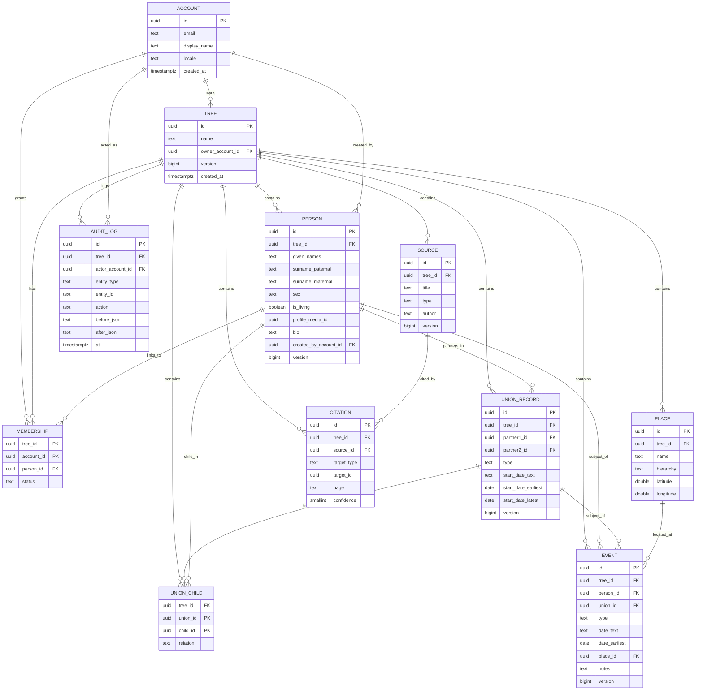

# Delivery Log

Session-by-session record of what was actually built, why, and what's still open. This
complements [concept-architecture.md](concept-architecture.md) (product scope, data
model, decisions, roadmap) — that document says what the product is; this one says what
exists in the repo right now and how it got there. Session entries are newest first;
the **Backlog** and **Database design** sections below them are living references kept
up to date in place, not logged chronologically.

---

## 2026-11-14 — FT-065 enforced tenant isolation in the graph API and PostgreSQL

**Service and repository layer.** Every graph and source repository lookup now takes
the tree ID (`findById(treeId, id)`, `childrenOf(treeId, unionId)`,
`listByPerson(treeId, personId)`). Writes resolve each referenced person, union and
place in the caller's tree through `graph/TreeScopedLookups` before inserting: union
partners, union and child for child links, and an event's person or union and place.
An ID from another tree gets the same `404` and message as an ID that doesn't exist.
Reading a person from another tree used to fail an `IllegalArgumentException` check
(an unmapped `500`); it is now a `404`. Ancestor/descendant/event reads return `404`
for an anchor outside the tree instead of an empty list. The recursive ancestor and
descendant CTEs filter by `tree_id` on the anchor, every join and every recursive step.

**Migration `V2__tree_scoped_references.sql`.** A preflight `DO` block checks
existing data for cross-tree union partners, child links, event subjects/places,
membership-linked people, and citations whose target is missing or in another tree
than the source. It raises one error listing up to 20 offending IDs per check, and
the transaction rolls back with nothing changed. Then V2 adds `tree_id` to
`union_child` and `citation` (backfilled from the union/source, `not null`, indexed),
unique `(id, tree_id)` keys on `person`, `union_record`, `place` and `source`, and
composite same-tree foreign keys on every reference listed above. The polymorphic
citation target still has no foreign key; FT-002 validates it in the application.
Exposed mappings gained the two new columns.

**Verification.** `gradlew.bat :server:test` passed 12 tests on Windows, Docker
Engine 29.7.2, PostgreSQL 16:
- `TenantIsolationTest` (7): cross-tree reads and writes return `404` with the same
  message as a missing ID; rejected writes leave per-tree row counts of every graph
  table and `audit_log` unchanged; tree-wide lists contain only the caller's tree;
  same-tree unions, child links, events with places and ancestor/descendant queries
  still work; direct cross-tree inserts fail with SQLSTATE `23503` for all six
  references.
- `TreeScopedMigrationTest` (2): migrates fresh databases to V1, plants historical
  rows, then runs V2. Bad rows stop the migration with each offending ID named and no
  V2 column created; consistent rows are backfilled.
- `GraphIntegrationTest` and `ApplicationTest` still pass.

The local dev database (shared Postgres instance) was checked read-only before
merging: no cross-tree rows and no citations, so V2 applies cleanly on next start.
The authenticated HTTP versions of these cases remain FT-072's scope.

**Local Gradle fix.** Gradle's earlier failures on this machine came from AVG
Antivirus's HTTPS scanning: it re-signs TLS traffic with "AVG Web/Mail Shield Root",
which Windows trusts and Java doesn't (`PKIX path building failed`), leaving partial
entries in the Gradle cache. Running with
`JAVA_TOOL_OPTIONS=-Djavax.net.ssl.trustStoreType=Windows-ROOT` and one
`--refresh-dependencies` fixed it without changing any repository or user settings.
The README's test section records the workaround.

## 2026-11-14 — FT-063 restored the PostgreSQL integration test

Testcontainers 1.21.0 failed Docker discovery with HTTP 400 on Docker Engine
29.7.2 (minimum API 1.40). Upgraded the existing JUnit 4 setup to
[Testcontainers 1.21.4](https://github.com/testcontainers/testcontainers-java/releases/tag/1.21.4).
`GraphIntegrationTest` closes its Hikari connection pool in JUnit teardown.
The class rule manages the disposable PostgreSQL container and surfaces startup
failures as test failures.

The filtered `:server:test --tests "*GraphIntegrationTest"` and the full
`:server:test` both passed on Windows with Engine 29.7.2 and PostgreSQL 16.8.
The test report confirms Flyway applied `V1__init.sql` to the fresh database,
the ancestor/descendant assertions ran, and the connection pool shut down.
The local Gradle run used a shorter JVM socket temp path and an offline repository
with Maven Central artifacts to work around environment-specific Gradle errors.
The README records the standard Windows and Linux commands.
The repository guidance now asks agents to review affected documentation before
committing changes. The architecture docs reflect the selected server stack and
link to the test instructions.

## 2026-11-14 — Review of the Phase 1 foundation

Reviewed the backlog against the current code. The server create/read routes, core
helpers, and local development stack are in place. The desktop greeting build repair
is recorded as FT-100 (`44d6653`). The Compose clients still show the starter UI.

The review found cross-tree access through event and relationship IDs, living-person
details outside the redacted person routes, authorization based on inactive memberships,
and a missing audit entry for place creation. The backlog now gives these gaps explicit
stories alongside the identity, API validation, logging, and CI work. No implementation
changed in this session.

Gradle failed to connect to its daemon over loopback. Running existing compiled tests
directly with JUnit passed 24 core, 2 shared, and 2 Ktor tests. Direct checks reproduced
the overlapping and inverted date range issues in FT-071. Docker returned HTTP 400 to
Testcontainers during setup, so the PostgreSQL suite did not execute. The access-control
findings came from source inspection.

## 2026-11-13 — Phase 1 "Foundations": server scaffold, persistence, auth, graph API

**Starting point:** a fresh Kotlin Multiplatform wizard template. `core/`, `server/`,
`app/*` held only `Greeting*`/`Platform*` placeholders; no git repository; no business
code anywhere.

**Ending point:** a working Ktor server backed by real PostgreSQL and real Keycloak
OIDC, implementing the Phase 1 roadmap slice (accounts, trees, people, unions, events,
sources; ancestor/descendant graph queries), verified end-to-end against the actual
running stack, with two real bugs found and fixed along the way.

### 1. Decisions resolved

Two items were listed as "Still open" in `concept-architecture.md`. Both had to be
settled before anything could be scaffolded, so they were asked up front rather than
guessed:

| Decision | Choice | Why |
| --- | --- | --- |
| Auth provider | **Keycloak**, self-hosted | Full control, no AWS lock-in to start; runs in `docker-compose` for local dev running the *real* authorization-code/password flow, not a bypass login, so dev and prod exercise the same code path. OIDC discovery keeps swapping providers later a config change, not a rewrite. |
| Persistence library | **Exposed** (+ Flyway for migrations) | JetBrains' own Kotlin SQL library — idiomatic DSL, good coroutine story, lighter setup than jOOQ's codegen for this stage. |

Both are now recorded in `concept-architecture.md`'s decisions table.

### 2. `:core` — domain model, DTOs, shared logic (no I/O)

Per `AGENTS.md`'s "Where code goes" table, everything here is pure Kotlin, unit-tested,
usable from both the server and (eventually) the Compose clients.

- **`domain/`** — `Account`, `Tree`, `Membership`, `Person`, `Union` / `UnionChild`,
  `Event`, `Place`, `Source` / `Citation`, `AuditLog`, `Branch`. Every id is a typed
  wrapper (`PersonId`, `TreeId`, ...) around a `String` so a `PersonId` can never be
  passed where a `TreeId` is expected — the compiler catches it instead of a runtime
  cross-tenant bug.
- **`format/GedcomDateParser`** — parses what a researcher actually types ("abt 1890",
  "bef 12 Mar 1901", "bet 1880 and 1885", plain years/months/dates, English *and*
  Spanish month abbreviations) into a `GedcomDate` carrying both the original display
  text and a sortable `(earliest, latest)` range. It is designed to preserve free text
  without bounds when parsing fails. FT-071 covers gaps in range handling.
- **`format/PersonNameFormatter`** — given names + two surnames → display string / sort
  key. Nothing formats a name by string concatenation anywhere else.
- **`format/DuplicatePersonScorer`** — fuzzy name/date/parent match (0–100) backing the
  MVP's "might be a duplicate" warning on person creation. Uses a character-bigram Dice
  coefficient plus a diacritic fold (see the bug below) rather than pulling in a fuzzy
  matching library.
- **`validation/Validation`** — shared field rules (blank checks, email format, date
  ordering, confidence range) so server and future client forms reject the same input
  the same way.
- **`api/`** — `@Serializable` DTOs and request/response types for all of the above,
  plus `GedcomDate` ↔ `GedcomDateDto` mapping.
- **23 unit tests** across all of the above (`core/src/commonTest`).

### 3. `:server` — Ktor, Postgres, Keycloak

New packages under `com.moxietech.family_tree.server.<feature>`, each with
`routes` / `service` / `repository` per `AGENTS.md`:

| Package | Owns |
| --- | --- |
| `config` | `DatabaseConfig` (HikariCP DataSource, Flyway migration runner, Exposed `Database.connect`), `AuthConfig` (Ktor JWT auth provider verifying against Keycloak's live JWKS endpoint), `StatusPagesConfig` (maps `ValidationException`/`NotFoundException`/`ForbiddenException` to 400/404/403 JSON bodies) |
| `db` | Exposed `Table` objects mirroring the Flyway migration exactly |
| `identity` | Just-in-time `Account` provisioning from the verified JWT (`GET /api/v1/me`) |
| `trees` | Create/list/get `Tree`; seeds an owner `Membership` row on creation |
| `graph` | `Person` (create + duplicate check, list, get, ancestors, descendants), `Union` + `UnionChild`, `Event`, `Place` |
| `sources` | `Source` create/list (`Citation` is modeled in the schema but has no routes yet — see "Not built") |
| `collaboration` | `AuditLogRepository.append(...)` and `AuditJson` for transactional snapshots. Place creation still needs coverage (FT-069). |
| `errors` | `ValidationException` / `NotFoundException` / `ForbiddenException` — the vocabulary every service throws, mapped centrally by `StatusPagesConfig` |

**Routes implemented** (all under `/api/v1` and require authentication):

```
GET    /api/v1/me
POST   /api/v1/trees
GET    /api/v1/trees
GET    /api/v1/trees/{treeId}
POST   /api/v1/trees/{treeId}/people
GET    /api/v1/trees/{treeId}/people
GET    /api/v1/trees/{treeId}/people/{personId}
GET    /api/v1/trees/{treeId}/people/{personId}/ancestors
GET    /api/v1/trees/{treeId}/people/{personId}/descendants
GET    /api/v1/trees/{treeId}/people/{personId}/events
POST   /api/v1/trees/{treeId}/unions
GET    /api/v1/trees/{treeId}/unions
POST   /api/v1/trees/{treeId}/unions/{unionId}/children
POST   /api/v1/trees/{treeId}/events
POST   /api/v1/trees/{treeId}/places
GET    /api/v1/trees/{treeId}/places
POST   /api/v1/trees/{treeId}/sources
GET    /api/v1/trees/{treeId}/sources
```

**Authorization**, for now: routes resolve the caller's `Account` from the JWT.
Tree-specific operations check for a membership row for the URL tree. The people list,
detail, and branch routes redact a living person's name, bio, and profile media for
non-owners. FT-065, FT-066, and FT-068 cover the gaps in resource scoping, privacy
across responses, and membership checks.

**Multi-table writes are one transaction** (e.g. create tree → insert owner membership
→ append audit entry): the service layer opens one Exposed `transaction { }` and the
repository calls inside it share it rather than opening their own.

### 4. Local dev environment

- `docker-compose.yml` — Postgres 16 + Keycloak 26, both exposing the same protocols
  production will use (real Postgres wire protocol, real OIDC authorization-code flow).
- `ops/keycloak/realm-export.json` — a seeded `family-tree` realm with a public
  `family-tree-web` client and a confidential `family-tree-server` resource-server
  client, plus one dev user, imported automatically on container start.

### 5. Verification

Beyond the 23 `:core` unit tests and two Ktor `testApplication` routing tests
(`ApplicationTest`), the whole stack was brought up for real
(`docker compose up`) and driven end-to-end with `curl` against a live Postgres and a
live Keycloak-issued JWT:

- Created a tree, three people, a union, a union-child link, a birth event, a source.
- Confirmed `ancestors`/`descendants` resolve correctly across the union graph.
- Confirmed the duplicate-check flags near-matches and the living-person redaction
  shows a non-owner member `"Private"` while the owner sees the real record.
- Confirmed `400` (blank name, same partner twice), `404` (unknown tree), `403`
  (real tree, non-member caller), `401` (no token) all return structured JSON, not a
  stack trace.

That live testing is what caught two real bugs — unit tests alone wouldn't have, since
neither needs a real Postgres or a second account to reproduce:

1. **Recursive CTE bug.** The `ancestors` query's recursive term referenced the CTE
   twice (once for `partner1_id`, once for `partner2_id`), which Postgres flatly
   rejects ("recursive reference to query 'ancestors' must not appear more than once").
   Fixed by unnesting both partner columns through one `LATERAL VALUES` join, so the
   self-reference appears exactly once (`server/graph/PersonRepository.kt`).
2. **Accent-insensitive duplicate matching.** `DuplicatePersonScorer` compared raw
   lowercased strings, so "Jose Perez" never matched "José Pérez" — an extremely common
   way the same name ends up typed twice. Added a diacritic-folding step in `:core`
   (plain Kotlin char map; `commonMain` has no `java.text.Normalizer`).

A third issue was fixed along the way but wasn't a logic bug: `:server` was missing the
`kotlinx.serialization` Gradle plugin, so the server-local `ApiErrorResponse` DTO had no
generated serializer and every mapped error response threw and returned `500` instead
of its intended status code.

**A `GraphIntegrationTest`** (Testcontainers Postgres, per `AGENTS.md`'s testing
convention) codifies bug #1 as a regression test — same scenario as the manual curl
testing above, run against an ephemeral container. It's written and correct but can't
execute in *this* sandbox: Testcontainers 1.21.0's Docker-detection probe pins an old
Docker API version that this machine's very new Docker Desktop (29.7.2) rejects with a
400. That's a local tooling/version-skew issue, confirmed by the fact that the identical
scenario was separately verified by hand against the real stack; it should run cleanly
in a normal dev machine or CI image.

### 6. Not built yet (flagged, not silently dropped)

- **Invitations / grants (Phase 2).** No API path exists yet to make someone other than
  the tree owner a member — the membership used for the "second viewer" redaction test
  above was inserted directly in Postgres to simulate what the invite flow will do.
- **Citation routes.** The table exists (`citation`, with a polymorphic
  `target_type`/`target_id`) but there's no service/route layer over it yet.
- **Photo upload.** Needs an S3 bucket and credentials decision first; not something to
  guess at.
- **Update/delete on any entity.** Phase 1's roadmap line is "accounts, trees, people,
  unions, events, sources" — read + create. Edit/delete semantics (and whatever
  optimistic-concurrency behavior they need, given every row already carries a
  `version` column) are a deliberate next-session scope, not an oversight.

### 7. Local dev database, pointed at a shared Postgres instance

This machine already runs a Postgres 17 container (`mappy-roadmap-postgres-1`, for a
separate project) bound to host port 5432 — the same port `docker-compose.yml`'s
`postgres` service would try to claim. Rather than run a second, conflicting Postgres,
this project now shares that instance: a dedicated `family_tree` role and `family_tree`
database were created inside it (`CREATE ROLE ... LOGIN PASSWORD 'family_tree'`,
`CREATE DATABASE family_tree OWNER family_tree`), isolated from that other project's
own database, with its own login — not reusing the other project's admin credentials.

Role/database name match the server's existing `DB_USER`/`DB_URL` defaults exactly, so
no environment variables changed. Started the server once to let Flyway apply
`V1__init.sql` against it, confirmed all 11 tables landed with `family_tree` as owner,
and confirmed the other project's own tables (`mappy_dev`) were untouched. Then stopped
the server — this was a one-time setup step, not something that needs to stay running.

`docker-compose.yml`'s `postgres` service is still there and still works for a machine
*without* a conflicting instance — see README.md "Setting up the database" for both
paths. (Keycloak has the identical port-8081 conflict with that other project's own
Keycloak container, but that wasn't today's ask — flagged here so it doesn't surprise
anyone later.)

---

## Backlog: status, priority, and order of work

Every story has a **status**, a **priority**, and a place in the **order** below. This
section is kept up to date in place: change a story's status when work on it starts or
finishes, in both the status board and the story's own line, in the same commit.

- **Status:** `Done` · `In progress` · `To do` · `Blocked` (waiting on a decision or an
  outside dependency, named in the story).
- **Priority:** `P1` must have to close the current phase · `P2` should have, picked up
  alongside P1 work · `P3` later phase or only when needed.
- **Order:** the sequence stories will be worked on (1 = next). Done stories have no
  order number. A `Blocked` story keeps its slot and moves forward once it's unblocked.

IDs are stable, so commits and PRs can reference them. E0's stories were numbered after
the fact (FT-090 to FT-099) so they don't collide with the IDs already in use.

### Status board

**Done (13)** · **In progress (0)** · **To do (41)** · **Blocked (1)**

| Order | ID | Story | Epic | Priority | Status |
| --- | --- | --- | --- | --- | --- |
| — | FT-090 | Resolve auth provider + persistence library | E0 | P1 | Done |
| — | FT-091 | `:core` domain model with typed ids | E0 | P1 | Done |
| — | FT-092 | `:core` shared logic: dates, names, duplicates, validation | E0 | P1 | Done |
| — | FT-093 | `:core` API DTOs | E0 | P1 | Done |
| — | FT-094 | Server scaffold: Postgres, Flyway, Keycloak JWT, error mapping | E0 | P1 | Done |
| — | FT-095 | Accounts, trees, memberships | E0 | P1 | Done |
| — | FT-096 | Graph API: people, unions, children, events, places, ancestors/descendants | E0 | P1 | Done |
| — | FT-097 | Sources create/list | E0 | P1 | Done |
| — | FT-098 | Initial audit logging and redacted person views | E0 | P1 | Done |
| — | FT-099 | Local dev environment | E0 | P1 | Done |
| — | FT-100 | Repair the desktop/shared starter build | E0 | P2 | Done |
| — | FT-063 | Restore PostgreSQL integration tests on Docker | E7 | P1 | Done |
| — | FT-065 | Enforce tenant isolation in graph routes and PostgreSQL | E7 | P1 | Done |
| 1 | FT-068 | Require active membership and authorize writes separately | E7 | P1 | To do |
| 2 | FT-066 | Apply living-person privacy across API responses | E7 | P1 | To do |
| 3 | FT-067 | Require API audience on Keycloak access tokens | E7 | P1 | To do |
| 4 | FT-003 | Bind local accounts to OIDC issuer and subject | E1 | P1 | To do |
| 5 | FT-072 | Require authenticated PostgreSQL regression tests in CI | E7 | P1 | To do |
| 6 | FT-060 | Keep private data out of routine server logs | E7 | P2 | To do |
| 7 | FT-069 | Complete transactional audit coverage | E7 | P2 | To do |
| 8 | FT-070 | Return structured client errors for invalid inputs and duplicate links | E7 | P2 | To do |
| 9 | FT-071 | Correct uncertain and inverted date bounds | E7 | P2 | To do |
| 10 | FT-004 | "Whole tree" bundle endpoint | E1 | P1 | To do |
| 11 | FT-005 | Authenticated owner workflow and web tree views | E1 | P1 | To do |
| 12 | FT-006 | Person page UI | E1 | P1 | To do |
| 13 | FT-001 | Update & delete endpoints | E1 | P1 | To do |
| 14 | FT-002 | Citation routes | E1 | P1 | To do |
| 15 | FT-007 | Duplicate-merge workflow | E1 | P1 | To do |
| 16 | FT-008 | Photo upload (S3 presigned URLs) | E1 | P1 | Blocked |
| 17 | FT-064 | Make compose host ports configurable | E7 | P2 | To do |
| 18 | FT-010 | `Grant` + `GrantScope` tables, branch resolution | E2 | P1 | To do |
| 19 | FT-011 | Invitations + account-to-person linking | E2 | P1 | To do |
| 20 | FT-012 | Grant-based authorization | E2 | P1 | To do |
| 21 | FT-013 | Grant-based living-person redaction | E2 | P1 | To do |
| 22 | FT-014 | `ChangeProposal` workflow | E2 | P1 | To do |
| 23 | FT-015 | Maternal/paternal "side" views | E2 | P1 | To do |
| 24 | FT-016 | Activity feed UI + revert | E2 | P1 | To do |
| 25 | FT-062 | Decide which citation source types come first | E7 | P2 | To do |
| 26 | FT-020 | Android Compose screens | E3 | P3 | To do |
| 27 | FT-021 | iOS Compose screens | E3 | P3 | To do |
| 28 | FT-022 | Offline cache (SQLDelight) | E3 | P3 | To do |
| 29 | FT-023 | Camera upload | E3 | P3 | To do |
| 30 | FT-030 | Stripe plans + usage limits | E4 | P3 | To do |
| 31 | FT-031 | GEDCOM 7 import | E4 | P3 | To do |
| 32 | FT-032 | GEDCOM 7 / PDF export | E4 | P3 | To do |
| 33 | FT-040 | Comments | E5 | P3 | To do |
| 34 | FT-041 | Live presence / WebSocket updates | E5 | P3 | To do |
| 35 | FT-050 | "How are we related?" calculator | E6 | P3 | To do |
| 36 | FT-051 | Memory prompts | E6 | P3 | To do |
| 37 | FT-052 | Photo face-tagging suggestions | E6 | P3 | To do |
| 38 | FT-053 | Birthday / anniversary reminders | E6 | P3 | To do |
| 39 | FT-054 | Fan, hourglass, timeline, map views | E6 | P3 | To do |
| 40 | FT-055 | Print/PDF charts and photo books | E6 | P3 | To do |
| 41 | FT-017 | Row-level security on `tree_id` | E2 | P3 | To do |
| 42 | FT-061 | `audit_log` JSON columns `text` → `jsonb` | E7 | P3 | To do |

Start with the API security fixes. Complete FT-072 before
using real family data or enabling invitations. FT-017 and FT-061 remain deferred
until their stories identify a concrete need.

### Epics

| Epic | Theme | Depends on | Status |
| --- | --- | --- | --- |
| **E0** | Phase 1 server foundation | — | Done (2026-11-13) |
| **E1** | Close out Phase 1 — Foundations | E0 | To do |
| **E2** | Phase 2 — Branches and sharing | E1 | To do |
| **E3** | Phase 3 — Mobile | E2 (a real multi-user mobile app needs grants first) | To do |
| **E4** | Phase 4 — Billing and import | E2 | To do |
| **E5** | Phase 5 — Collaboration depth | E2 | To do |
| **E6** | Phase 6 — Delight | mostly E1; a few touch E2 | To do |
| **E7** | Hardening & housekeeping | Core security stories gate real data and sharing | To do |

### E0 — Phase 1 server foundation (Done)

The 2026-11-13 entry records the server foundation. FT-100 records the subsequent
desktop/shared build repair.

- **FT-090 Resolve auth provider + persistence library.** `Done · P1` — Keycloak and
  Exposed + Flyway, recorded in `concept-architecture.md`.
- **FT-091 `:core` domain model with typed ids.** `Done · P1`
- **FT-092 `:core` shared logic.** `Done · P1` — `GedcomDateParser`,
  `PersonNameFormatter`, `DuplicatePersonScorer` (accent-insensitive), `Validation`;
  24 core tests at the 2026-11-14 review.
- **FT-093 `:core` API DTOs.** `Done · P1`
- **FT-094 Server scaffold.** `Done · P1` — HikariCP + Flyway `V1__init.sql`, Exposed
  tables, Keycloak JWT auth via JWKS, `StatusPagesConfig` error mapping.
- **FT-095 Accounts, trees, memberships.** `Done · P1` — just-in-time account
  provisioning (`GET /me`), tree create/list/get, owner membership seeded on creation.
- **FT-096 Graph API.** `Done · P1` — people (with duplicate check), unions, union
  children, events, places, recursive-CTE ancestors/descendants.
- **FT-097 Sources create/list.** `Done · P1`
- **FT-098 Initial audit logging and redacted person views.** `Done · P1` — audit
  snapshots are written with tree, person, union, child link, event, and source
  creation. Person list/detail and branch results redact names, bio, and profile media
  for non-owners. Remaining coverage is tracked in FT-066 and FT-069.
- **FT-099 Local dev environment.** `Done · P1` — `docker-compose.yml` (Postgres 16 +
  Keycloak 26), seeded realm, dev database on the shared Postgres instance.
- **FT-100 Repair the desktop/shared starter build.** `Done · P2` — updated
  `Greeting.kt` after removal of `sayHello()` (`44d6653`).

### E1 — Close out Phase 1 (Foundations)

- **FT-001 Update & delete endpoints.** `To do · P1 · #13` — Person, Union, UnionChild,
  Event, Place, and Source currently support create/read. Reuse tree-scoped lookups,
  owner write checks, and transactional audits (FT-065, FT-068, FT-069). Use existing
  version columns for optimistic concurrency and define a version strategy for Place
  and UnionChild, which lack one. A stale mutation returns `409` with no changes
  to the domain record or audit log.
- **FT-002 Citation routes.** `To do · P1 · #14` — use the current `citation` table
  and `:core`'s `CitationTarget` (person/event/union). Resolve both the source and
  the polymorphic target within the authorized tree, audit writes in the same
  transaction, and enforce the target's visibility policy (FT-065, FT-066).
- **FT-003 Bind local accounts to OIDC issuer and subject.** `To do · P1 · #4`.
  Update `AuthConfig`, `CurrentAccount`, `AccountRoutes`, and
  `AccountService`/`AccountRepository`. Pass the verified `iss` and `sub` to
  a transactional get-or-create. Add a unique constraint on the pair through Flyway.
  Treat email as profile data and reconcile the existing unique email constraint
  with email reuse by different identities.

  Preserve existing account IDs, tree ownership, and memberships when backfilling.
  Bind legacy rows only from an authoritative identity mapping. Surface unresolved
  rows for explicit resolution before access is restored to them. A matching email
  claim alone must never link an account.

  **Acceptance:** parallel first requests create one account, an email change preserves
  the account ID and tree access, a different subject with the former email cannot
  inherit membership, and verified backfills preserve existing foreign keys.
- **FT-004 "Whole tree" bundle endpoint.** `To do · P1 · #10` — one call returning every
  person + union for a tree, for a client's first paint, instead of composing it from
  two separate list calls. `Branch.direction = WHOLE_TREE` already exists in `:core`,
  unused. Build the bundle from the tree-scoped, viewer-safe projections established
  in FT-065 and FT-066.
- **FT-005 Authenticated owner workflow and web tree views.** `To do · P1 · #11`.
  Build the first workflow in Compose for Web using the tree mockup
  ([layout reference](mockups/tree-view.dc.html)). Keep the API client, DTO usage,
  view models, and layout in `app/shared`, and keep platform entry points thin.
  Connect browser sign-in against Keycloak using authorization code with PKCE
  and the API audience in FT-067. Use the existing create/read endpoints and the
  whole-tree bundle from FT-004. Localize controls and errors in English and Spanish
  and format names through `:core`.

  **Acceptance:** in the browser, sign in, create a tree, create people, and link a
  child through a union. Reload and confirm the saved relationship appears in the
  full-tree, ancestor, and descendant views. Select a person and open their page
  (FT-006). Cover empty states, loading, request failures, and session expiry.
- **FT-006 Person page UI** (Compose for Web). `To do · P1 · #12` — first render
  the selected person's profile, story, family links, and permitted timeline from the
  existing API. Show the localized private placeholder for redacted records. Verify
  navigation from the tree and back, plus reload of the selected person. Add source
  citations and photos when FT-002 and FT-008 provide the underlying APIs. Use
  [the person page mockup](mockups/person-page.dc.html) as the layout reference.
- **FT-007 Duplicate-merge workflow.** `To do · P1 · #15` — `DuplicatePersonScorer` only
  returns a warning score today (`CreatePersonResponse.possibleDuplicates`); there's no
  UI or API path to actually merge two person records into one yet.
- **FT-008 Photo upload** (S3 presigned URLs + a `media` table). `Blocked · P1 · #16` —
  waiting on an AWS bucket/credentials decision; not something to guess at.
  `person.profile_media_id` and `citation.media_id` are already typed `uuid` and
  FK-less, so the table can land later without a breaking migration.

### E2 — Phase 2: Branches and sharing

- **FT-010 `Grant` + `GrantScope` tables and branch resolution.** `To do · P1 · #18` —
  the recursive CTE that turns an anchor + direction + depth + include-partners into a
  resolved person-id set (cached, rebuilt when the graph changes). `Branch` already
  exists in `:core` as the shared definition; nothing resolves it against real data yet.
- **FT-011 Invitations** (email or link) **and account-to-person linking.**
  `To do · P1 · #19` — derives each member's home branch automatically once linked.
  Enable invitations for users after FT-072 passes and FT-012 through FT-014 cover
  shared-tree authorization and proposals.
- **FT-012 Real grant-based authorization.** `To do · P1 · #20` — replaces today's
  Phase 1 owner-only write policy from FT-068 with resolution against `GrantScope`.
  Keep the active membership requirement and pair grant checks with FT-014.
- **FT-013 Grant-based living-person redaction.** `To do · P1 · #21` — extend the
  response policy from FT-066 to allow visibility when a grant covers the person.
- **FT-014 `ChangeProposal` workflow.** `To do · P1 · #22` — out-of-branch edits become
  a proposal with a before/after diff, approved per field by the branch owner or the
  tree owner.
- **FT-015 Maternal/paternal "side" views** (`Branch.direction = SIDE`).
  `To do · P1 · #23` — ancestors of an anchor plus all of their descendants, nothing on
  the other side.
- **FT-016 Activity feed UI + revert.** `To do · P1 · #24` — reads `audit_log`, which
  already carries `before_json`/`after_json` for exactly this; nothing reads them yet.
- **FT-017 Row-level security on `tree_id`.** `To do · P3 · #41` — the defense-in-depth
  backstop `ARCHITECTURE.md` describes, once there's a performance/operational reason to
  add it. FT-065 covers tenant isolation in the current API and foreign keys.

### E3 — Phase 3: Mobile

- **FT-020 Android Compose screens.** `To do · P3 · #26`
- **FT-021 iOS Compose screens.** `To do · P3 · #27`
- **FT-022 Offline cache** (SQLDelight) on mobile. `To do · P3 · #28`
- **FT-023 Camera upload**, straight into the presigned-URL flow from FT-008.
  `To do · P3 · #29`

### E4 — Phase 4: Billing and import

- **FT-030 Stripe plans + usage limits**, opening the product to the public.
  `To do · P3 · #30`
- **FT-031 GEDCOM 7 import.** `To do · P3 · #31`
- **FT-032 GEDCOM 7 / PDF export.** `To do · P3 · #32`

### E5 — Phase 5: Collaboration depth

- **FT-040 Comments** on a person, event, or photo. `To do · P3 · #33`
- **FT-041 Live presence / WebSocket-pushed updates**, so collaborators see each
  other's edits without refreshing. `To do · P3 · #34`

### E6 — Phase 6: Delight

- **FT-050 "How are we related?" relationship calculator.** `To do · P3 · #35`
- **FT-051 Memory prompts** — text and voice answers added to a person's bio.
  `To do · P3 · #36`
- **FT-052 Photo face-tagging suggestions.** `To do · P3 · #37`
- **FT-053 Birthday / anniversary reminders.** `To do · P3 · #38`
- **FT-054 Fan chart, hourglass chart, timeline, and map views.** `To do · P3 · #39`
- **FT-055 Print/PDF charts and photo books.** `To do · P3 · #40`

### E7 — Hardening & housekeeping

- **FT-060 Keep private data out of routine server logs.** `To do · P2 · #6`.
  Set the root level in `server/src/main/resources/logback.xml` to `INFO`. Keep
  verbose tracing opt-in for local debugging. Check application, JDBC/Exposed,
  and request logging during a person or event write. Logs should show operational
  status without bearer tokens, request bodies, or SQL bind values containing
  names, dates, locations, or notes.
- **FT-061 Migrate `audit_log.before_json`/`after_json` from `text` to `jsonb`.**
  `To do · P3 · #42` — once something actually needs to query into them (deferred
  deliberately, see "Deliberate omissions" below).
- **FT-062 Decide which citation source types to prioritize.** `To do · P2 · #25` —
  beyond the 7 already modeled (vital records, census, church records, newspapers,
  family bibles, oral history, other); the one remaining "Still open" item in
  `concept-architecture.md`. Your decision, not an engineering task.
- **FT-063 Restore PostgreSQL integration tests on Docker.** `Done · P1`.
  Testcontainers 1.21.4 ran the graph regression against a fresh PostgreSQL 16
  container on Docker Engine 29.7.2. Flyway applied the schema, the graph
  assertions passed, and teardown closed Hikari. The README has the Windows and
  Linux test commands.
- **FT-064 Make compose host ports configurable.** `To do · P2 · #17` — this dev
  machine runs Postgres (5432) and Keycloak (8081) for another project on the same host
  ports `docker-compose.yml` claims. Worked around manually today (session entry 7);
  parameterizing the ports (or a per-developer override file) would let both projects'
  stacks coexist without a manual `CREATE ROLE`/`CREATE DATABASE` each time.
- **FT-065 Enforce tenant isolation in graph routes and PostgreSQL.**
  `Done · P1`. In `server/graph`, require the authorized tree ID for
  resource lookups and constrain each anchor, join, and recursive step in the
  ancestor/descendant queries. Scope person event reads and embedded places. For
  event creation, resolve the event's person or union and optional place in that
  tree. For union creation, scope both partners. For child links, scope the union
  and child, including the union returned in the response and audit snapshot.

  Add a new Flyway migration for composite same-tree foreign keys on union partners,
  child links, event subjects and places, and membership's linked person. Add
  `tree_id` to `union_child` and `citation`, backfill from the parent union or source,
  and constrain citation's source in the database. Resolve the polymorphic citation
  target in FT-002. Preflight existing references, including citation targets, and
  stop with actionable diagnostics if any are inconsistent. Resolve such data
  explicitly before enabling the constraints. Update Exposed mappings and the
  database reference with the migration.

  **Acceptance:** using tree A and IDs from B yields the same `404` as a missing
  resource within A, with no data from B or mutation/audit in either tree. Direct
  inserts with cross-tree references fail database constraints. Test malformed
  historical links in the migration preflight and normal same-tree graph traversal.
- **FT-066 Apply living-person privacy across API responses.** `To do · P1 · #2`.
  After FT-065 and FT-068, reuse one visibility policy for current routes. Owners
  can see full details in their own tree. For other active members, project hidden
  living people as a private placeholder, omit their events, and suppress union
  dates when a participant is hidden. Keep safe graph links needed to render the
  tree. Exclude hidden people before duplicate scoring, including matches that
  would reveal an identity through a score. Use the same projections for FT-004
  and extend the policy for grants in FT-013.

  **Acceptance:** owner responses retain the expected details. An active non-owner
  sees placeholders in person and branch views, no private event dates, places or
  notes, and no private union dates. Test the duplicate response with a known
  hidden name at the policy boundary as well as the route, since FT-068 denies
  non-owner create requests in Phase 1.
- **FT-067 Require API audience on Keycloak access tokens.** `To do · P1 · #3`.
  Configure the resource-server audience in `AuthConfig.kt` and make it configurable
  for deployment. Configure the Keycloak realm/client mapper so the browser client's
  access tokens include that audience. Validate audience and that the credential is an
  access token in addition to existing signature, issuer, and time checks. Update
  the realm setup instructions for existing local installations.

  **Acceptance:** a correctly signed, current access token intended for the API
  succeeds. Signed tokens with a missing or wrong audience, ID tokens, and expired
  tokens return `401`. Verify the browser client's Keycloak token against a real
  API request.
- **FT-068 Require active membership and authorize writes separately.**
  `To do · P1 · #1`. In `TreeRepository` and `TreeService`, query active
  memberships for both tree lists and tree-specific access. Introduce a distinct
  check for writes to an existing tree and require the active caller to be the
  owner during Phase 1. Apply it to people, unions, child links, events, places,
  and sources. Use the same policy for later mutations until FT-012 and FT-014
  supply grant and proposal handling. Tree creation still creates the caller's
  active owner membership in the creation transaction.

  **Acceptance:** an invited account cannot list, read, or change that tree.
  An active non-owner can read viewer-safe data and receives `403` for every
  current mutation under that tree. An active owner can complete existing create
  and read flows.
- **FT-069 Complete transactional audit coverage.** `To do · P2 · #7`.
  Wrap `PlaceService.createPlace` in one Exposed transaction with its
  `AuditLogRepository.append`. Record the tree, actor, place ID, `CREATE`, a null
  before snapshot, and the serialized created place as the after snapshot.
  Check that existing tenant creation paths preserve their audit coverage.

  **Acceptance:** a successful place create has exactly one matching audit entry.
  A failed audit write rolls back place creation, and a rejected request adds
  neither a place nor an audit record.
- **FT-070 Return structured client errors for invalid inputs and duplicate links.**
  `To do · P2 · #8`. Parse path and request body UUIDs through field-aware
  validation. Map invalid enum values such as `CreatePersonRequest.sex`, and
  malformed JSON, to structured `400` responses through `StatusPagesConfig`.
  Compare parsed UUIDs when checking whether union partners are the same. Map the
  specific duplicate union-child key conflict to `409`, including concurrent
  requests. Avoid exposing database exception text.

  **Acceptance:** table-driven route cases cover malformed IDs and enums,
  invalid JSON, an unknown valid ID (`404`), and a repeated link (`409`).
  A concurrent duplicate attempt leaves one link and one audit record.
- **FT-071 Correct uncertain and inverted date bounds.** `To do · P2 · #9`.
  In `:core`, change `Validation.validateDateOrder` to reject a range only when
  the earliest possible start is later than the latest possible end. In
  `GedcomDateParser`, preserve the display text and omit bounds for a reversed
  `BET … AND …` expression or an unsupported calendar year. Avoid throwing on
  out-of-range numeric input and guard approximate-year arithmetic.

  **Acceptance:** unit tests cover two same-year dates, overlapping bounds,
  clearly reversed bounds, a reversed `BET` expression, and out-of-range years.
  Existing English and Spanish date parsing continues to pass.
- **FT-072 Require authenticated PostgreSQL regression tests in CI.**
  `To do · P1 · #5`. Use the test environment from FT-063 and add Ktor
  `testApplication` route tests backed by a clean PostgreSQL 16 Testcontainer
  with Flyway migrations. Authenticate through the production verifier using
  test-signed JWTs and a controlled JWKS. Seed two trees, separate owners,
  an active non-owner, and an invited account. Exercise the acceptance cases
  from FT-003 and FT-065 through FT-068, plus the existing graph integration test.
  Add the core and server test tasks to pull request CI and make the job a
  merge gate. Extend coverage with tests from FT-069 through FT-071 as they land.

  **Acceptance:** CI executes the tests against real PostgreSQL, fails on a
  deliberate cross-tree regression, and passes with the fixes. The test run
  uses disposable data and test keys.

---

## Database design

PostgreSQL 16. One schema. Every tenant-owned table carries `tree_id` (`union_child`
and `citation` since V2), and every reference between tenant-owned rows is a
composite `(id, tree_id)` foreign key, so a row can only point at rows in its own
tree. Relationships go through `union_record` / `union_child`, never direct parent/child
columns on `person` (`AGENTS.md`: *"Union model"*). Source of truth, in order:
[`V1__init.sql`](../server/src/main/resources/db/migration/V1__init.sql),
[`V2__tree_scoped_references.sql`](../server/src/main/resources/db/migration/V2__tree_scoped_references.sql).

### Entity-relationship diagram



### Table reference

**`account`** — a login; *not* tenant-scoped (one person can belong to many trees).
`email` unique, `locale` constrained to `en`/`es`.

**`tree`** — the tenant boundary. `owner_account_id → account`. Carries `version` for
future optimistic-concurrency use.

**`person`** — `tree_id → tree`. Three-part name (`given_names`,
`surname_paternal`, `surname_maternal` — never concatenated). `sex` constrained to
`FEMALE`/`MALE`/`UNKNOWN`. `is_living` drives server-side redaction. `created_by_account_id`
is nullable because people without accounts (deceased relatives, children) can be
created by any contributor. Indexed on `tree_id`, plus three `gin`/`pg_trgm` trigram
indexes on the name columns backing the fuzzy duplicate-check.

**`place`** — `tree_id → tree`; shared within a tree, referenced by `event.place_id`.

**`union_record`** (named to dodge the `UNION` SQL keyword) — `tree_id → tree`,
`partner1_id → person` (required), `partner2_id → person` (nullable — a union can be
recorded with one known partner). `type` constrained to
`MARRIED`/`DIVORCED`/`PARTNERS`/`UNKNOWN`. A `check` forbids a union with the same
person as both partners. Dates are stored three ways per bound
(`*_text`, `*_earliest`, `*_latest`) so the GEDCOM-style free text a researcher entered
is preserved alongside a sortable range. Both partners must be in the union's tree (V2).

**`union_child`** — the join table that actually encodes parent/child relationships;
composite PK `(union_id, child_id)`. `relation` constrained to
`BIRTH`/`ADOPTED`/`STEP`/`FOSTER`. `tree_id` (V2) is copied from the union; same-tree
foreign keys require the union and the child to be in that tree.

**`event`** — belongs to *exactly one* of `person_id` or `union_id` (enforced by a
`check` constraint, mirrored by `Event`'s `init` block in `:core`). `type` is one of 11
GEDCOM-style event kinds. Same three-column date encoding as `union_record`. The
person, union and place must all be in the event's tree (V2).

**`source`** — reusable across many facts. `type` is one of 7 kinds (vital record,
census, church record, newspaper, family bible, oral history, other — the "still open"
list in `concept-architecture.md`).

**`citation`** — ties one fact to one `source`. The polymorphic target is
`target_type` (`PERSON`/`EVENT`/`UNION`) plus `target_id`. The current schema has no
target FK. FT-002 adds application-level validation using `CitationTarget` in
`:core`. `confidence` ranges from `0` to `3` (unreliable → primary evidence).
`tree_id` (V2) is copied from the source, and a same-tree foreign key keeps the source
in that tree. V2's preflight also checked existing targets; the target itself stays
without a foreign key until FT-002.

**`membership`** — links an `account` to a `tree` and, once set, to that member's own
`person` (drives the Phase 2 home-branch calculation). Composite PK
`(tree_id, account_id)`. Not yet written to by any invite flow — Phase 1 only ever
inserts the owner's row, at tree-creation time. A linked `person_id` must be in the same
tree (V2).

**`audit_log`** — immutable, append-only, written in the same transaction as the
mutation it describes. `before_json`/`after_json` are plain `text` holding
JSON-*encoded* snapshots, not Postgres `jsonb` — nothing queries into them yet, so
`jsonb`'s binding overhead with the JDBC driver wasn't worth it; revisit via a new
migration if that changes.

### Deliberate omissions (for now)

- **No row-level security yet.** `TreeService.getTreeForMember` checks membership
  for the requested tree, repositories filter every lookup by `tree_id`, and V2's
  same-tree foreign keys enforce referential isolation in the database (FT-065). FT-017 tracks RLS as a later defense-in-depth measure.
- **No `grant` / `change_proposal` tables yet.** Those belong to Phase 2
  (branches and sharing) per the roadmap in `concept-architecture.md`, and adding them
  speculatively now would mean designing branch-scope resolution before any UI or API
  needs it.
- **No `media` table yet.** Photo upload needs the S3/CloudFront decision first; `person.profile_media_id`
  and `citation.media_id` are already typed `uuid` so the column exists, FK-less, ready
  for that table to land without a breaking change.
