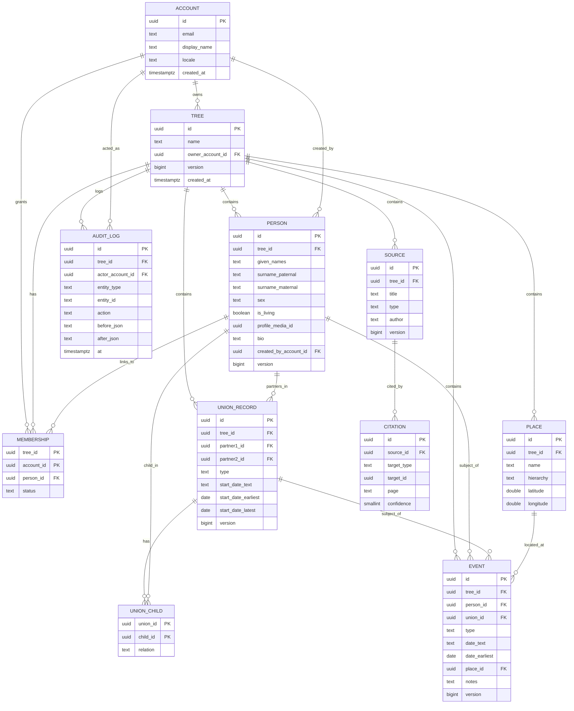

# Delivery Log

Session-by-session record of what was actually built, why, and what's still open. This
complements [concept-architecture.md](concept-architecture.md) (product scope, data
model, decisions, roadmap) — that document says what the product is; this one says what
exists in the repo right now and how it got there. Newest entry first.

---

## 2026-11-13 — Phase 1 "Foundations": server scaffold, persistence, auth, graph API

**Starting point:** a fresh Kotlin Multiplatform wizard template. `core/`, `server/`,
`app/*` held only `Greeting*`/`Platform*` placeholders; no git repository; no business
code anywhere.

**Ending point:** a working Ktor server backed by real PostgreSQL and real Keycloak
OIDC, implementing the Phase 1 roadmap slice (accounts, trees, people, unions, events,
sources; ancestor/descendant graph queries), verified end-to-end against the actual
running stack, with two real bugs found and fixed along the way.

### 1. Decisions resolved

Two items were listed as "Still open" in `concept-architecture.md`. Both had to be
settled before anything could be scaffolded, so they were asked up front rather than
guessed:

| Decision | Choice | Why |
| --- | --- | --- |
| Auth provider | **Keycloak**, self-hosted | Full control, no AWS lock-in to start; runs in `docker-compose` for local dev running the *real* authorization-code/password flow, not a bypass login, so dev and prod exercise the same code path. OIDC discovery keeps swapping providers later a config change, not a rewrite. |
| Persistence library | **Exposed** (+ Flyway for migrations) | JetBrains' own Kotlin SQL library — idiomatic DSL, good coroutine story, lighter setup than jOOQ's codegen for this stage. |

Both are now recorded in `concept-architecture.md`'s decisions table.

### 2. `:core` — domain model, DTOs, shared logic (no I/O)

Per `AGENTS.md`'s "Where code goes" table, everything here is pure Kotlin, unit-tested,
usable from both the server and (eventually) the Compose clients.

- **`domain/`** — `Account`, `Tree`, `Membership`, `Person`, `Union` / `UnionChild`,
  `Event`, `Place`, `Source` / `Citation`, `AuditLog`, `Branch`. Every id is a typed
  wrapper (`PersonId`, `TreeId`, ...) around a `String` so a `PersonId` can never be
  passed where a `TreeId` is expected — the compiler catches it instead of a runtime
  cross-tenant bug.
- **`format/GedcomDateParser`** — parses what a researcher actually types ("abt 1890",
  "bef 12 Mar 1901", "bet 1880 and 1885", plain years/months/dates, English *and*
  Spanish month abbreviations) into a `GedcomDate` carrying both the original display
  text and a sortable `(earliest, latest)` range. Never throws on unparseable input —
  it just keeps the text with no range, because a date a user typed must always be
  savable.
- **`format/PersonNameFormatter`** — given names + two surnames → display string / sort
  key. Nothing formats a name by string concatenation anywhere else.
- **`format/DuplicatePersonScorer`** — fuzzy name/date/parent match (0–100) backing the
  MVP's "might be a duplicate" warning on person creation. Uses a character-bigram Dice
  coefficient plus a diacritic fold (see the bug below) rather than pulling in a fuzzy
  matching library.
- **`validation/Validation`** — shared field rules (blank checks, email format, date
  ordering, confidence range) so server and future client forms reject the same input
  the same way.
- **`api/`** — `@Serializable` DTOs and request/response types for all of the above,
  plus `GedcomDate` ↔ `GedcomDateDto` mapping.
- **23 unit tests** across all of the above (`core/src/commonTest`).

### 3. `:server` — Ktor, Postgres, Keycloak

New packages under `com.moxietech.family_tree.server.<feature>`, each with
`routes` / `service` / `repository` per `AGENTS.md`:

| Package | Owns |
| --- | --- |
| `config` | `DatabaseConfig` (HikariCP DataSource, Flyway migration runner, Exposed `Database.connect`), `AuthConfig` (Ktor JWT auth provider verifying against Keycloak's live JWKS endpoint), `StatusPagesConfig` (maps `ValidationException`/`NotFoundException`/`ForbiddenException` to 400/404/403 JSON bodies) |
| `db` | Exposed `Table` objects mirroring the Flyway migration exactly |
| `identity` | Just-in-time `Account` provisioning from the verified JWT (`GET /api/v1/me`) |
| `trees` | Create/list/get `Tree`; seeds an owner `Membership` row on creation |
| `graph` | `Person` (create + duplicate check, list, get, ancestors, descendants), `Union` + `UnionChild`, `Event`, `Place` |
| `sources` | `Source` create/list (`Citation` is modeled in the schema but has no routes yet — see "Not built") |
| `collaboration` | `AuditLogRepository.append(...)`, called from inside the *same* Exposed transaction as every mutation above, and `AuditJson` for before/after snapshots |
| `errors` | `ValidationException` / `NotFoundException` / `ForbiddenException` — the vocabulary every service throws, mapped centrally by `StatusPagesConfig` |

**Routes implemented** (all under `/api/v1`, all requiring a valid Keycloak-issued JWT
except none — every route below is authenticated):

```
GET    /api/v1/me
POST   /api/v1/trees
GET    /api/v1/trees
GET    /api/v1/trees/{treeId}
POST   /api/v1/trees/{treeId}/people
GET    /api/v1/trees/{treeId}/people
GET    /api/v1/trees/{treeId}/people/{personId}
GET    /api/v1/trees/{treeId}/people/{personId}/ancestors
GET    /api/v1/trees/{treeId}/people/{personId}/descendants
GET    /api/v1/trees/{treeId}/people/{personId}/events
POST   /api/v1/trees/{treeId}/unions
GET    /api/v1/trees/{treeId}/unions
POST   /api/v1/trees/{treeId}/unions/{unionId}/children
POST   /api/v1/trees/{treeId}/events
POST   /api/v1/trees/{treeId}/places
GET    /api/v1/trees/{treeId}/places
POST   /api/v1/trees/{treeId}/sources
GET    /api/v1/trees/{treeId}/sources
```

**Authorization**, for now: every route resolves the caller's `Account` from the JWT,
then checks tree membership (`403` if the tree exists but the caller isn't a member,
`404` if it doesn't exist at all). Branch-scoped grants (Phase 2) don't exist yet, so
membership is currently binary — but **living-person redaction is enforced anyway**: a
living person's record is reduced to `"Private"` (no name, bio, or photo) for everyone
except the tree owner. That's the conservative, rule-correct default until grants land
— `AGENTS.md`'s privacy rule applies from day one, not from whenever Phase 2 ships.

**Multi-table writes are one transaction** (e.g. create tree → insert owner membership
→ append audit entry): the service layer opens one Exposed `transaction { }` and the
repository calls inside it share it rather than opening their own.

### 4. Local dev environment

- `docker-compose.yml` — Postgres 16 + Keycloak 26, both exposing the same protocols
  production will use (real Postgres wire protocol, real OIDC authorization-code flow).
- `ops/keycloak/realm-export.json` — a seeded `family-tree` realm with a public
  `family-tree-web` client and a confidential `family-tree-server` resource-server
  client, plus one dev user, imported automatically on container start.

### 5. Verification

Beyond the 23 `:core` unit tests and two Ktor `testApplication` routing tests
(`ApplicationTest`), the whole stack was brought up for real
(`docker compose up`) and driven end-to-end with `curl` against a live Postgres and a
live Keycloak-issued JWT:

- Created a tree, three people, a union, a union-child link, a birth event, a source.
- Confirmed `ancestors`/`descendants` resolve correctly across the union graph.
- Confirmed the duplicate-check flags near-matches and the living-person redaction
  shows a non-owner member `"Private"` while the owner sees the real record.
- Confirmed `400` (blank name, same partner twice), `404` (unknown tree), `403`
  (real tree, non-member caller), `401` (no token) all return structured JSON, not a
  stack trace.

That live testing is what caught two real bugs — unit tests alone wouldn't have, since
neither needs a real Postgres or a second account to reproduce:

1. **Recursive CTE bug.** The `ancestors` query's recursive term referenced the CTE
   twice (once for `partner1_id`, once for `partner2_id`), which Postgres flatly
   rejects ("recursive reference to query 'ancestors' must not appear more than once").
   Fixed by unnesting both partner columns through one `LATERAL VALUES` join, so the
   self-reference appears exactly once (`server/graph/PersonRepository.kt`).
2. **Accent-insensitive duplicate matching.** `DuplicatePersonScorer` compared raw
   lowercased strings, so "Jose Perez" never matched "José Pérez" — an extremely common
   way the same name ends up typed twice. Added a diacritic-folding step in `:core`
   (plain Kotlin char map; `commonMain` has no `java.text.Normalizer`).

A third issue was fixed along the way but wasn't a logic bug: `:server` was missing the
`kotlinx.serialization` Gradle plugin, so the server-local `ApiErrorResponse` DTO had no
generated serializer and every mapped error response threw and returned `500` instead
of its intended status code.

**A `GraphIntegrationTest`** (Testcontainers Postgres, per `AGENTS.md`'s testing
convention) codifies bug #1 as a regression test — same scenario as the manual curl
testing above, run against an ephemeral container. It's written and correct but can't
execute in *this* sandbox: Testcontainers 1.21.0's Docker-detection probe pins an old
Docker API version that this machine's very new Docker Desktop (29.7.2) rejects with a
400. That's a local tooling/version-skew issue, confirmed by the fact that the identical
scenario was separately verified by hand against the real stack; it should run cleanly
in a normal dev machine or CI image.

### 6. Not built yet (flagged, not silently dropped)

- **Invitations / grants (Phase 2).** No API path exists yet to make someone other than
  the tree owner a member — the membership used for the "second viewer" redaction test
  above was inserted directly in Postgres to simulate what the invite flow will do.
- **Citation routes.** The table exists (`citation`, with a polymorphic
  `target_type`/`target_id`) but there's no service/route layer over it yet.
- **Photo upload.** Needs an S3 bucket and credentials decision first; not something to
  guess at.
- **Update/delete on any entity.** Phase 1's roadmap line is "accounts, trees, people,
  unions, events, sources" — read + create. Edit/delete semantics (and whatever
  optimistic-concurrency behavior they need, given every row already carries a
  `version` column) are a deliberate next-session scope, not an oversight.

### 7. Local dev database, pointed at a shared Postgres instance

This machine already runs a Postgres 17 container (`mappy-roadmap-postgres-1`, for a
separate project) bound to host port 5432 — the same port `docker-compose.yml`'s
`postgres` service would try to claim. Rather than run a second, conflicting Postgres,
this project now shares that instance: a dedicated `family_tree` role and `family_tree`
database were created inside it (`CREATE ROLE ... LOGIN PASSWORD 'family_tree'`,
`CREATE DATABASE family_tree OWNER family_tree`), isolated from that other project's
own database, with its own login — not reusing the other project's admin credentials.

Role/database name match the server's existing `DB_USER`/`DB_URL` defaults exactly, so
no environment variables changed. Started the server once to let Flyway apply
`V1__init.sql` against it, confirmed all 11 tables landed with `family_tree` as owner,
and confirmed the other project's own tables (`mappy_dev`) were untouched. Then stopped
the server — this was a one-time setup step, not something that needs to stay running.

`docker-compose.yml`'s `postgres` service is still there and still works for a machine
*without* a conflicting instance — see README.md "Setting up the database" for both
paths. (Keycloak has the identical port-8081 conflict with that other project's own
Keycloak container, but that wasn't today's ask — flagged here so it doesn't surprise
anyone later.)

---

## Database design

PostgreSQL 16. One schema, `tree_id` on every tenant-owned table
(`AGENTS.md`: *"every table has `tree_id`; every query filters by it"*).
Relationships go through `union_record` / `union_child`, never direct parent/child
columns on `person` (`AGENTS.md`: *"Union model"*). Source of truth:
[`server/src/main/resources/db/migration/V1__init.sql`](../server/src/main/resources/db/migration/V1__init.sql).

### Entity-relationship diagram



### Table reference

**`account`** — a login; *not* tenant-scoped (one person can belong to many trees).
`email` unique, `locale` constrained to `en`/`es`.

**`tree`** — the tenant boundary. `owner_account_id → account`. Carries `version` for
future optimistic-concurrency use.

**`person`** — `tree_id → tree`. Three-part name (`given_names`,
`surname_paternal`, `surname_maternal` — never concatenated). `sex` constrained to
`FEMALE`/`MALE`/`UNKNOWN`. `is_living` drives server-side redaction. `created_by_account_id`
is nullable because people without accounts (deceased relatives, children) can be
created by any contributor. Indexed on `tree_id`, plus three `gin`/`pg_trgm` trigram
indexes on the name columns backing the fuzzy duplicate-check.

**`place`** — `tree_id → tree`; shared within a tree, referenced by `event.place_id`.

**`union_record`** (named to dodge the `UNION` SQL keyword) — `tree_id → tree`,
`partner1_id → person` (required), `partner2_id → person` (nullable — a union can be
recorded with one known partner). `type` constrained to
`MARRIED`/`DIVORCED`/`PARTNERS`/`UNKNOWN`. A `check` forbids a union with the same
person as both partners. Dates are stored three ways per bound
(`*_text`, `*_earliest`, `*_latest`) so the GEDCOM-style free text a researcher entered
is preserved alongside a sortable range.

**`union_child`** — the join table that actually encodes parent/child relationships;
composite PK `(union_id, child_id)`. `relation` constrained to
`BIRTH`/`ADOPTED`/`STEP`/`FOSTER`.

**`event`** — belongs to *exactly one* of `person_id` or `union_id` (enforced by a
`check` constraint, mirrored by `Event`'s `init` block in `:core`). `type` is one of 11
GEDCOM-style event kinds. Same three-column date encoding as `union_record`.

**`source`** — reusable across many facts. `type` is one of 7 kinds (vital record,
census, church record, newspaper, family bible, oral history, other — the "still open"
list in `concept-architecture.md`).

**`citation`** — ties one fact to one `source`. Polymorphic target: `target_type`
(`PERSON`/`EVENT`/`UNION`) + `target_id` (no FK, since it can point at three different
tables — enforced only in application code, matching `CitationTarget` in `:core`).
`confidence` is `0`–`3` (unreliable → primary evidence).

**`membership`** — links an `account` to a `tree` and, once set, to that member's own
`person` (drives the Phase 2 home-branch calculation). Composite PK
`(tree_id, account_id)`. Not yet written to by any invite flow — Phase 1 only ever
inserts the owner's row, at tree-creation time.

**`audit_log`** — immutable, append-only, written in the same transaction as the
mutation it describes. `before_json`/`after_json` are plain `text` holding
JSON-*encoded* snapshots, not Postgres `jsonb` — nothing queries into them yet, so
`jsonb`'s binding overhead with the JDBC driver wasn't worth it; revisit via a new
migration if that changes.

### Deliberate omissions (for now)

- **No row-level security yet.** Every table-scoping check happens in the service
  layer (`TreeService.getTreeForMember`); RLS as a defense-in-depth backstop is a
  Phase-2-or-later hardening pass, not required to ship Phase 1 correctly.
- **No `grant` / `change_proposal` tables yet.** Those belong to Phase 2
  (branches and sharing) per the roadmap in `concept-architecture.md`, and adding them
  speculatively now would mean designing branch-scope resolution before any UI or API
  needs it.
- **No `media` table yet.** Photo upload needs the S3/CloudFront decision first; `person.profile_media_id`
  and `citation.media_id` are already typed `uuid` so the column exists, FK-less, ready
  for that table to land without a breaking change.
